# Visual health on darwin

Approved fixture captures of the real Electron UI on darwin (OS 24.5.0, Electron 44.5.1). The primary gallery in [README.md](README.md) is the Windows source machine's; this page stands beside it, never in its place. See [rules](RULES.md).

Reviewed by Codex independent host reviewer. Compared the 145ec530 candidate with the reviewed same-machine 5e0cf08c baseline. Verified both manifests, unchanged control geometry for all 44 stills, and reviewed four changed pairs plus all nine fixture motion sequences. The largest differences were a disposable CLI path and the narrow goal frame. Candidate host-profile tests passed all three cases. Native save, candidate loading and rollback remain separate.

Source commit: 145ec53046f629603abb96bbbbdb6de19191187b; review: docs/visual/reviews/approval-94dd3d79f67cb51eb92bedc7835cc11e18a97796e563dd840f7515c063fa03cb.json.

## workspace

Real desktop navigation with disposable local notes; no cloud or provider.

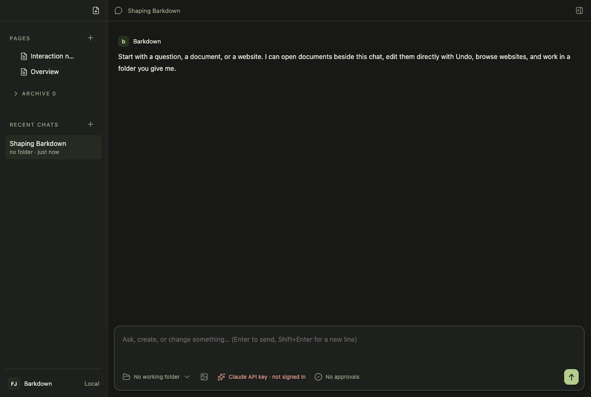

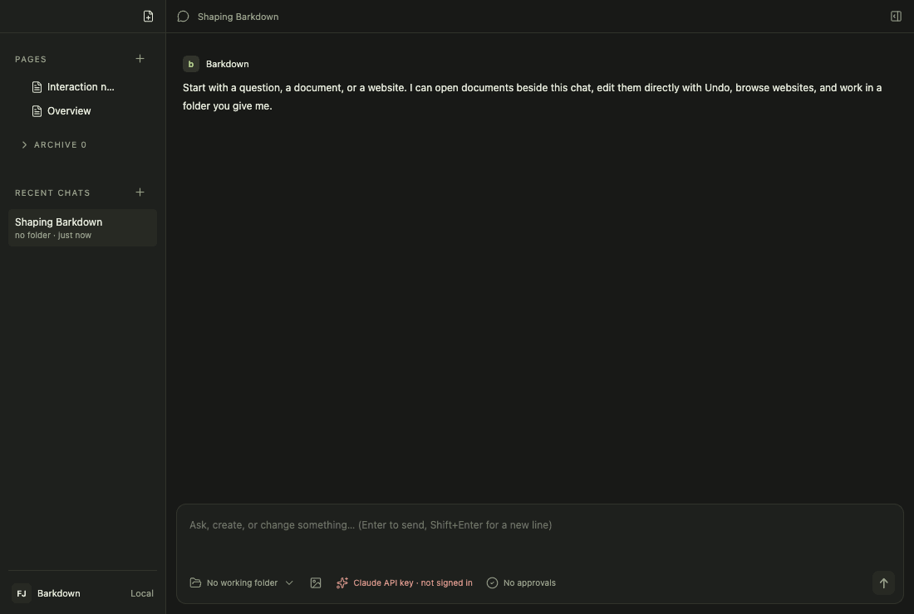

## chat

Shared main composer: draft, provider chooser and model chooser. No message is sent.

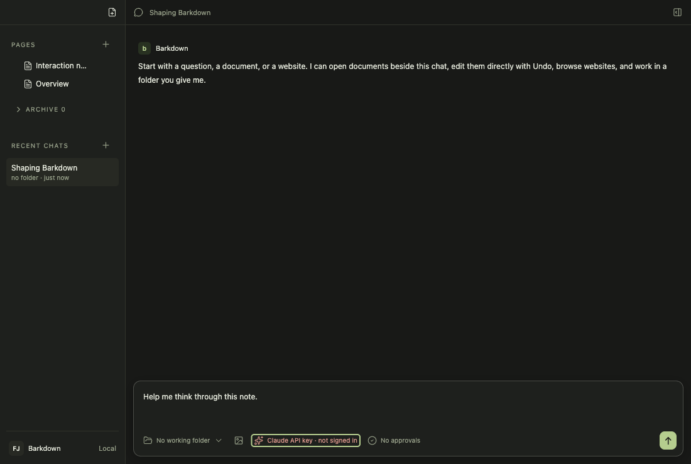

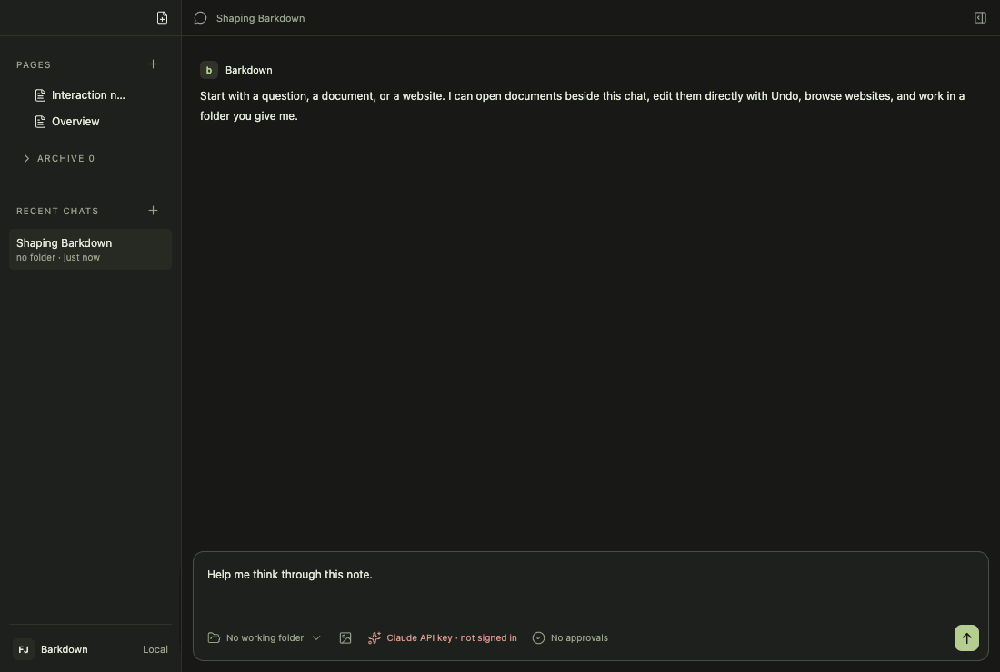

## side-chat

A real saved side conversation and its independent composer, using disposable fixture state.

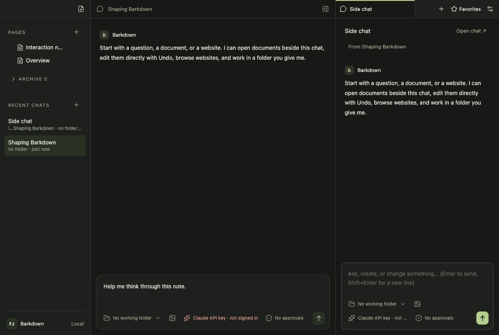

## documents

Read-only legacy document viewer. The light frame is a theme-contrast comparison; no Paper server or editing is used.

## retained

After the library switch the legacy notes are retained read-only. Dark by default; the light frame compares theme contrast. Fixture journal; no Paper server.

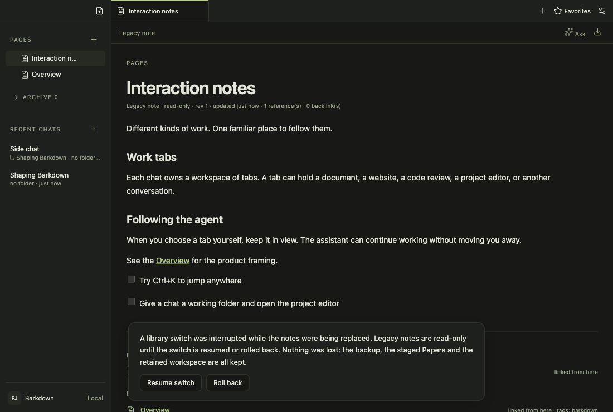

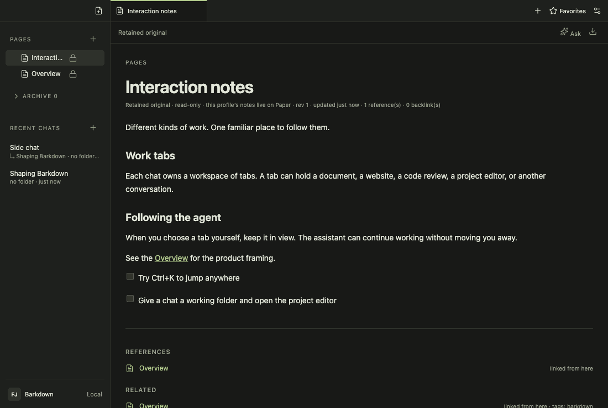

## settings

Real Settings navigation. No server connection or credential is configured.

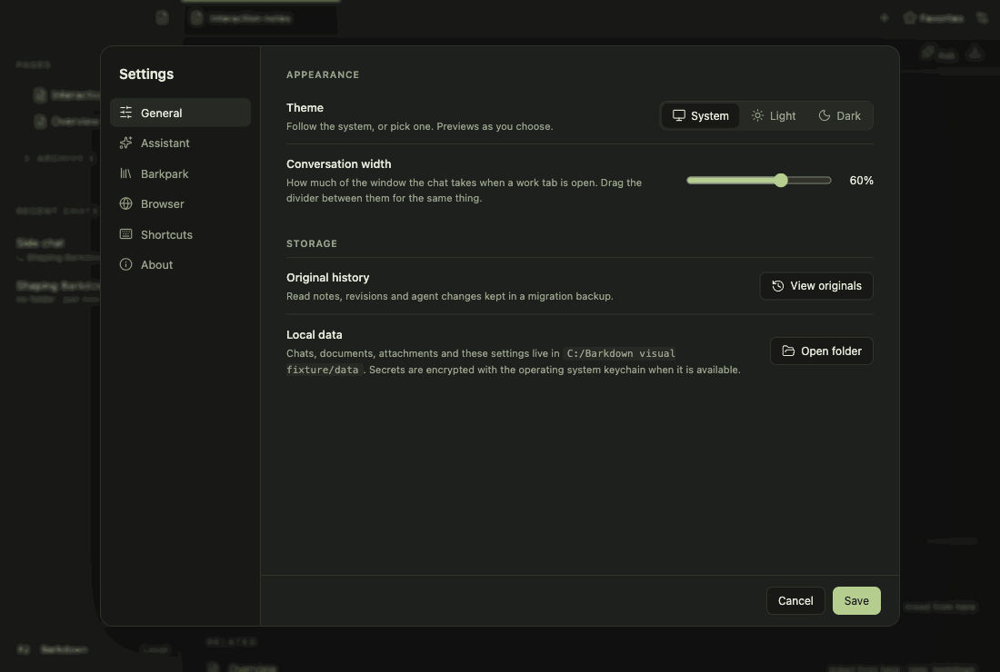

## goals

Goal component with explicitly injected fixture snapshots and providers blocked. Saved worker chats use the ordinary composer; this is not live scheduler/provider proof.

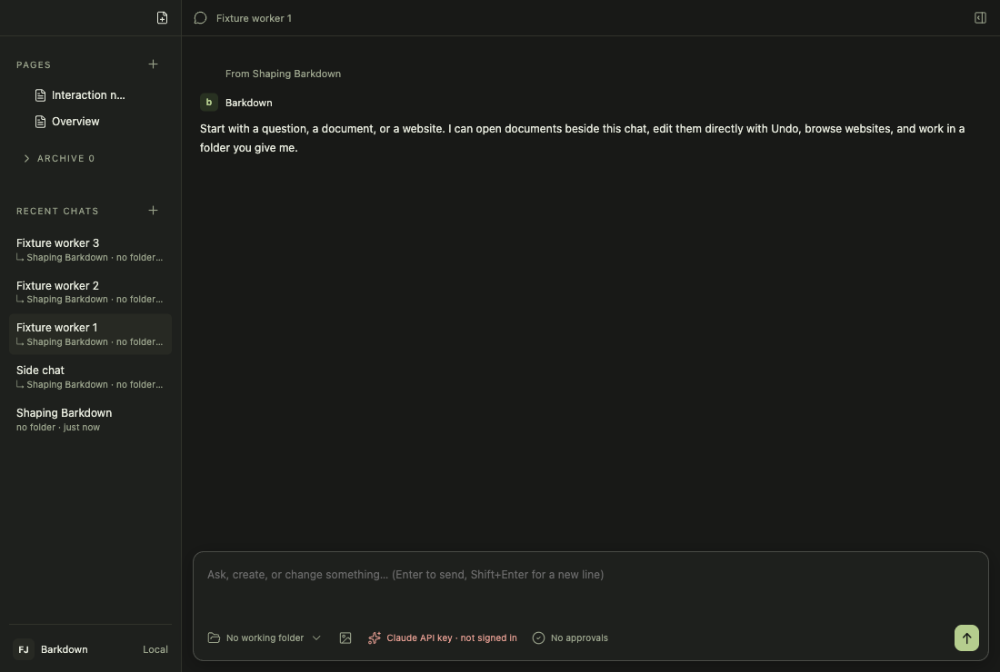

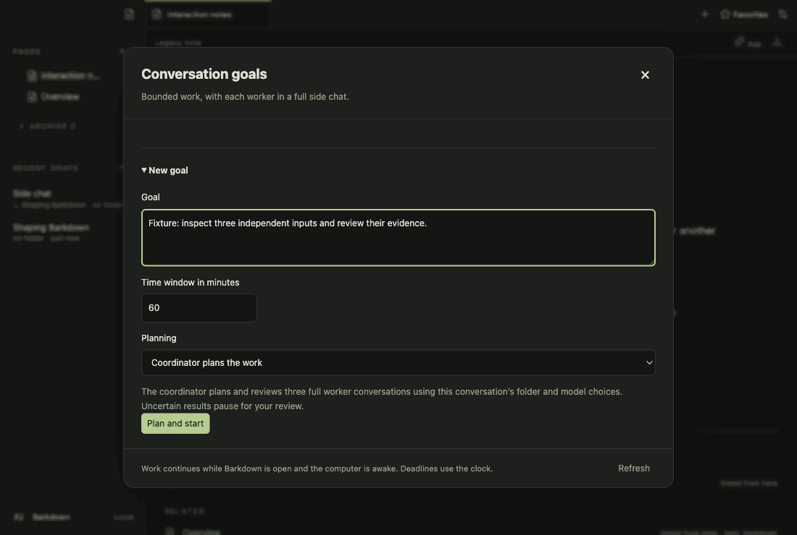

## profiles

Profile Settings controls with injected stable registry names. This tour makes no profile switch; real switching and Paper save protection have separate integration evidence.

## adoption

Real recovery window with explicit fixture states; no migration is performed in this visual tour. Actual transaction/restart proof is separate.

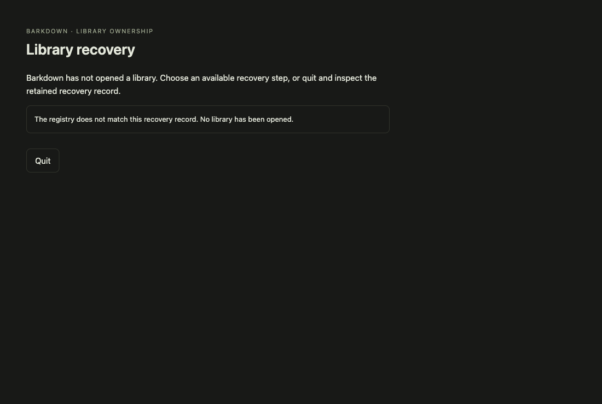

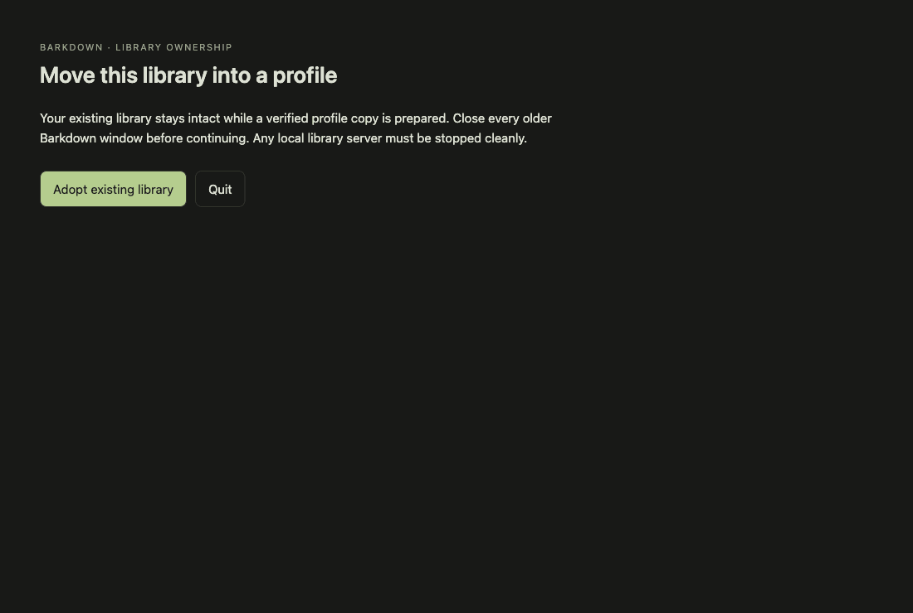

