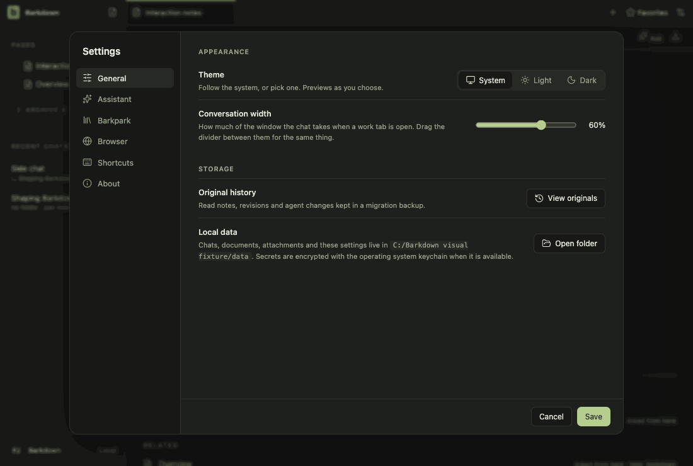

# Visual health on darwin

Approved fixture captures of the real Electron UI on darwin (OS 24.5.0, Electron 44.5.1). The primary gallery in [README.md](README.md) is the Windows source machine's; this page stands beside it, never in its place. See [rules](RULES.md).

Reviewed by claude-barkdown-mac. Inspected every frame of run 2026-10-29T10-17-28-154Z on darwin: 51 within tolerance; settings-1 (Settings > Assistant) differs only in the temporary path of the command-line row; workspace-3 (narrow) is one anti-aliasing pixel at the send button. The first-run toast and its Settings > Providers jump are not in the tour (it runs with a provider signed in); they were checked live with a system-only PATH and an empty HOME: toast text, button, Settings opened on Assistant with the Providers heading at the top, and each missing tool's Install link and sign-in command.

Source commit: 46a297e0e04c2cfb971bd89fae8de1af63abccec; review: docs/visual/reviews/approval-5dc138d8e87484ef1cc878a2d6f08b9e8a1e0c21e0be3867e4101b7aba69ee29.json.

## workspace

Real desktop navigation with disposable local notes; no cloud or provider.

## chat

Shared main composer: draft, provider chooser and model chooser. No message is sent.

## side-chat

A real saved side conversation and its independent composer, using disposable fixture state.

## documents

Read-only legacy document viewer. The light frame is a theme-contrast comparison; no Paper server or editing is used.

## retained

After the library switch the legacy notes are retained read-only. Dark by default; the light frame compares theme contrast. Fixture journal; no Paper server.

## settings

Real Settings navigation. No server connection or credential is configured.

## goals

Goal component with explicitly injected fixture snapshots and providers blocked. Saved worker chats use the ordinary composer; this is not live scheduler/provider proof.

## profiles

Profile Settings controls with injected stable registry names. This tour makes no profile switch; real switching and Paper save protection have separate integration evidence.

## adoption

Real recovery window with explicit fixture states; no migration is performed in this visual tour. Actual transaction/restart proof is separate.

