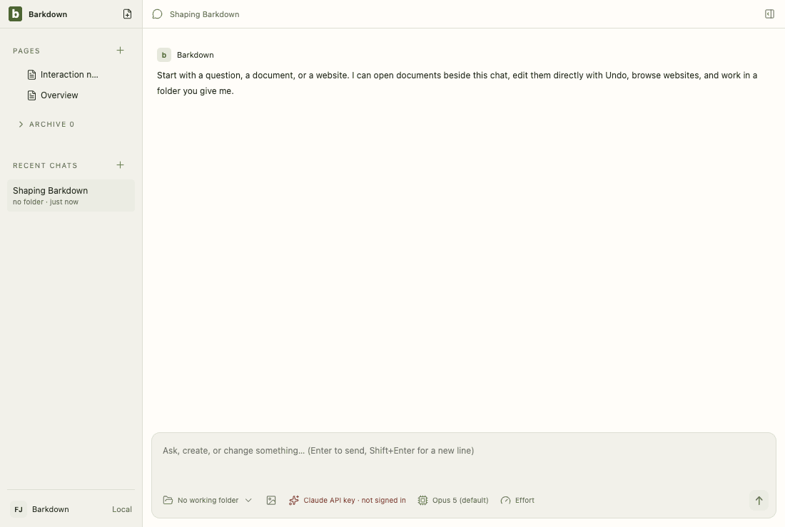
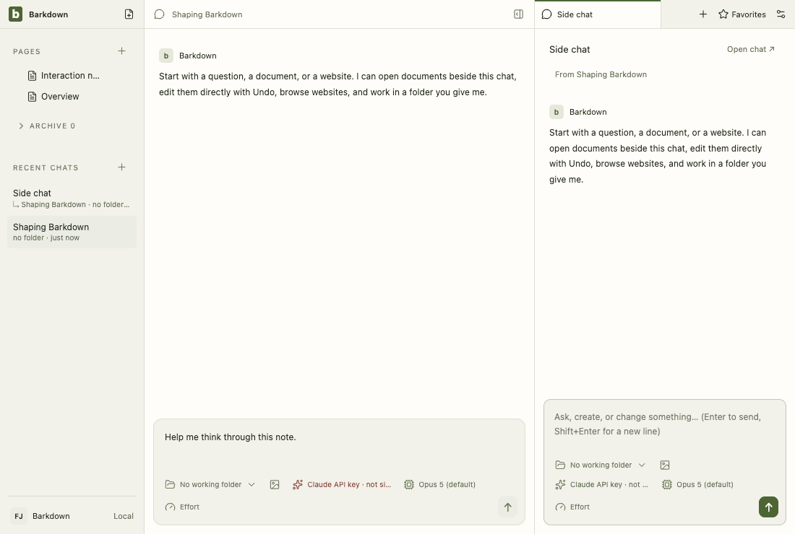
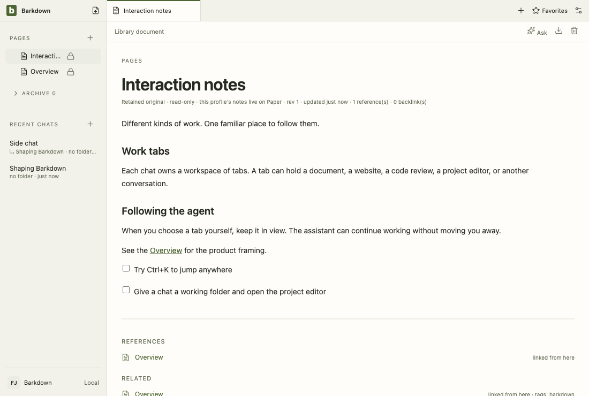
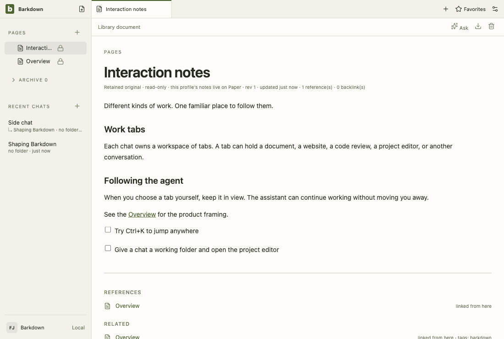
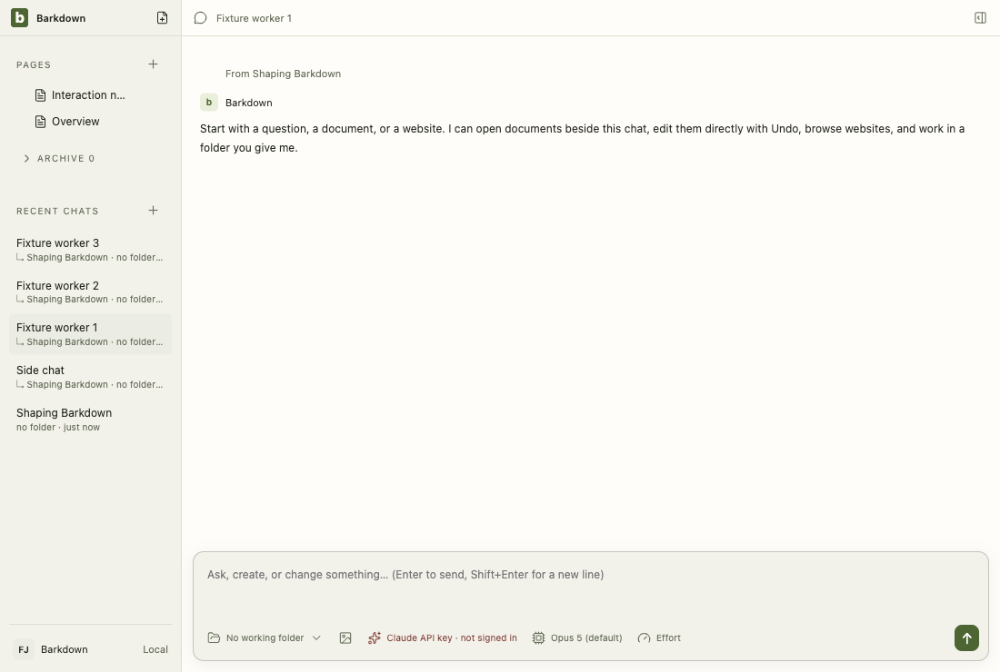

# Visual health on darwin

Approved fixture captures of the real Electron UI on darwin (OS 24.3.0, Electron 38.8.6). The primary gallery in [README.md](README.md) is the Windows source machine's; this page stands beside it, never in its place. See [rules](RULES.md).

Reviewed by Claude Fable 5.1 (agent, macOS host). New retained area (4 frames) for the library switch: lock badge beside legacy notes in Pages and a read-only meta line on the opened note, light and dark, driven by a fixture selection journal. All other areas within tolerance against the 2026-09-28T22-04-21 darwin baseline (two-pixel anti-aliasing on send buttons). Inspected: retained open (light), retained dark, badge frame, settings/profiles unchanged after the fixture reapply fix. Behavior evidence: documents-selection unit tests (legacy writes refused, retained summaries and reads), selection rehearsals live on this host. Limits: darwin only; the start-time prompt and reconciliation view are not in this tour; win32 stays stale until the Windows return checkpoint.

Source commit: 72ca86ed59e0a12fdf40fe9e1a551bd9cfb1ccb0; review: docs/visual/reviews/approval-6b1503bb18382db626039ea96a380f0852cef7fc9ef4bc8c59a40728be433ce9.json.

## workspace

Real desktop navigation with disposable local notes; no cloud or provider.

## chat

Shared main composer: draft, provider chooser and model chooser. No message is sent.

## side-chat

A real saved side conversation and its independent composer, using disposable fixture state.

## documents

Legacy local document editor, still retained until P2 migration. This is not the Barkpark Paper canvas.

## retained

After the library switch the legacy notes are retained read-only: a badge in Pages and a read-only editor. Fixture journal; no Paper server.

## settings

Real Settings navigation. No server connection or credential is configured.

## goals

Goal component with explicitly injected fixture snapshots and providers blocked. Saved worker chats use the ordinary composer; this is not live scheduler/provider proof.

## profiles

Profile Settings controls with injected stable registry names. This tour makes no profile switch; real switching and Paper save protection have separate integration evidence.

## adoption

Real recovery window with explicit fixture states; no migration is performed in this visual tour. Actual transaction/restart proof is separate.

