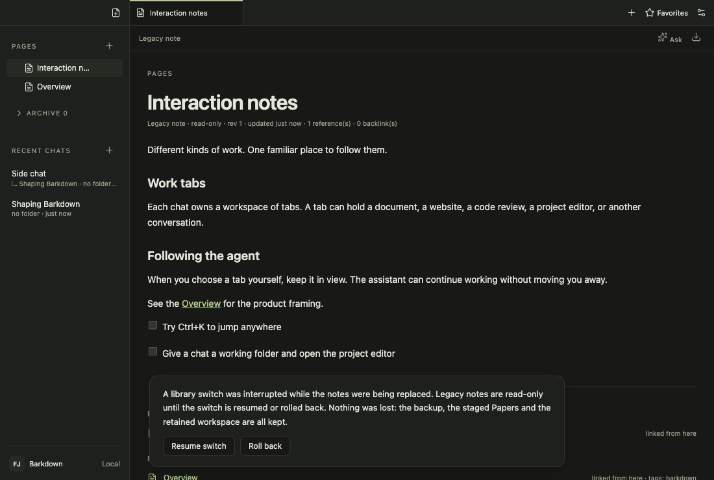
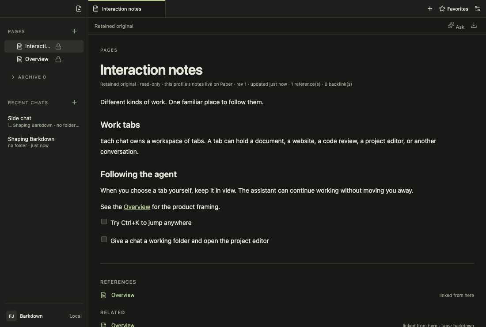
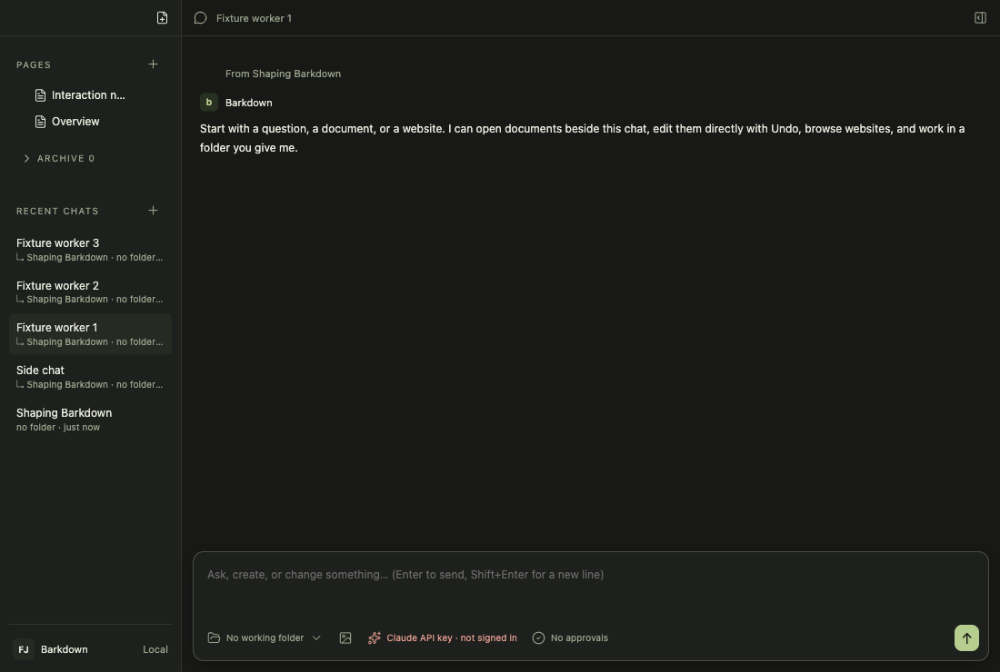

# Visual health on darwin

Approved fixture captures of the real Electron UI on darwin (OS 24.5.0, Electron 44.5.1). The primary gallery in [README.md](README.md) is the Windows source machine's; this page stands beside it, never in its place. See [rules](RULES.md).

Reviewed by feat-barkdown-3 builder (Opus). Mention a note with @ in the chat composer (new picker, @[title] tokens, chips in sent messages). Inspected run 2026-11-18T07-32-11-163Z: every frame within tolerance or noise; settings-assistant differs only in the random temp folder name of the command-line path; workspace/side-chat/goals narrow differ by a few pixels with no geometry change. The fixture tour never types @, so the picker and chips are not in it; they are proven by app/tests/note-mention.live.mjs (real Electron, carried runtime, scripted API SDK: picker, Enter/Tab pick, Escape, Backspace, dispatched fence, dedupe, cut, deleted note, history Up, side chat, chip opens note, reload) whose screenshots were inspected (picker left-aligned above the composer, chips legible in dark mode). Limits: no narrow-width picture of the picker; Windows not captured.

Source commit: 1f812bb48eb116c9f2fc90a2bf52195bb9f0dc0a; review: docs/visual/reviews/approval-ef166de6737a71641db5136e3e9d0f9df4246c022e6cea6ae5fe3a174b880c3e.json.

## workspace

Real desktop navigation with disposable local notes; no cloud or provider.

## chat

Shared main composer: draft, provider chooser and model chooser. No message is sent.

## side-chat

A real saved side conversation and its independent composer, using disposable fixture state.

## documents

Read-only legacy document viewer. The light frame is a theme-contrast comparison; no Paper server or editing is used.

## retained

After the library switch the legacy notes are retained read-only. Dark by default; the light frame compares theme contrast. Fixture journal; no Paper server.

## settings

Real Settings navigation. No server connection or credential is configured.

## goals

Goal component with explicitly injected fixture snapshots and providers blocked. Saved worker chats use the ordinary composer; this is not live scheduler/provider proof.

## profiles

Profile Settings controls with injected stable registry names. This tour makes no profile switch; real switching and Paper save protection have separate integration evidence.

## adoption

Real recovery window with explicit fixture states; no migration is performed in this visual tour. Actual transaction/restart proof is separate.

