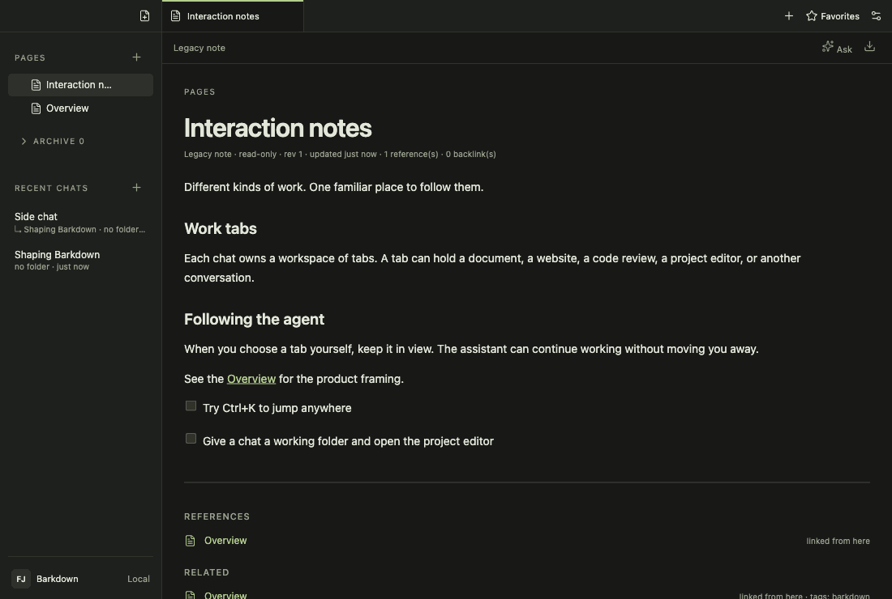
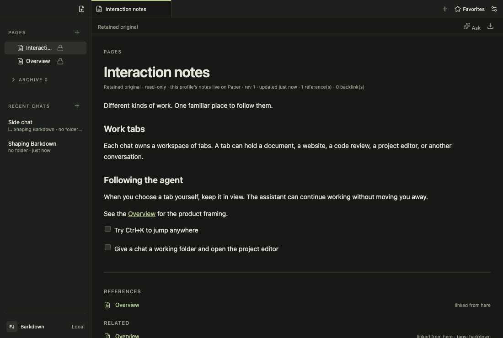

# Visual health on darwin

Approved fixture captures of the real Electron UI on darwin (OS 24.5.0, Electron 44.5.1). The primary gallery in [README.md](README.md) is the Windows source machine's; this page stands beside it, never in its place. See [rules](RULES.md).

Reviewed by feat-barkdown builder (Opus). Markdown import (Pages folder-input button beside +, quick open 'Import Markdown…', import progress line under Pages). The fixture tour runs without a local profile library, so the new button, palette item and progress line do not appear in it; all 44 frames are within tolerance except noise: settings-1 (random temp-dir suffix in the command-line path), goals-0..2 and side-chat-3 (sub-0.01% textarea resize handle / anti-aliasing). Inspected workspace-3 (narrow), settings-1 and goals-1 diffs. The new UI is shown and asserted in tests/markdown-import.live.mjs against the packaged runtime (PASS: 4-note vault with nesting, image upload, wiki link; same selection again creates nothing; 200 files interrupted by profile switch and quit finish with exactly 200; worst frame 18 ms); its screenshots are in app/test-results (untracked). Status pictures retaken at b19e717c.

Source commit: 6c376bbb3cc0ccc77a7adb3c9ed20ec972e22f31; review: docs/visual/reviews/approval-297f1d3a35d347afa5a1682ceab79df9d321d98aa7c4bc2c88cda9f24eba21b4.json.

## workspace

Real desktop navigation with disposable local notes; no cloud or provider.

## chat

Shared main composer: draft, provider chooser and model chooser. No message is sent.

## side-chat

A real saved side conversation and its independent composer, using disposable fixture state.

## documents

Read-only legacy document viewer. The light frame is a theme-contrast comparison; no Paper server or editing is used.

## retained

After the library switch the legacy notes are retained read-only. Dark by default; the light frame compares theme contrast. Fixture journal; no Paper server.

## settings

Real Settings navigation. No server connection or credential is configured.

## goals

Goal component with explicitly injected fixture snapshots and providers blocked. Saved worker chats use the ordinary composer; this is not live scheduler/provider proof.

## profiles

Profile Settings controls with injected stable registry names. This tour makes no profile switch; real switching and Paper save protection have separate integration evidence.

## adoption

Real recovery window with explicit fixture states; no migration is performed in this visual tour. Actual transaction/restart proof is separate.

