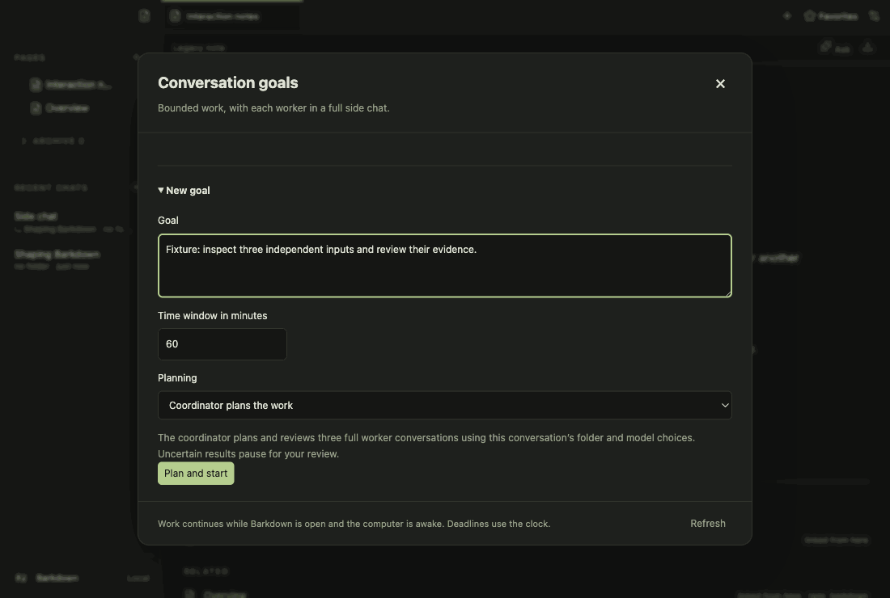

# Visual health on darwin

Approved fixture captures of the real Electron UI on darwin (OS 24.5.0, Electron 44.5.1). The primary gallery in [README.md](README.md) is the Windows source machine's; this page stands beside it, never in its place. See [rules](RULES.md).

Reviewed by feat-barkdown-3 builder (Opus). Markdown import you can trust: one link rule (shared/safe-url.js, twin of Barkpark Render.Util.safe_url) in the Markdown converter, clip and the legacy read-only view, with one legacy exception (barkdown://doc links on the legacy ProseMirror path); a 401/403 stops an import; a held-then-edited file imports its new content. Merged with main at 72d5f135. Inspected run 2026-11-18T22-31-46-107Z against 2026-11-18T21-35-55-369Z: every frame within tolerance except settings-assistant (only the random temp suffix of the command-line path differs) and a few pixels in workspace narrow and side-chat open with no geometry change. documents-1 still shows the seeded legacy note's Overview link and 1 reference, so the legacy exception holds in the real view. The tour never imports Markdown; app/tests/markdown-import.live.mjs passed on this branch (real Electron, carried runtime 1482fb675: javascript:/data: links import as words, a relative .md link stays a note link). Limits: no picture of the 401 stop message; Windows not captured.

Source commit: 2faf1e3d55dbce37e110c53c2815a6cb1f96170b; review: docs/visual/reviews/approval-278d5fb42f19f70a34d1b90e9eb2d7741484c0d4111c15c0995ac11c35142632.json.

## workspace

Real desktop navigation with disposable local notes; no cloud or provider.

## chat

Shared main composer: draft, provider chooser and model chooser. No message is sent.

## side-chat

A real saved side conversation and its independent composer, using disposable fixture state.

## documents

Read-only legacy document viewer. The light frame is a theme-contrast comparison; no Paper server or editing is used.

## retained

After the library switch the legacy notes are retained read-only. Dark by default; the light frame compares theme contrast. Fixture journal; no Paper server.

## settings

Real Settings navigation. No server connection or credential is configured.

## goals

Goal component with explicitly injected fixture snapshots and providers blocked. Saved worker chats use the ordinary composer; this is not live scheduler/provider proof.

## profiles

Profile Settings controls with injected stable registry names. This tour makes no profile switch; real switching and Paper save protection have separate integration evidence.

## adoption

Real recovery window with explicit fixture states; no migration is performed in this visual tour. Actual transaction/restart proof is separate.

