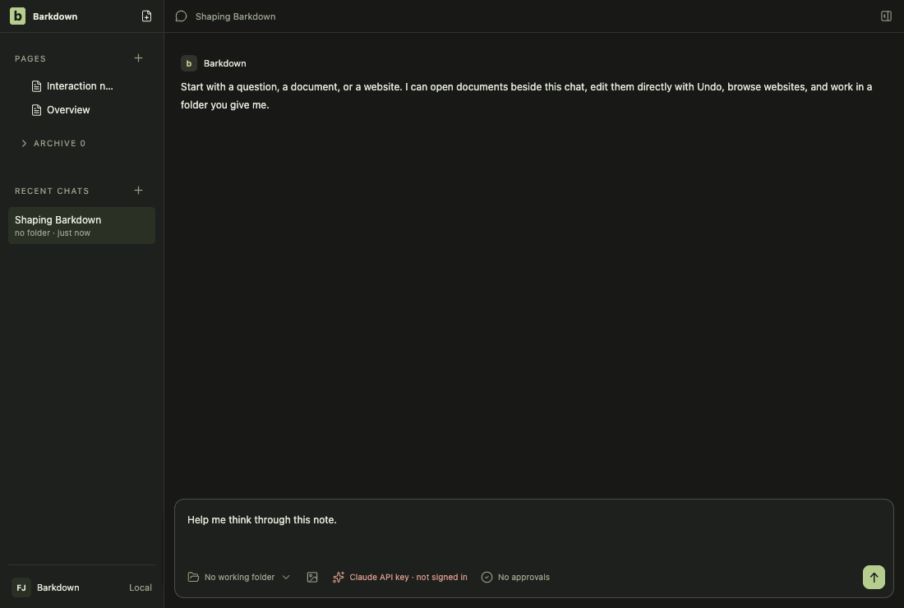
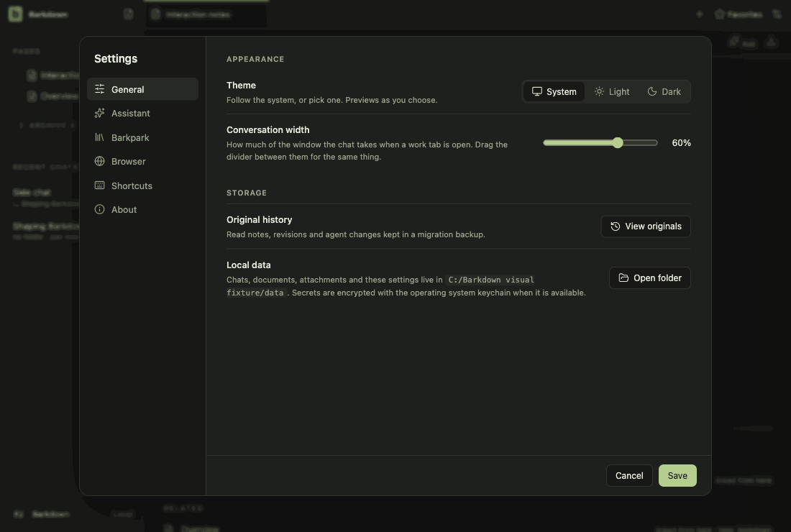

# Visual health on darwin

Approved fixture captures of the real Electron UI on darwin (OS 24.5.0, Electron 44.5.1). The primary gallery in [README.md](README.md) is the Windows source machine's; this page stands beside it, never in its place. See [rules](RULES.md).

Reviewed by Claude (agent, Opus 5.5). Inspected run 2026-10-27T13-24-54-798Z: the only changed frame is settings-1 (review-required), whose difference is the random temp folder name in the Command line path; every other frame 0 changed pixels, geometry unchanged. The change adds a 'This page stopped (reason). Reload' message to a website tab whose renderer dies; no tour shows a crashed tab. Its look is in docs/cycles/evidence/C089/live/2026-10-27T13-22-14-884Z-browser/10b-page-stopped.png (dark), inspected: message in the tab's error line under the address bar, Reload as a link-style button; browser.live.mjs reloads from it.

Source commit: b79518c63b50df9e5984d37ebc8ea0f7b911b27b; review: docs/visual/reviews/approval-442a1200fbc36d204e895dfb4e5606d6f110c43e7f9c5800ee032414c90a0e36.json.

## workspace

Real desktop navigation with disposable local notes; no cloud or provider.

## chat

Shared main composer: draft, provider chooser and model chooser. No message is sent.

## side-chat

A real saved side conversation and its independent composer, using disposable fixture state.

## documents

Read-only legacy document viewer. The light frame is a theme-contrast comparison; no Paper server or editing is used.

## retained

After the library switch the legacy notes are retained read-only. Dark by default; the light frame compares theme contrast. Fixture journal; no Paper server.

## settings

Real Settings navigation. No server connection or credential is configured.

## goals

Goal component with explicitly injected fixture snapshots and providers blocked. Saved worker chats use the ordinary composer; this is not live scheduler/provider proof.

## profiles

Profile Settings controls with injected stable registry names. This tour makes no profile switch; real switching and Paper save protection have separate integration evidence.

## adoption

Real recovery window with explicit fixture states; no migration is performed in this visual tour. Actual transaction/restart proof is separate.

