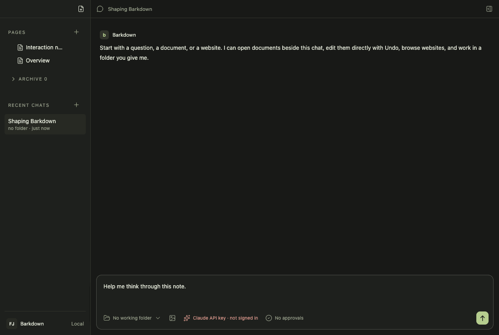
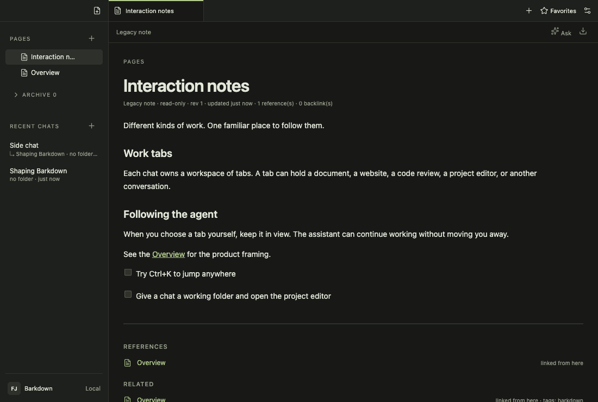

# Visual health on darwin

Approved fixture captures of the real Electron UI on darwin (OS 24.5.0, Electron 44.5.1). The primary gallery in [README.md](README.md) is the Windows source machine's; this page stands beside it, never in its place. See [rules](RULES.md).

Reviewed by feat-barkdown-2 builder (Opus). Quick open gains an In chats group (search inside the current profile's chats, side chats included) and the transcript gains data-message markers plus a brief highlight on the found message. Reviewed run 2026-11-16T06-38-09-118Z against 2026-11-15T21-36-19-140Z: all 53 frames within tolerance except settings-1 (only the random temp path in the Command line row differs), goals-6 narrow and side-chat 0/1 (sub-0.04% anti-aliasing, nothing visible in the diffs); side-chat and transcript frames look unchanged, as expected since data-message adds no style. Limit: the fixture tour's quick-open step has an empty query, so it never shows In chats; the live status shot docs/images/status/quick-open.png (dark, carried runtime) shows two In chats rows with the match marked, and tests/chat-search.live.mjs (passed via heavy) types in quick open, checks the escaped snippet and mark, clicks the hit and asserts the side chat opened with the reply in view and highlighted, and that each profile finds only its own chats. Narrow layout of an In chats row not captured; rows use the existing palette ellipsis.

Source commit: f7fc00892241b79b3dcf0744c306c1b60fc74365; review: docs/visual/reviews/approval-c9c0dd4b212aa0ab1f6c093dc8951785db25fffa558b3fa58a3fb2ae29d8ba8d.json.

## workspace

Real desktop navigation with disposable local notes; no cloud or provider.

## chat

Shared main composer: draft, provider chooser and model chooser. No message is sent.

## side-chat

A real saved side conversation and its independent composer, using disposable fixture state.

## documents

Read-only legacy document viewer. The light frame is a theme-contrast comparison; no Paper server or editing is used.

## retained

After the library switch the legacy notes are retained read-only. Dark by default; the light frame compares theme contrast. Fixture journal; no Paper server.

## settings

Real Settings navigation. No server connection or credential is configured.

## goals

Goal component with explicitly injected fixture snapshots and providers blocked. Saved worker chats use the ordinary composer; this is not live scheduler/provider proof.

## profiles

Profile Settings controls with injected stable registry names. This tour makes no profile switch; real switching and Paper save protection have separate integration evidence.

## adoption

Real recovery window with explicit fixture states; no migration is performed in this visual tour. Actual transaction/restart proof is separate.

