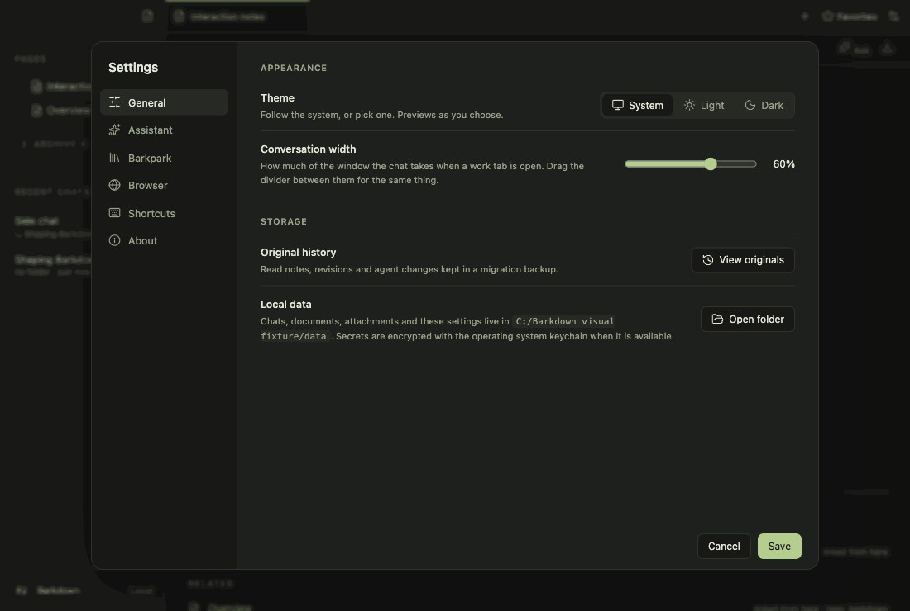
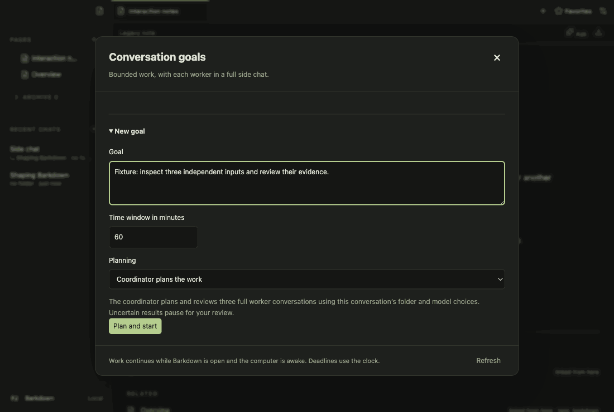

# Visual health on darwin

Approved fixture captures of the real Electron UI on darwin (OS 24.5.0, Electron 44.5.1). The primary gallery in [README.md](README.md) is the Windows source machine's; this page stands beside it, never in its place. See [rules](RULES.md).

Reviewed by feat-barkdown-3 builder (Opus). Merge of origin/main (#139 note outline) into the chat menu branch. Compared with approved run 2026-11-18T07-39-22-052Z: every frame within tolerance except side-chat ready and goals narrow (sub-pixel noise, nothing visible in the diffs) and settings assistant (the temporary CLI path). The chat rows' subline still truncates for the … button; the fixture tour never reaches a Paper path bar, so the new Outline button is checked in the status picture paper-dark (path bar icons: Ask, open, export, folder, Outline, refresh) and in #139's live evidence.

Source commit: 3bfc095cc14fdd155722ffd8bb303a093aa86c31; review: docs/visual/reviews/approval-1940554275b47bddc4b8f8c3d9ee7ff08750ed8f31640a0ac605335a817afe28.json.

## workspace

Real desktop navigation with disposable local notes; no cloud or provider.

## chat

Shared main composer: draft, provider chooser and model chooser. No message is sent.

## side-chat

A real saved side conversation and its independent composer, using disposable fixture state.

## documents

Read-only legacy document viewer. The light frame is a theme-contrast comparison; no Paper server or editing is used.

## retained

After the library switch the legacy notes are retained read-only. Dark by default; the light frame compares theme contrast. Fixture journal; no Paper server.

## settings

Real Settings navigation. No server connection or credential is configured.

## goals

Goal component with explicitly injected fixture snapshots and providers blocked. Saved worker chats use the ordinary composer; this is not live scheduler/provider proof.

## profiles

Profile Settings controls with injected stable registry names. This tour makes no profile switch; real switching and Paper save protection have separate integration evidence.

## adoption

Real recovery window with explicit fixture states; no migration is performed in this visual tour. Actual transaction/restart proof is separate.

