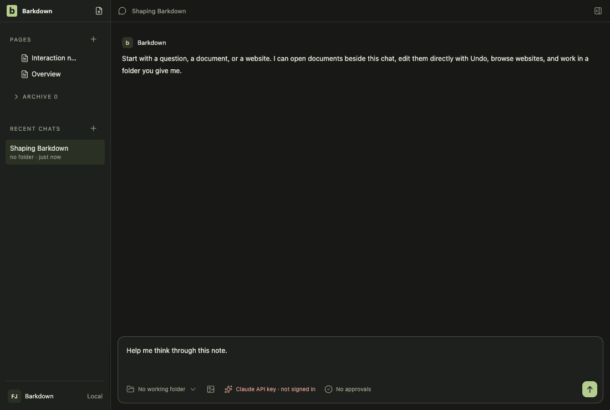
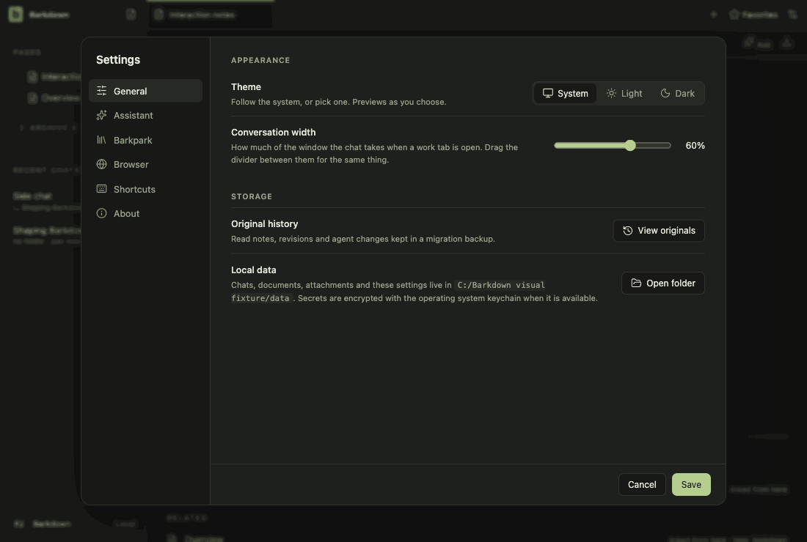
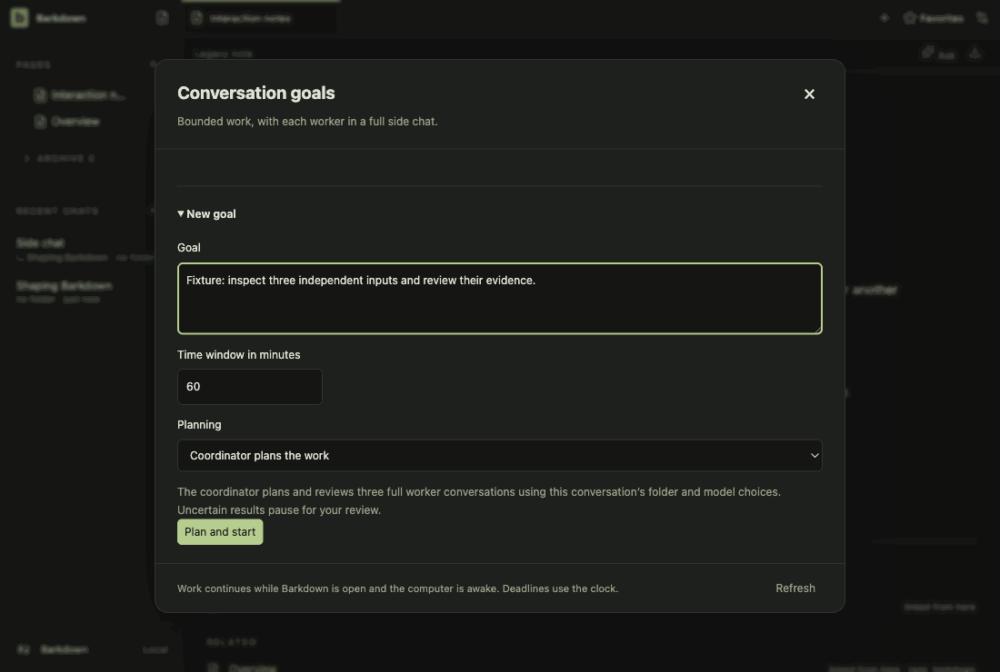

# Visual health on darwin

Approved fixture captures of the real Electron UI on darwin (OS 24.5.0, Electron 44.5.1). The primary gallery in [README.md](README.md) is the Windows source machine's; this page stands beside it, never in its place. See [rules](RULES.md).

Reviewed by Claude (agent). Reviewed 2026-10-26T17-17-50-775Z against 05-48-36 (darwin, dark). Only change: settings-1 command-line path shows the random temp folder name (expected per run). goals-6, quick-open, side-chat: sub-0.04% anti-alias noise, no visible change. The change under test (control.js note lookup, import/migration directTab) has no visual effect.

Source commit: 849fc7a9e432cf1dd168736d84988cc5242fe3ed; review: docs/visual/reviews/approval-ad1e135ec9fc01594a7a2f844990ebafae6a5f1e45fd08a65286600499d37c26.json.

## workspace

Real desktop navigation with disposable local notes; no cloud or provider.

## chat

Shared main composer: draft, provider chooser and model chooser. No message is sent.

## side-chat

A real saved side conversation and its independent composer, using disposable fixture state.

## documents

Read-only legacy document viewer. The light frame is a theme-contrast comparison; no Paper server or editing is used.

## retained

After the library switch the legacy notes are retained read-only. Dark by default; the light frame compares theme contrast. Fixture journal; no Paper server.

## settings

Real Settings navigation. No server connection or credential is configured.

## goals

Goal component with explicitly injected fixture snapshots and providers blocked. Saved worker chats use the ordinary composer; this is not live scheduler/provider proof.

## profiles

Profile Settings controls with injected stable registry names. This tour makes no profile switch; real switching and Paper save protection have separate integration evidence.

## adoption

Real recovery window with explicit fixture states; no migration is performed in this visual tour. Actual transaction/restart proof is separate.

