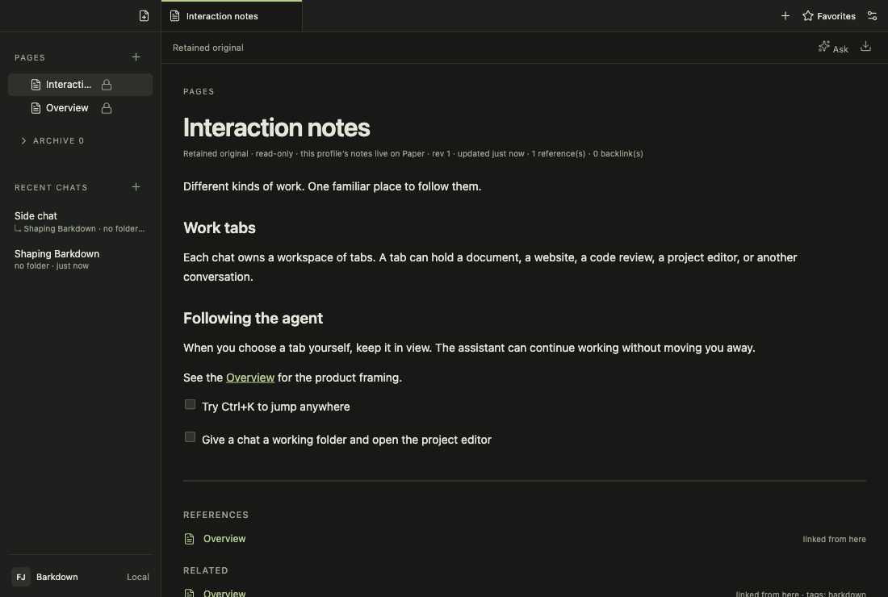

# Visual health on darwin

Approved fixture captures of the real Electron UI on darwin (OS 24.5.0, Electron 44.5.1). The primary gallery in [README.md](README.md) is the Windows source machine's; this page stands beside it, never in its place. See [rules](RULES.md).

Reviewed by feat-barkdown-3 builder (Opus). Note outline (task-c07e746760cbedc1), recapture after the review fix: in Markdown source mode the panel says it follows the Paper view instead of 'No headings yet'; render is wrapped so it can never break a note; the shortcut matches event.code KeyO and skips composition. Compared with the previous approved run 2026-11-18T06-29-13-717Z: settings: assistant differs only in the random temp path of the command-line text; quick-open, side-chat open and goals narrow are sub-pixel noise. The fixture tour never reaches a Paper path bar, so the panel and the source-mode notice are shown only in live Paper evidence docs/cycles/evidence/note-outline/live/2026-11-18-note-outline-live. Behavior: tests/note-outline.test.mjs 8/8, tests/paper-host.test.mjs passes, tests/note-outline.live.mjs 12/12 in real Electron on the carried runtime; its new source-mode step fails on the previous code (timeout waiting for the notice).

Source commit: a1cfb8854c7d02af446e69ace960b6d081bd5b6f; review: docs/visual/reviews/approval-a90b3ae7e322cafee6333182d12d01901732f7342d4a2e1e5cf1a26c7fa53f15.json.

## workspace

Real desktop navigation with disposable local notes; no cloud or provider.

## chat

Shared main composer: draft, provider chooser and model chooser. No message is sent.

## side-chat

A real saved side conversation and its independent composer, using disposable fixture state.

## documents

Read-only legacy document viewer. The light frame is a theme-contrast comparison; no Paper server or editing is used.

## retained

After the library switch the legacy notes are retained read-only. Dark by default; the light frame compares theme contrast. Fixture journal; no Paper server.

## settings

Real Settings navigation. No server connection or credential is configured.

## goals

Goal component with explicitly injected fixture snapshots and providers blocked. Saved worker chats use the ordinary composer; this is not live scheduler/provider proof.

## profiles

Profile Settings controls with injected stable registry names. This tour makes no profile switch; real switching and Paper save protection have separate integration evidence.

## adoption

Real recovery window with explicit fixture states; no migration is performed in this visual tour. Actual transaction/restart proof is separate.

