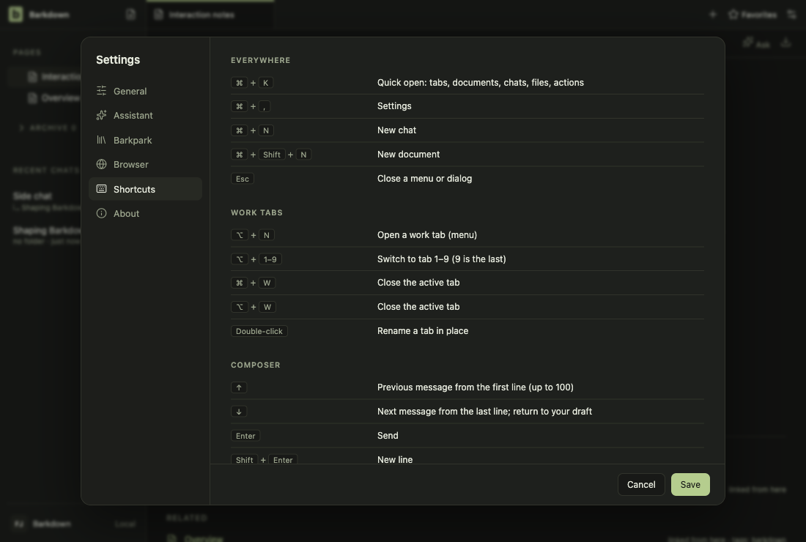
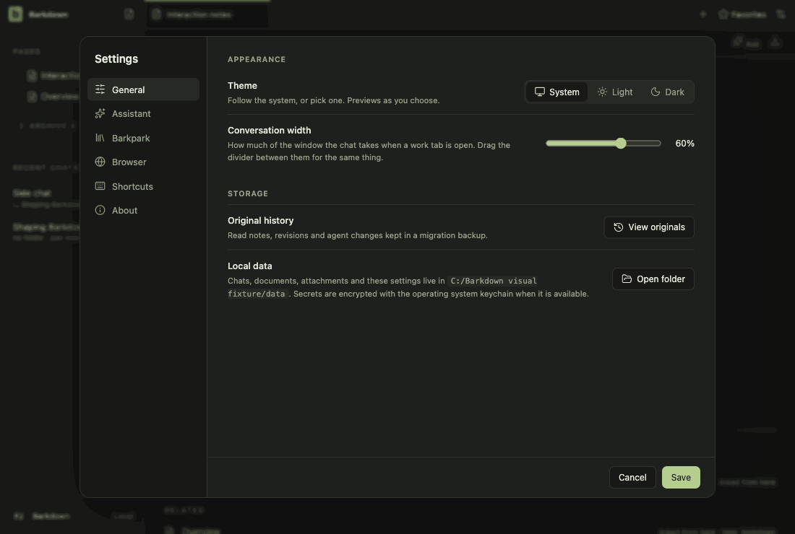

# Visual health on darwin

Approved fixture captures of the real Electron UI on darwin (OS 24.5.0, Electron 44.5.1). The primary gallery in [README.md](README.md) is the Windows source machine's; this page stands beside it, never in its place. See [rules](RULES.md).

Reviewed by claude-barkdown-mac. Inspected run 2026-10-29T13-32-42-440Z on darwin: settings-1 differs only in the temporary path of the command-line row; workspace-3 is one anti-aliasing pixel at the send button; every other frame within tolerance. The change is the bundle icon (build.mac.icon), which no in-app capture shows; checked separately in an electron-builder --dir bundle (Contents/Resources/icon.icns identical, CFBundleIconFile icon.icns).

Source commit: 7567d009c240d70882f053a2ec81ae005027d975; review: docs/visual/reviews/approval-dbe7109f34f0a5ebf333518dd162d5946d98f37a4d5787ef7c7dfa16b5d8a06e.json.

## workspace

Real desktop navigation with disposable local notes; no cloud or provider.

## chat

Shared main composer: draft, provider chooser and model chooser. No message is sent.

## side-chat

A real saved side conversation and its independent composer, using disposable fixture state.

## documents

Read-only legacy document viewer. The light frame is a theme-contrast comparison; no Paper server or editing is used.

## retained

After the library switch the legacy notes are retained read-only. Dark by default; the light frame compares theme contrast. Fixture journal; no Paper server.

## settings

Real Settings navigation. No server connection or credential is configured.

## goals

Goal component with explicitly injected fixture snapshots and providers blocked. Saved worker chats use the ordinary composer; this is not live scheduler/provider proof.

## profiles

Profile Settings controls with injected stable registry names. This tour makes no profile switch; real switching and Paper save protection have separate integration evidence.

## adoption

Real recovery window with explicit fixture states; no migration is performed in this visual tour. Actual transaction/restart proof is separate.

