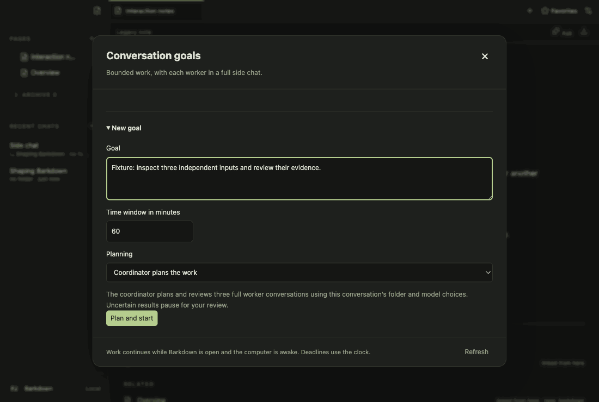

# Visual health on darwin

Approved fixture captures of the real Electron UI on darwin (OS 24.5.0, Electron 44.5.1). The primary gallery in [README.md](README.md) is the Windows source machine's; this page stands beside it, never in its place. See [rules](RULES.md).

Reviewed by feat-barkdown-3 builder (Opus). Stuck Save as a note fix (task-456e13040ed2b603), merged with main after #146 (head 2477000e + status shots). All tour steps unchanged (0 changed pixels; side-chat draft 0.0000025, no geometry change). The tour has no step that reaches a kept chat-note or clip request, so the new Pages notice (Chat note not confirmed. Retry / Discard on one line) is not in it; it is shown and checked in tests/chat-menu.live.mjs step 6b (03b-chat-note-not-confirmed, 03c-chat-note-refused), which passed 13/13 on this merged code on the carried runtime 1482fb675. Limits: one Mac (darwin arm64), dark mode; the refusal and the unconfirmed reply are forced through a test-only IPC handler.

Source commit: 2149a24dcdc20eda47b0039d8076f272784f5c2f; review: docs/visual/reviews/approval-6a7cde704384363876b1a1e0d3173248d6b2ea7436aab0e40dddeae61e5aa159.json.

## workspace

Real desktop navigation with disposable local notes; no cloud or provider.

## chat

Shared main composer: draft, provider chooser and model chooser. No message is sent.

## side-chat

A real saved side conversation and its independent composer, using disposable fixture state.

## documents

Read-only legacy document viewer. The light frame is a theme-contrast comparison; no Paper server or editing is used.

## retained

After the library switch the legacy notes are retained read-only. Dark by default; the light frame compares theme contrast. Fixture journal; no Paper server.

## settings

Real Settings navigation. No server connection or credential is configured.

## goals

Goal component with explicitly injected fixture snapshots and providers blocked. Saved worker chats use the ordinary composer; this is not live scheduler/provider proof.

## profiles

Profile Settings controls with injected stable registry names. This tour makes no profile switch; real switching and Paper save protection have separate integration evidence.

## adoption

Real recovery window with explicit fixture states; no migration is performed in this visual tour. Actual transaction/restart proof is separate.

