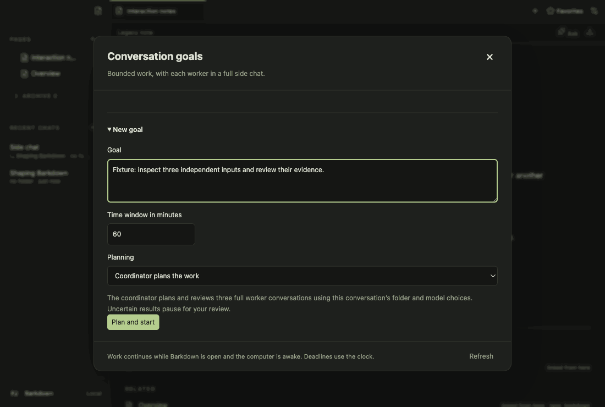

# Visual health on darwin

Approved fixture captures of the real Electron UI on darwin (OS 24.5.0, Electron 44.5.1). The primary gallery in [README.md](README.md) is the Windows source machine's; this page stands beside it, never in its place. See [rules](RULES.md).

Reviewed by feat-barkdown-3 builder (Opus). Review fix for PR 148 (M1, L2, L4): the importer rewrites wiki and relative .md links only in prose, with a placeholder made from the chunk's own text; a URL holds parentheses two deep; the forbidden message ends in one full stop. Main unchanged at 72d5f135. Inspected run 2026-11-18T23-29-53-712Z against 2026-11-18T22-31-46-107Z: every frame within tolerance except settings-assistant, where only the random temp suffix of the command-line path differs. documents-1 still shows the legacy note's Overview link and 1 reference. The tour does not import Markdown; app/tests/markdown-import.live.mjs passed on 1554efc2 (real Electron, carried runtime 1482fb675). Limits: Windows not captured.

Source commit: 2910e2cb8807fc7a78cf76761cc598b3d5b71330; review: docs/visual/reviews/approval-36e1c18a28d74600c01d7fca6bdda8429ad5d9ed69927ff83339de9b2c69d433.json.

## workspace

Real desktop navigation with disposable local notes; no cloud or provider.

## chat

Shared main composer: draft, provider chooser and model chooser. No message is sent.

## side-chat

A real saved side conversation and its independent composer, using disposable fixture state.

## documents

Read-only legacy document viewer. The light frame is a theme-contrast comparison; no Paper server or editing is used.

## retained

After the library switch the legacy notes are retained read-only. Dark by default; the light frame compares theme contrast. Fixture journal; no Paper server.

## settings

Real Settings navigation. No server connection or credential is configured.

## goals

Goal component with explicitly injected fixture snapshots and providers blocked. Saved worker chats use the ordinary composer; this is not live scheduler/provider proof.

## profiles

Profile Settings controls with injected stable registry names. This tour makes no profile switch; real switching and Paper save protection have separate integration evidence.

## adoption

Real recovery window with explicit fixture states; no migration is performed in this visual tour. Actual transaction/restart proof is separate.

