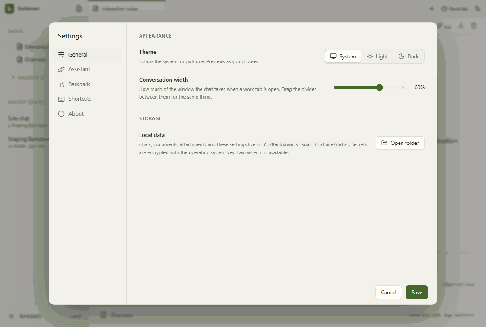

# Visual health

Approved fixture captures of the real Electron UI. No live provider, Paper-server save, migration or sync proof is implied. See [rules](RULES.md), [coverage](coverage.json) and the [review report](runs/2026-09-22T01-53-12-281Z/README.md).

Reviewed by Codex next-cycle agent. Reviewed all 37 candidate frames across eight areas; zero pixel or geometry differences. Separately inspected C018 db9b2ca actual Electron seven stills, 17 video samples and all 41 recovery frames (38 encoded GIF frames). All four native jobs stopped. Rapid Enter executes once and preserves newer draft. Pipe-shell Windows containment only; live Paper freshness remains a separate check.

Source commit: db9b2cad63678cea2b0010ffdab8f292b8891f7e; platform: win32; Electron: 38.8.6. Source fingerprints, including dirty capture inputs, are recorded in the manifest.

## [workspace](workspace/README.md)

## [chat](chat/README.md)

## [side-chat](side-chat/README.md)

## [documents](documents/README.md)

## [settings](settings/README.md)

## [goals](goals/README.md)

## [profiles](profiles/README.md)

## [adoption](adoption/README.md)

## Live evidence and gaps

The existing [Paper editor gallery](../images/status/manifest.json) includes a live editor GIF and server provenance. Separate live walkthroughs for agent editing, files/reviews, recovery and profile switching remain outstanding. New behavior must add its journey here before claiming full visual coverage.
