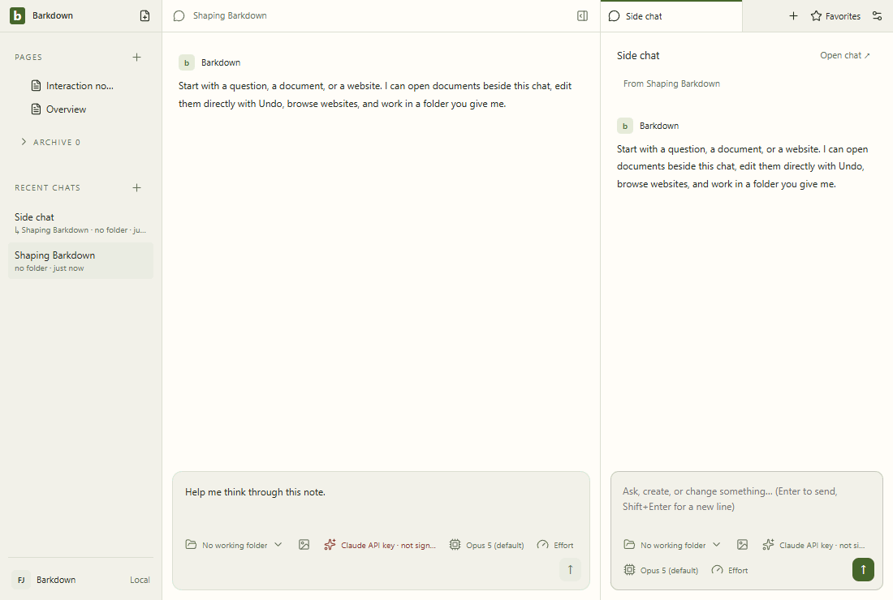
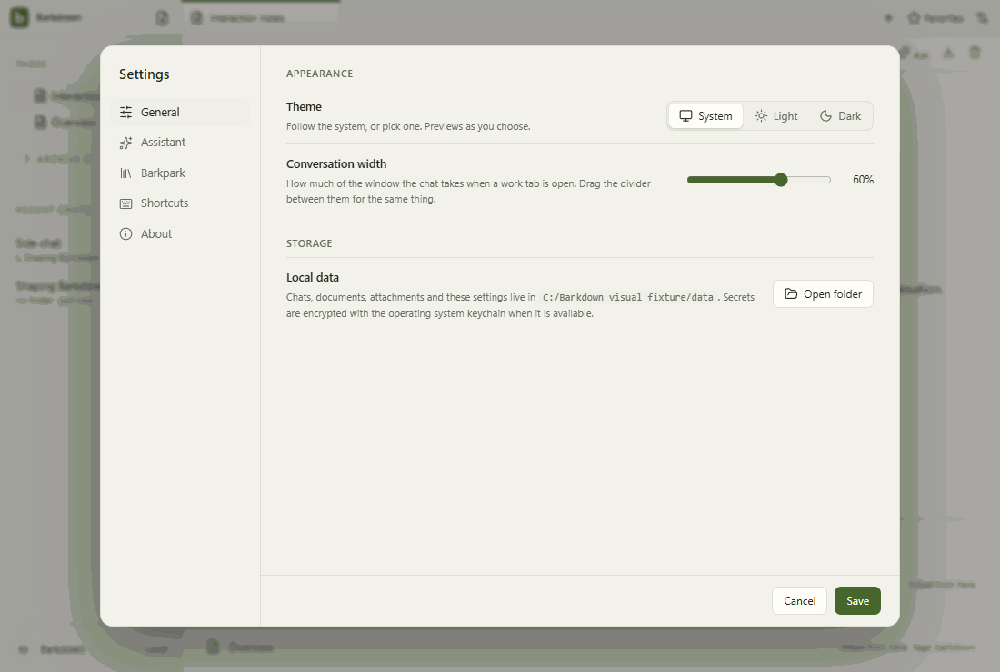

# Visual health

Approved fixture captures of the real Electron UI. No live provider, Paper-server save, migration or sync proof is implied. See [rules](RULES.md), [coverage](coverage.json) and the [review report](runs/2026-09-22T05-31-59-959Z/README.md).

Reviewed by Codex editor agent. E011: inspected all 40 deterministic stills/diffs and all 40 decoded GIF frames. Settings bundle SHA change to c73a0f46 is expected; geometry unchanged. Both real fallback compatibility runs separately prove actual upload/Undo/Redo/save/reload against a544 and545 servers. No new clipping or unintended displacement observed; deterministic tours are not server proof.

Source commit: cc17fcafd9868c0d8b65a99855f4f14992dce5e5; platform: win32; Electron: 38.8.6. Source fingerprints, including dirty capture inputs, are recorded in the manifest.

## [workspace](workspace/README.md)

## [chat](chat/README.md)

## [side-chat](side-chat/README.md)

## [documents](documents/README.md)

## [settings](settings/README.md)

## [goals](goals/README.md)

## [profiles](profiles/README.md)

## [adoption](adoption/README.md)

## Dedicated journeys and remaining limits

The [Paper editor gallery](../images/status/manifest.json) records its own live server provenance. Dedicated journeys below retain their original source and review; this fixture approval does not restamp them or prove their remaining acceptance criteria. See each page for failures and coverage limits.

- [agent-takeover](agent-takeover/README.md): live-paper-agent-adapter-with-human-takeover.
- [rich-takeover](rich-takeover/README.md): live-paper-rich-content-takeover.
- [chat-recovery](chat-recovery/README.md): actual-electron-owned-job-crash-and-recovery.
- [paper-save](paper-save/README.md): live-paper-with-injected-transport-faults.
- [structured-table](structured-table/README.md): live-paper-MCP-structured-table-edits.
- [api-paper](api-paper/README.md): actual-API-SDK-and-live-Paper-with-scripted-model.
- [markdown-paste](markdown-paste/README.md): live-paper-Markdown-paste-native-history.
- [terminal-ownership](terminal-ownership/README.md): actual-electron-owned-terminal-switch-and-crash.
- [project-buffers](project-buffers/README.md): actual-CodeMirror-profile-switch-preservation.
- [native-rollback](native-rollback/README.md): actual-electron-owned-work-refusal-and-explicit-rollback.
- [html-table-paste](html-table-paste/README.md): live-paper-HTML-paste-native-history-and-keyboard-recovery.
- [coordinator-recovery](coordinator-recovery/README.md): actual-electron-coordinator-interruption-and-explicit-retry.
- [adoption-repeat](adoption-repeat/README.md): actual-Electron-cold-repeat-adoption-and-rollback.
- [project-file-authority](project-file-authority/README.md): actual-electron-file-navigation-and-explicit-save.
- [cache-integrity](cache-integrity/README.md): actual-electron-corrupt-cache-profile-switch-and-restart.
- [profile-isolation](profiles/isolation-runs/README.md): actual-Electron-two-runtime-late-edit-Undo-restart.
- [editor-fallback-consumption](fallback-consumption/README.md): actual-Paper-vendored545-on-old-and-current-private-server.
