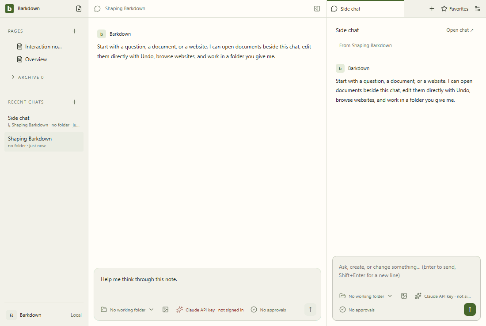
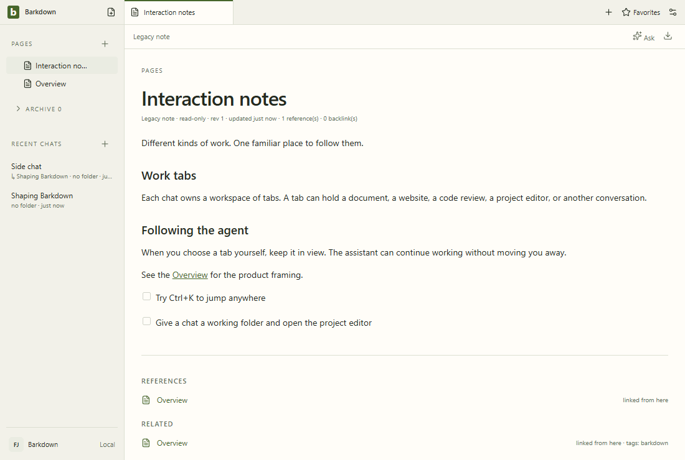
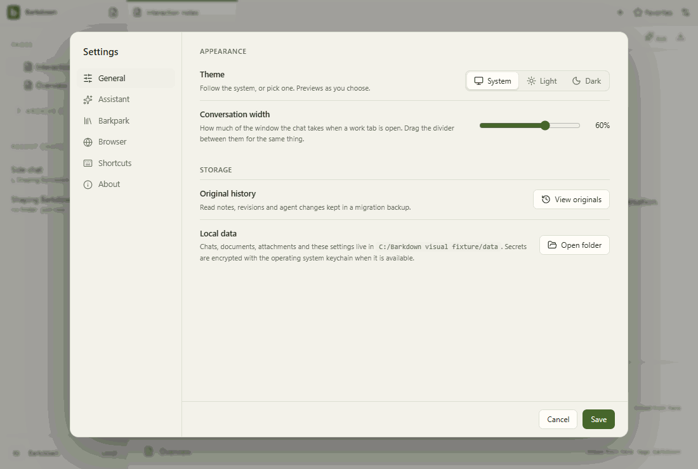
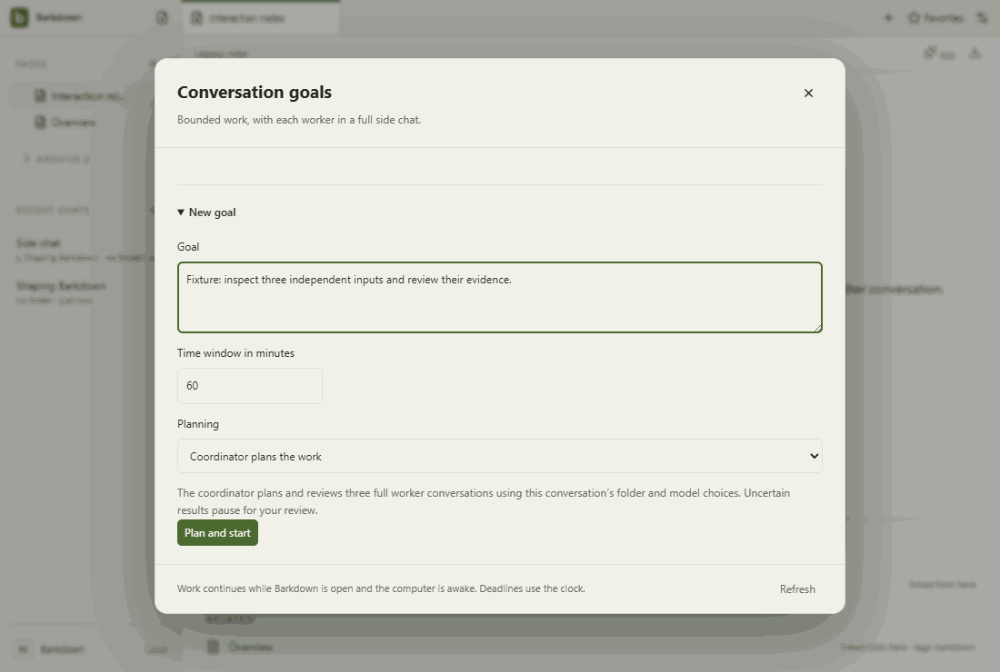
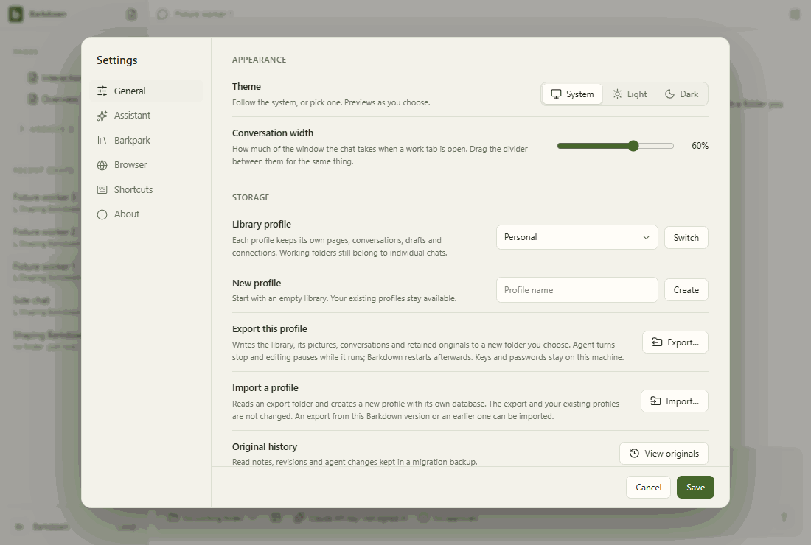

# Visual health

Approved fixture captures of the real Electron UI. No live provider, Paper-server save, migration or sync proof is implied. See [rules](RULES.md), [coverage](coverage.json) and the [review report](runs/2026-10-07T20-35-47-119Z/README.md).

Reviewed by Codex Windows return. C097 source9a74a3af: inspected all44 standard stills,44 differences,44 motion frames, five Paper stills and37 GIF frames; enlarged Settings assistant,390px Goals and Paper29/36. Only temporary Settings command path differs (ratio0.00020761670761670762); no geometry change. Controlled original30s failure and delayed repaired pass retained; ordinary recovery and all21 resumed Desktop commands pass. Segmented validation, not an uninterrupted Desktop pass. Private live Paper uses a labeled sample transcript. Existing light fixtures retain theme/contrast comparison; dark Paper and Original history also reviewed. No Mac transfer or real-provider claim.

Source commit: 9a74a3af2681268ca13a9a3d5b1e888cefdee45d; platform: win32; Electron: 44.5.1. Source fingerprints, including dirty capture inputs, are recorded in the manifest.

## [workspace](workspace/README.md)

## [chat](chat/README.md)

## [side-chat](side-chat/README.md)

## [documents](documents/README.md)

## [retained](retained/README.md)

## [settings](settings/README.md)

## [goals](goals/README.md)

## [profiles](profiles/README.md)

## [adoption](adoption/README.md)

## Dedicated journeys and remaining limits

The [Paper editor gallery](../images/status/manifest.json) records its own live server provenance. Dedicated journeys below retain their original source and review; this fixture approval does not restamp them or prove their remaining acceptance criteria. See each page for failures and coverage limits.

- [agent-takeover](agent-takeover/README.md): live-paper-agent-adapter-with-human-takeover.
- [rich-takeover](rich-takeover/README.md): live-paper-rich-content-takeover.
- [chat-recovery](chat-recovery/README.md): actual-electron-owned-job-crash-and-recovery.
- [paper-save](paper-save/README.md): live-paper-with-injected-transport-faults.
- [structured-table](structured-table/README.md): live-paper-MCP-structured-table-edits.
- [api-paper](api-paper/README.md): actual-API-SDK-and-live-Paper-with-scripted-model.
- [markdown-paste](markdown-paste/README.md): live-paper-Markdown-paste-native-history.
- [terminal-ownership](terminal-ownership/README.md): actual-electron-owned-terminal-switch-and-crash.
- [project-buffers](project-buffers/README.md): actual-CodeMirror-profile-switch-preservation.
- [native-rollback](native-rollback/README.md): actual-electron-owned-work-refusal-and-explicit-rollback.
- [html-table-paste](html-table-paste/README.md): live-paper-HTML-paste-native-history-and-keyboard-recovery.
- [coordinator-recovery](coordinator-recovery/README.md): actual-electron-coordinator-interruption-and-explicit-retry.
- [adoption-repeat](adoption-repeat/README.md): actual-Electron-cold-repeat-adoption-and-rollback.
- [project-file-authority](project-file-authority/README.md): actual-electron-file-navigation-and-explicit-save.
- [cache-integrity](cache-integrity/README.md): actual-electron-corrupt-cache-profile-switch-and-restart.
- [profile-isolation](profiles/isolation-runs/README.md): actual-Electron-two-runtime-late-edit-Undo-restart.
- [send-preservation](send-preservation/README.md): actual-Electron-managed-and-legacy-send-rejection-keyboard-recovery.
- [rich-clipboard](rich-clipboard/README.md): live-connected-Paper-3495-clipboard-recovery-and-image-upload.
- [upload-history](upload-history/README.md): live-connected-Paper-54579-upload-completion-native-Undo-Redo-save-reload.
- [missing-folder](missing-folder/69acbce/README.md): historical-C029-accepted-CLI-failure-before-C032-predispatch-refusal.
- [fallback-consumption](fallback-consumption/README.md): actual-vendored-Paper-upload-history-against-a544-and-54579.
- [folder-preflight](folder-preflight/README.md): actual-main-side-refusal-restart-and-selected-B-missing-reference.
- [paper-callouts](callouts/README.md): live-isolated-Paper-seven-tones-title-body-fold-reload.
- [provider-login](provider-login/README.md): actual-Electron-shared-login-lifecycle-with-controlled-process-and-SDK.
- [migration](migration/README.md): live-isolated-staged-Paper-keyboard-Undo-reload-Electron-restart.
- [migration-restore](migration/README.md): actual-Electron-restored-legacy-profile-history-drafts-media-save-restart.
- [migration-native-source](migration/README.md): actual-legacy-save-to-Paper-link-list-edit-Undo-navigation-restart.
- [migration-workspace](migration/README.md): actual-projected-Pages-favorites-sidechat-paths-and-restart; C080-managed-local-Archive-and-owner-refusal.
- [paper-catalog](catalog/README.md): actual-private-Paper-201-note-discovery-failure-retry-and-restart.
- [paper-connection](paper-connection/README.md): native-open-Paper-foreign-connection-refusal-original-retry-CLI-restart.
- [paper-evidence](paper-evidence/README.md): native-fresh-foreign-binding-readonly-legacy-evidence-and-original-HTTP-CLI-Undo-restart.
- [paper-navigation](paper-navigation/README.md): native-saved-same-slug-tabs-favorites-Pages-foreign-refusal-and-restart.
- [paper-archive](paper-archive/README.md): native-managed-profiles-and-manual-loopback.
- [paper-notes](paper-notes/README.md): native-managed-local-empty-note-typing-search-and-profile-restart.
- [agent-notes](agent-notes/README.md): native-managed-agent-create-body-edit-Undo-profile-restart.
- [paper-deletions](paper-deletions/README.md): private-real-runtime-native-restart-and-copy.
- [original-history](original-history/README.md): actual-Electron-profile-owned-backup-reader-refusal-and-restart.
- [writer-fence](writer-fence/README.md): actual-Electron-managed-Paper-quiescence-refusal-and-original-history-restart.
- [profile-preparation](profile-preparation/README.md): actual-Electron-profile-preparation-cancel-retained-drafts-and-restart.
- [editor-shortcuts](editor-shortcuts/README.md): native-Electron-keyboard-and-private-Paper-save-reload.
- [quit-backend](quit-backend/README.md): actual-electron-with-controlled-driver-cleanup-failure.
- [quit-admission](quit-admission/README.md): actual-electron-send-and-quit-with-controlled-environment-wait.
