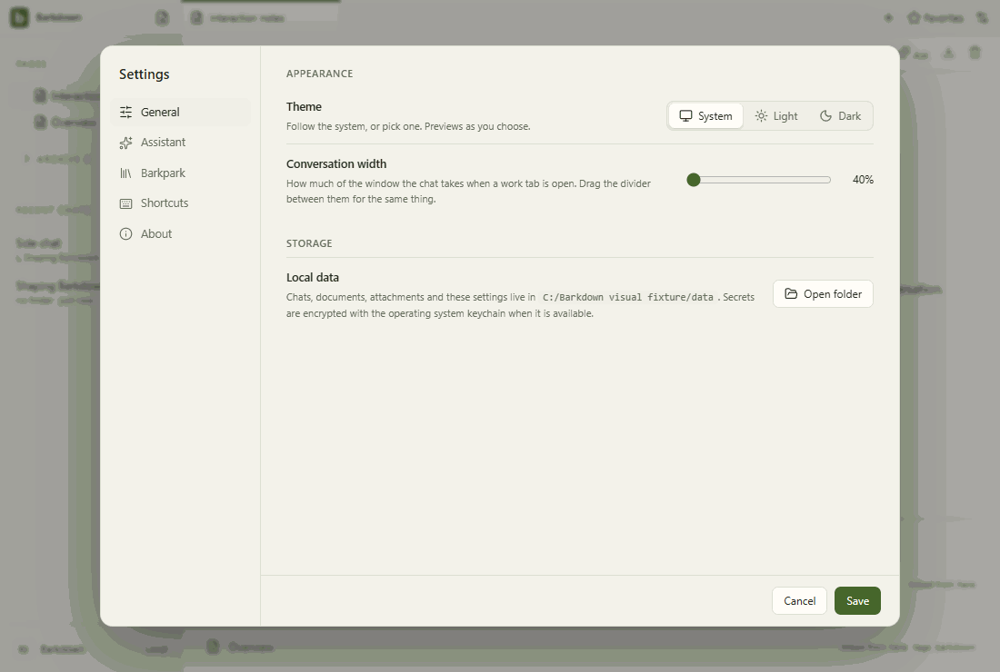

# Visual health

Approved fixture captures of the real Electron UI. No live provider, Paper-server save, migration or sync proof is implied. See [rules](RULES.md), [coverage](coverage.json) and the [review report](runs/2026-09-21T23-39-00-392Z/README.md).

Reviewed by Codex integration coordinator. Inspected all31 actual frames in seven area contact sheets, including profile Settings and goal planned/running/paused/narrow/worker navigation. Existing21 reference frames have zero above-tolerance pixel or geometry differences; new10 frames readable with menus and footer/scroll regions intact. No new clipping or overlap observed. Deterministic providers remain blocked; this does not prove native worker execution or live Paper behavior. Inherited40percent default mismatch is tracked separately. Full pre-native desktop passed;46 native goal tests and23 Paper host tests pass, current native Electron fixture adaptation pending.

Source commit: ae49f97b92290ac2efbfa508e032b57b3ceeb3f1; platform: win32; Electron: 38.8.6. Source fingerprints, including dirty capture inputs, are recorded in the manifest.

## [workspace](workspace/README.md)

## [chat](chat/README.md)

## [side-chat](side-chat/README.md)

## [documents](documents/README.md)

## [settings](settings/README.md)

## [goals](goals/README.md)

## [profiles](profiles/README.md)

## Live evidence and gaps

The existing [Paper editor gallery](../images/status/manifest.json) includes a live editor GIF and server provenance. Separate live walkthroughs for agent editing, files/reviews, recovery and profile switching remain outstanding. New behavior must add its journey here before claiming full visual coverage.
