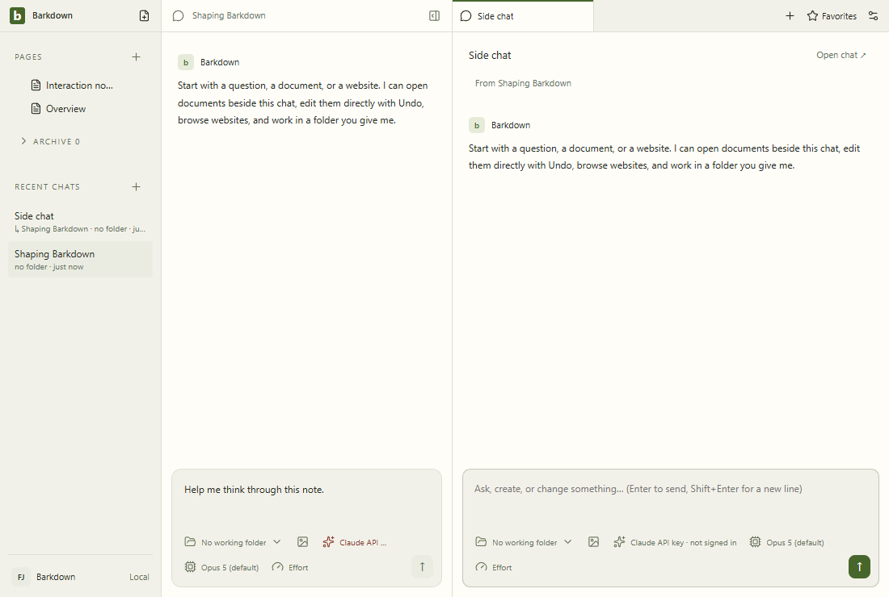

# Visual health

Approved fixture captures of the real Electron UI. No live provider, Paper-server save, migration or sync proof is implied. See [rules](RULES.md), [coverage](coverage.json) and the [review report](runs/2026-09-21T22-41-46-408Z/README.md).

Reviewed by Codex editor agent. E001 final harness review: inspected all 21 action frames across workspace, chat, side chat, documents and Settings after adding the Paper recovery capture tripwire. No changed pixels above tolerance, geometry change or environment drift; clean capture inputs at e19edfa. Nineteen controlled Paper races and four real-server recovery journeys separately prove behavior. Live Paper and recovery images remain distinct from these fixture tours; no crash-recovery or profile-isolation claim.

Source commit: e19edfa6dbe60475adc0f26bf5782066250478d6; platform: win32; Electron: 38.8.6. Source fingerprints, including dirty capture inputs, are recorded in the manifest.

## [workspace](workspace/README.md)

## [chat](chat/README.md)

## [side-chat](side-chat/README.md)

## [documents](documents/README.md)

## [settings](settings/README.md)

## Live evidence and gaps

The existing [Paper editor gallery](../images/status/manifest.json) includes a live editor GIF and server provenance. [Paper save safety](paper-save/README.md) now covers delayed writes, retained navigation/close, server Undo/redo, refusal/Retry and cancelable discard with real Paper and explicitly injected transport faults. Separate live walkthroughs for agent takeover, files/reviews, crash recovery and profile switching remain outstanding.
