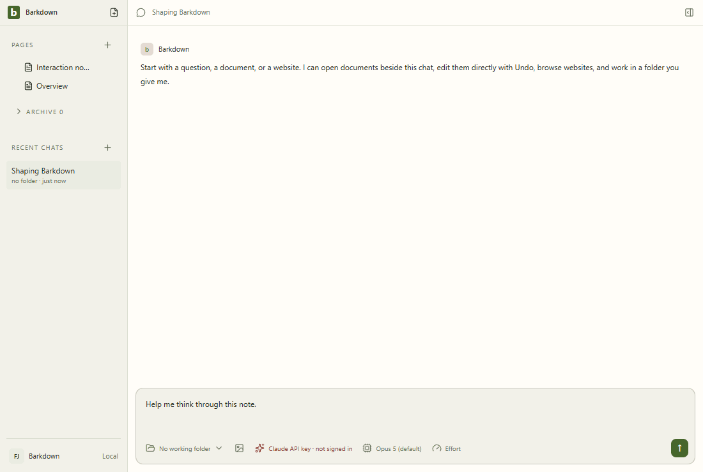

# Visual health

Approved fixture captures of the real Electron UI. No live provider, Paper-server save, migration or sync proof is implied. See [rules](RULES.md), [coverage](coverage.json) and the [review report](runs/2026-09-21T23-10-09-960Z/README.md).

Reviewed by Codex goal integration agent. Inspected all 27 raw action frames via contact sheets and full-size390px goal view; six step-recorded GIFs map to those same27 frames. Existing21 frames have zero changed pixels or geometry changes; environment unchanged. Six new explicitly labelled fixture goal frames cover plan, three observed fixture workers, pause, narrow, restore and ordinary worker navigation. No clipping or unintended tracks; main content remains scrollable behind fixed footer. Goals/provider/service36 tests pass including real provider loops with deterministic transport, profile switch, stale saves and recovered termination guard. Full desktop suite and isolated live Paper capture are still running; these fixtures do not prove production IPC or authenticated goal execution.

Source commit: cde979434d00f56f2a43fe7bd72938b89655bd12; platform: win32; Electron: 38.8.6. Source fingerprints, including dirty capture inputs, are recorded in the manifest.

## [workspace](workspace/README.md)

## [chat](chat/README.md)

## [side-chat](side-chat/README.md)

## [documents](documents/README.md)

## [settings](settings/README.md)

## [goals](goals/README.md)

## Live evidence and gaps

The existing [Paper editor gallery](../images/status/manifest.json) includes a live editor GIF and server provenance. Separate live walkthroughs for agent editing, files/reviews, recovery and profile switching remain outstanding. New behavior must add its journey here before claiming full visual coverage.
