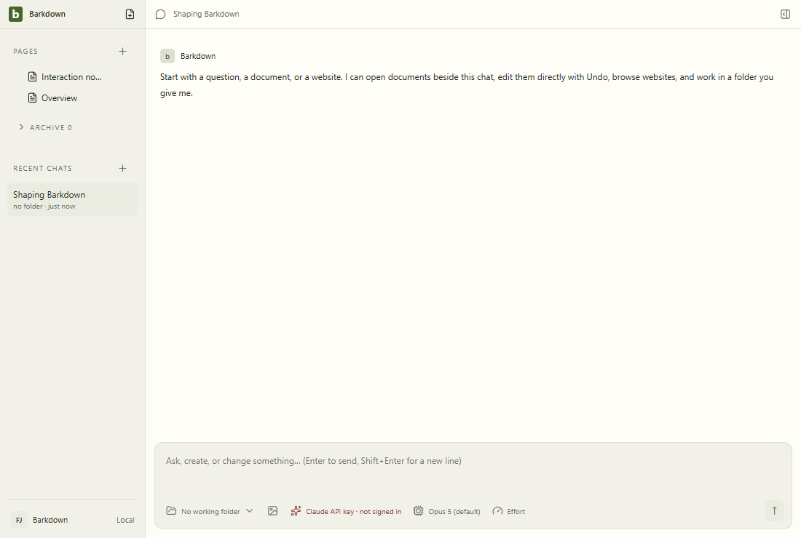

# Visual health

Approved fixture captures of the real Electron UI. No live provider, Paper-server save, migration or sync proof is implied. See [rules](RULES.md), [coverage](coverage.json) and the [review report](runs/2026-09-21T23-01-10-158Z/README.md).

Reviewed by Codex C007 runtime lane. Inspected all 21 frames across five recorded action sequences, including narrow workspace, menus, side-chat composer, light/dark documents and Settings. No clipping or geometry regression; comparator reports zero changed pixels. Full desktop suite passed on24e1bc3; async snapshot unit checks and real dual runtime/media/restart proof passed on34b17ce. Fixture tour remains separate from live Paper and profile runtime evidence.

Source commit: 34b17cecf5186ba682ee3aca13b6ba74ddeb567b; platform: win32; Electron: 38.8.6. Source fingerprints, including dirty capture inputs, are recorded in the manifest.

## [workspace](workspace/README.md)

## [chat](chat/README.md)

## [side-chat](side-chat/README.md)

## [documents](documents/README.md)

## [settings](settings/README.md)

## Live evidence and gaps

The existing [Paper editor gallery](../images/status/manifest.json) includes a live editor GIF and server provenance. Separate live walkthroughs for agent editing, files/reviews, recovery and profile switching remain outstanding. New behavior must add its journey here before claiming full visual coverage.
