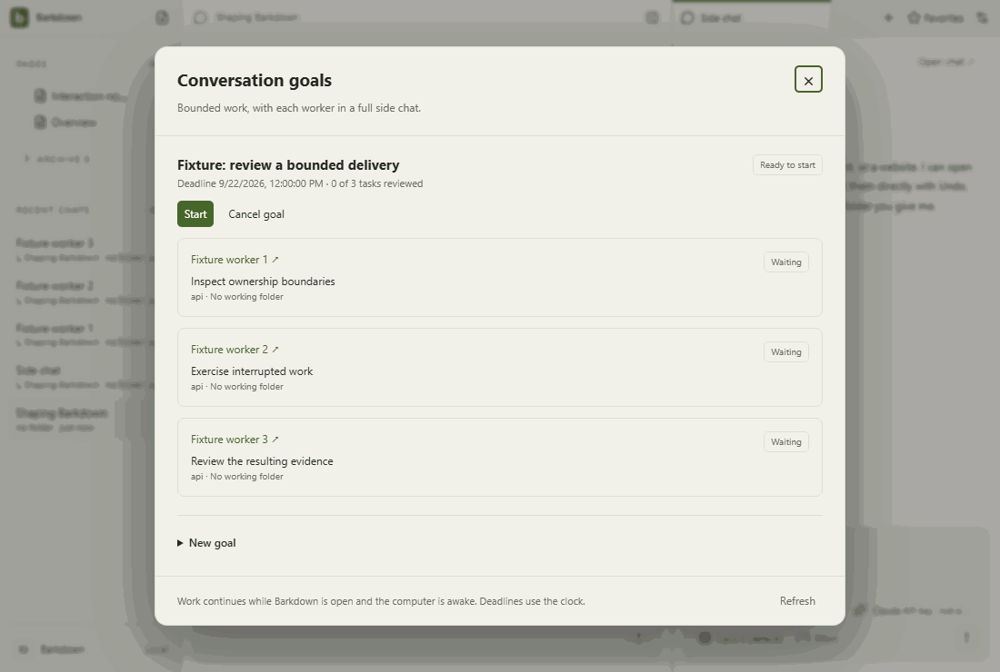
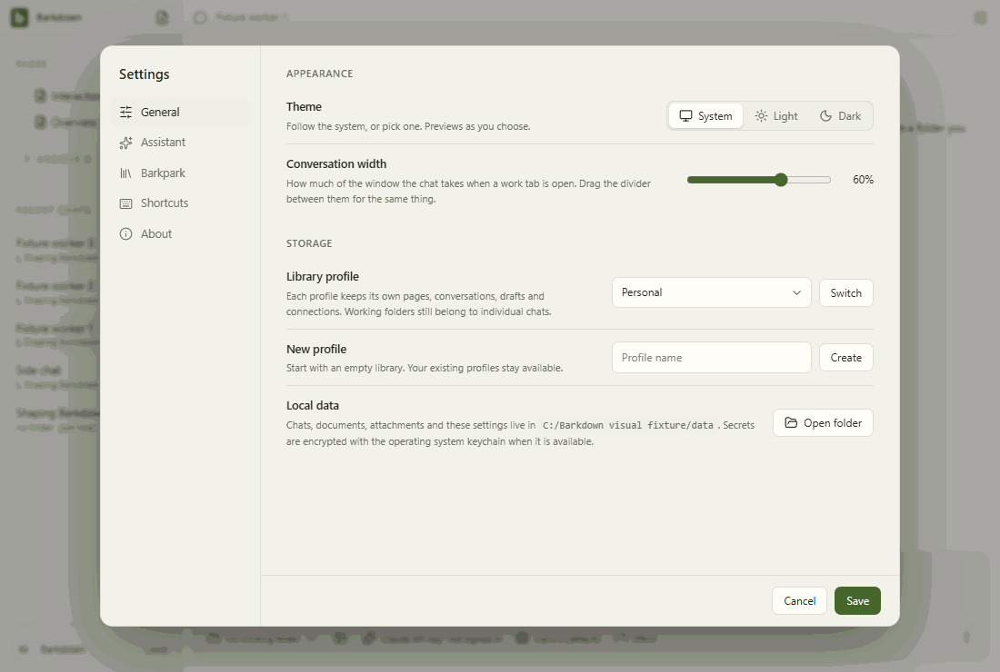

# Visual health

Approved fixture captures of the real Electron UI. No live provider, Paper-server save, migration or sync proof is implied. See [rules](RULES.md), [coverage](coverage.json) and the [review report](runs/2026-09-22T00-46-12-892Z/README.md).

Reviewed by Codex C016 agent. Inspected all37 frames and eight step sequences, including narrow profile/goals/recovery controls, theme contrast and menus. This fixture tour remains distinct from running dual-runtime acceptance. Test-only additions introduce no intended UI change; source and geometry comparison reviewed.

Source commit: 5e75a404d9a0d8b33d89c0270624110efd6508dd; platform: win32; Electron: 38.8.6. Source fingerprints, including dirty capture inputs, are recorded in the manifest.

## [workspace](workspace/README.md)

## [chat](chat/README.md)

## [side-chat](side-chat/README.md)

## [documents](documents/README.md)

## [settings](settings/README.md)

## [goals](goals/README.md)

## [profiles](profiles/README.md)

## [adoption](adoption/README.md)

## Live evidence and gaps

The existing [Paper editor gallery](../images/status/manifest.json) includes a live editor GIF and server provenance. Separate live walkthroughs for agent editing, files/reviews, recovery and profile switching remain outstanding. New behavior must add its journey here before claiming full visual coverage.
