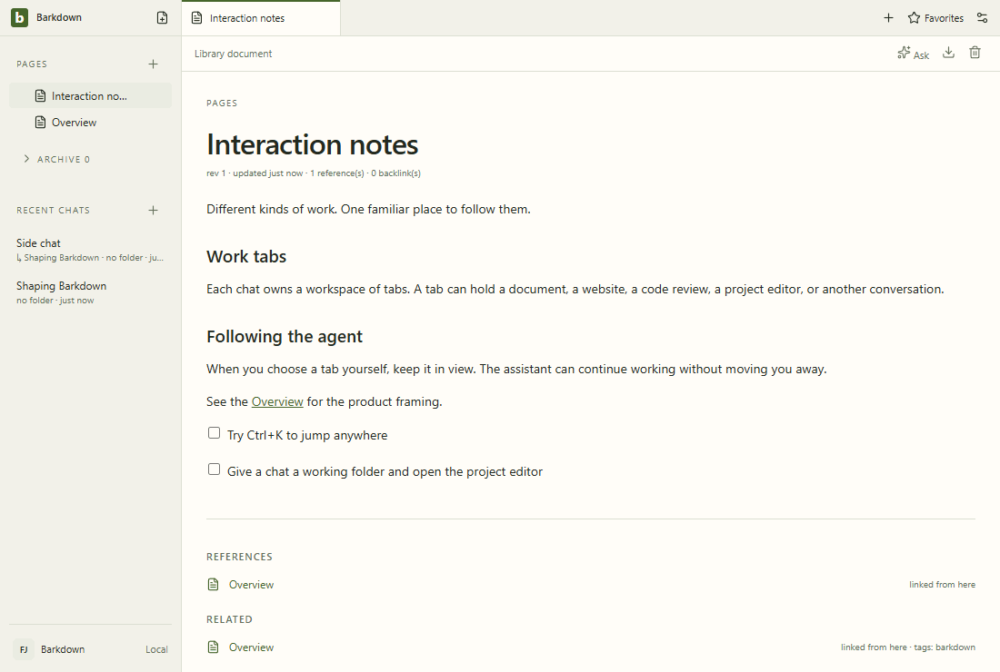

# Visual health

Approved fixture captures of the real Electron UI. No live provider, Paper-server save, migration or sync proof is implied. See [rules](RULES.md), [coverage](coverage.json) and the [review report](runs/2026-09-22T00-00-37-127Z/README.md).

Reviewed by Codex goal recovery agent. Inspected all31 candidate action frames including narrow goals/settings. All pixels and geometry unchanged from reviewed baseline; seven GIFs use these same step frames. Separate actual Electron crash/reopen/reconcile/retry test passes with local deterministic SDK transport and synthetic environment credentials; its dedicated recovery views cover changed wording. No authenticated recovery or encrypted-key restart claim.

Source commit: e9be0194d970511449961b7335228c976a9a54ec; platform: win32; Electron: 38.8.6. Source fingerprints, including dirty capture inputs, are recorded in the manifest.

## [workspace](workspace/README.md)

## [chat](chat/README.md)

## [side-chat](side-chat/README.md)

## [documents](documents/README.md)

## [settings](settings/README.md)

## [goals](goals/README.md)

## [profiles](profiles/README.md)

## Live evidence and gaps

The existing [Paper editor gallery](../images/status/manifest.json) includes a live editor GIF and server provenance. Separate live walkthroughs for agent editing, files/reviews, recovery and profile switching remain outstanding. New behavior must add its journey here before claiming full visual coverage.

Actual Electron [goal recovery stills](../goals/evidence/e9be019/README.md) cover interrupted, shutdown verified, reviewed retry and saved results including390px. Local deterministic HTTP through actual SDK/owned workers; no continuous-motion or authenticated recovery claim.
