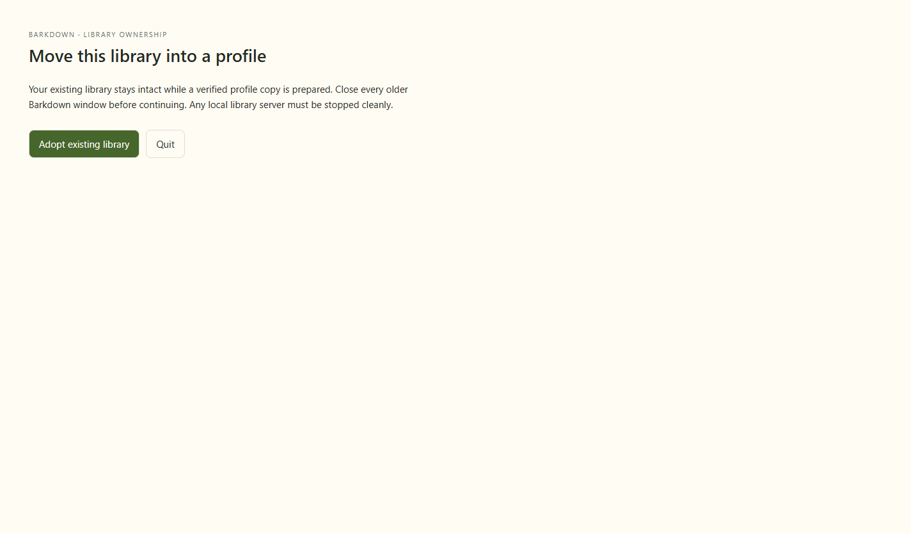

# Actual repeated cold adoption

C022 dedicated same-machine journey passed at aaeed2c (fixture f18e899), Barkpark a5440345c. [Exact report](runs/2026-09-22T03-18-44-678Z/manifest.json). Frozen production source was unchanged. Full desktop80620, final reviewed40-frame tour, actual Codex/Paper status46803 and rootverify6557 pass. [Cycle closeout](../../cycles/C022-repeat-cold-adoption.md).

The real PostgreSQL/Paper source was cleanly stopped before copying. First adoption retained Pages, favorite, parent/side conversation, draft attachment, local note, revision receipt and original credential bytes. A human Paper edit was acknowledged at revision3. Second explicit adoption retained one UUID, exact workspace/document/receipt/Paper inventories and unchanged original/backup hashes. Ordinary process restart retained the edit. Explicit rollback restored original revision2/media and retained the edited cold database byte-for-byte.

Eight raw stills personally inspected, including both confirmations/progress and edit/repeat/restart/rollback. The GIF letterboxes native window bounds without resizing the original stills. Three workspace records are parent, side and the normal internal direct-navigation record; no duplicate conversation was introduced on repeat. Normal cleanup: stopped true, no errors, independently no private postmaster markers.

Synthetic plain credentials are fixture-only; this does not prove encrypted cross-machine portability, power-loss durability, arbitrary source versions or completion of P1. No real library was touched. No external model turn occurs in this dedicated journey.

## Changelog

- 2026-09-22: first actual repeated-adoption journey passes; full repository closeout passed. Dedicated source and media remain distinct from deterministic tour approval.

## Integration import

Original evidence is retained here, not promoted to the integration branch's global approval. [Import verification](integration-import.json) records unchanged protected globals and exact hashes. Original status manifest is archived as [C022-89f9af2](../../images/status/history/C022-89f9af2.json). Earlier inaccurate comparison wording survives in [the exact original area README archive](original-visual-changelog.txt); same-candidate review JSON was overwritten by the existing tool, so it is not an immutable history of those earlier notes. The final original JSON remains unchanged, with this correction alongside it.
