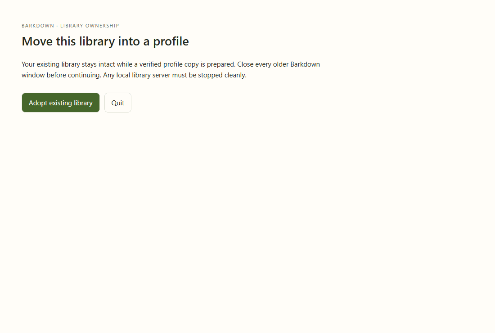

# adoption

Real recovery window with explicit fixture states; no migration is performed in this visual tour. Actual transaction/restart proof is separate.

[Full comparison](../runs/2026-09-22T00-18-43-302Z/README.md) · [Capture manifest](../runs/2026-09-22T00-18-43-302Z/manifest.json)

## Changelog

- 2026-09-22T00:19:42.530Z: C012 final coverage-bound run: all37 stills and37 decoded frames in8 GIFs reviewed through prior00-14-30 actual media inspection plus SHA256 comparison of45 final PNG/GIF artifacts.41 byte-identical;4 changed stills (goals worker and sidechat states) viewed directly. Reviewed baseline changes: inherited60percent width changes sidechat/settings/reset label; inherited goal controls and new adoption states readable; no new clipping or overlaps. Existing scrollable goal content/GIF palette banding remain. Actual workspace-loss Electron3 images reviewed separately; full desktop passed, isolated87ca Paper5stills+37GIFframes reviewed, runtime stopped. Fixture tours remain distinct from actual migration/provider proof. Source ba0aa59b3; [review](../runs/2026-09-22T00-18-43-302Z/comparison.json).
