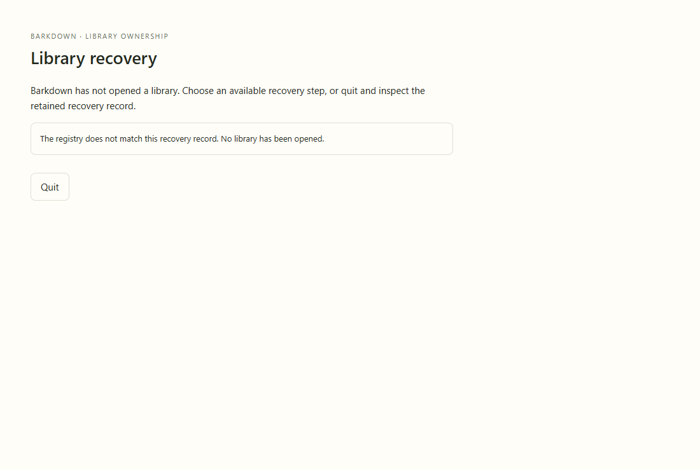

# adoption

Real recovery window with explicit fixture states; no migration is performed in this visual tour. Actual transaction/restart proof is separate.

[Full comparison](../runs/2026-09-22T00-46-12-892Z/README.md) · [Capture manifest](../runs/2026-09-22T00-46-12-892Z/manifest.json)

## Changelog

- 2026-09-22T00:47:47.128Z: Inspected all37 frames and eight step sequences, including narrow profile/goals/recovery controls, theme contrast and menus. This fixture tour remains distinct from running dual-runtime acceptance. Test-only additions introduce no intended UI change; source and geometry comparison reviewed. Source 5e75a404d; [review](../runs/2026-09-22T00-46-12-892Z/comparison.json).
- 2026-09-22T00:25:49.206Z: Inspected all37 actual candidate stills in eight area sheets, including menus, both themes, full side chats, narrow profile/goal/adoption recovery views. All comparisons have zero above-tolerance pixel/geometry changes versus preceding combined baseline. No new clipping or displacement observed. These are reduced-motion fixture steps, not live Paper or credential durability evidence; dedicated actual crash tests and live captures remain separate. Full combined desktop44785 is still running; prior466dfd9 full suite and rebuilt7248ef8 delayed-startup draft regression passed. Source 82cc6229a; [review](../runs/2026-09-22T00-23-29-485Z/comparison.json).
- 2026-09-22T00:11:34.408Z: Inspected all37 actual candidate frames:31 shell/goals/profiles and6 recovery-window states. Intended default width60 changes side-chat proportions and background geometry; saved-width behavior passed. Model controls wrap within side-chat composer, no overlapping menus; narrow goal scroll/footer and420px recovery buttons remain legible. Recovery images are explicit fixture states with no migration, not actual runtime adoption proof. Combined full desktop56cc102 passes incl crash/reopen/reconcile/retry and16 adoption process exits; corrected adoption fixture passes atf0d513a. Live Paper freshness for this new source remains pending. Source f0d513a73; [review](../runs/2026-09-22T00-09-52-577Z/comparison.json).
