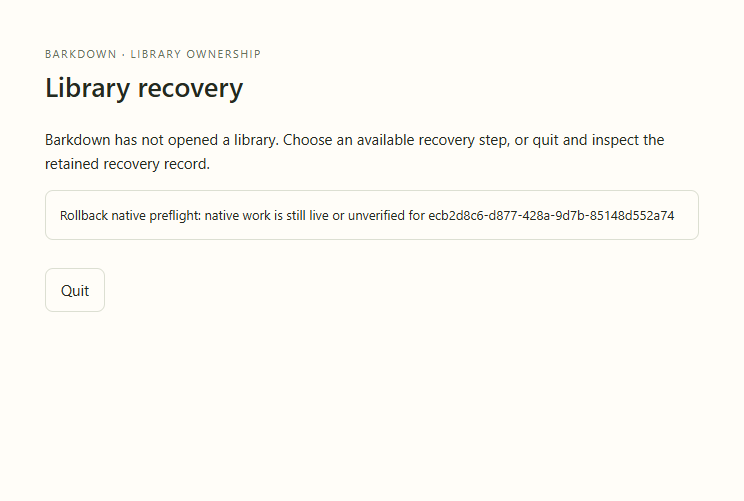

# C021 actual native rollback

Source `f3e92a1`, disposable yh4xq0. Actual Electron refuses rollback while an owned three-process native job remains live, then allows explicit retry after verified shutdown. [Manifest](manifest.json) · [Hash-bound review](review.json) · [Cycle](../../../cycles/C021-rollback-native-preflight.md).

All three stills and25 sampled motion frames were inspected. The12 refusal frames encode as11 GIF frames with identical duplicates coalesced; original timing retained. Original [refusal video](page@f55c7a692a3bd3b1c5b789d555a74e39.webm), [verified retry confirmation](page@b0eadd354bd05f952a9887169592b606.webm), and [restored workspace](page@1d16d8dc9906e885ceef463bddc8a310.webm) remain available. All native processes stopped.

The fixture proves exact original source bytes before any legacy boot writer, unchanged complete backup bytes, and every original human field after normal default insertion. It does not claim byte-identical workspace serialization after ordinary legacy startup. No real user data, provider or Barkpark runtime is used in this fixture.
