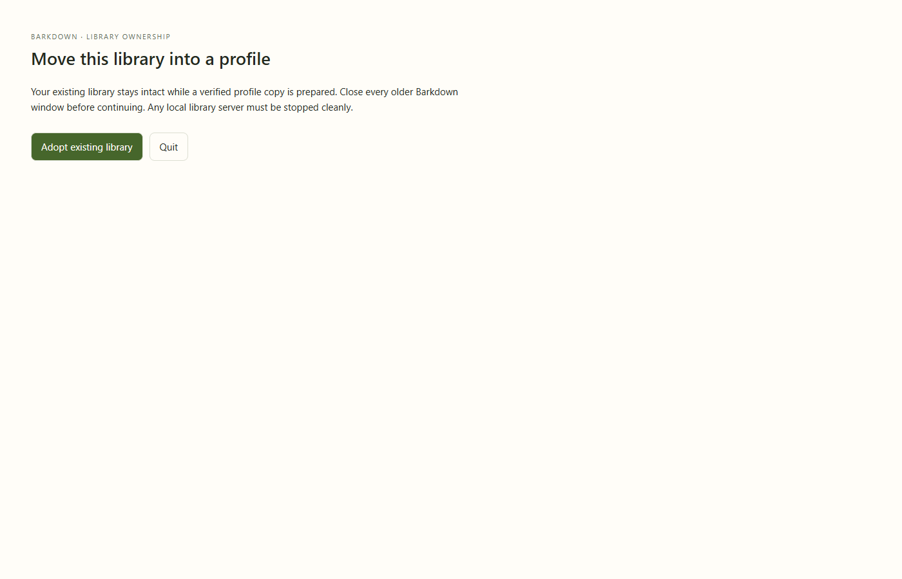

# Actual adoption, edit, restart and rollback

Clean Barkdown source54464ef with production draft fix74aaf16 and imported storage helper e16eaa7; real Barkpark sourcea5440345c. Disposable same-machine fixture only. [Manifest](manifest.json).

The actual Electron application confirmed adoption, copied a clean stopped real PostgreSQL library, activated its UUID profile, retained drafts and side-chat parent links, rendered the remapped attachment, and served unchanged original media URLs. Human Paper editing received a saved revision acknowledgement. A real process restart without flags restored the same profile and edit. Explicit offline rollback restarted the original unchanged revision/content/media and retained the edited profile copy. All owned services stopped; no cleanup errors.

The seven GIF steps are the exact seven screenshots, all inspected by the current-cycle agent: readable recovery controls, correct 60% split, intact draft/image and saved content before/after restart, original content after rollback. This is a step recording, not continuous animation or portability proof. Synthetic plain credentials verify byte preservation, not Windows DPAPI durability. Older binaries must be closed; no real user library was migrated. Earlier failed runs remain beside this successful run.
