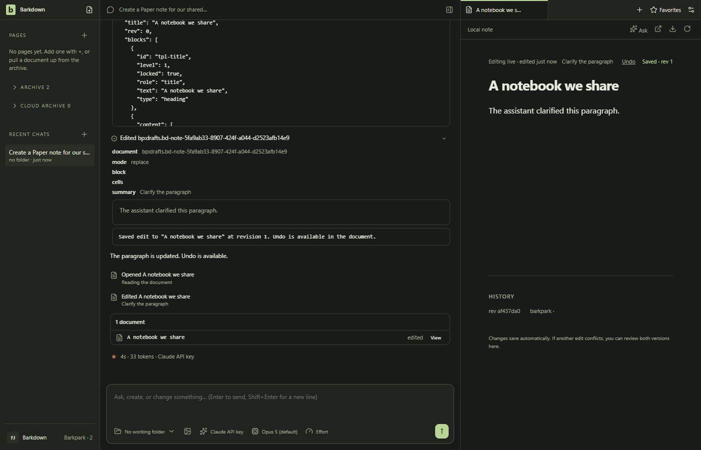
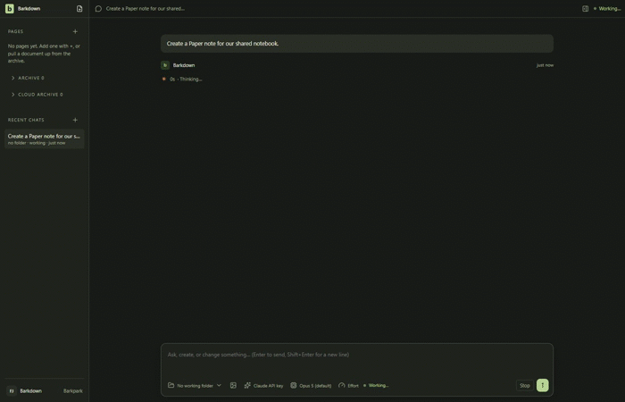

# Agents on ordinary Paper notes

API and MCP agents now create, discover and edit the same managed-local Paper notes as the person. Exact draft identity and library ownership survive activity, profile changes, receipts and restart. An uncertain creation reconciles its original request instead of creating another note.

The dark excerpt uses41 actual video samples at2fps. It omits startup, profile waits and some settled duplicates. [Full sampled journey](runs/2026-09-24T20-35-36-323Z/derived/journey.gif), [creation/profile video](runs/2026-09-24T20-35-36-323Z/create-edit-profile-switch.webm), [restart/Undo video](runs/2026-09-24T20-35-36-323Z/restart-undo-human-edit.webm) and [derivation](runs/2026-09-24T20-35-36-323Z/derived/derivation.json) retain provenance. Initial startup is light before persisted dark settings apply. This is actual Electron, SDK and a private real Paper server with scripted model choices, not live-model decision proof.

## README demo

[The root README loop](runs/2026-09-24T22-38-56-443Z/derived/readme-color-corrected.gif) shows a visible agent edit, Undo after restart, and human typing. Fresh native capture at Barkdown `299e14d` and private Barkpark `f2528db`: dark mode, 1120 x 720, 8 fps, 14 seconds, 3 MB. Model responses are scripted through the actual SDK and Paper server.

[Color review](runs/2026-09-24T22-38-56-443Z/COLOR-REVIEW.md), [capture review](runs/2026-09-24T22-38-56-443Z/REVIEW.md), [manifest](runs/2026-09-24T22-38-56-443Z/manifest.json), [full creation/profile video](runs/2026-09-24T22-38-56-443Z/create-edit-profile-switch.webm), [full restart/Undo video](runs/2026-09-24T22-38-56-443Z/restart-undo-human-edit.webm), and [excerpt recipe](runs/2026-09-24T22-38-56-443Z/derived/readme-derivation.json). Setup, profile checks and restart waits are omitted. Refresh with visible product changes using the [README demo rule](../RULES.md#readme-demo).

## What the evidence establishes

- [Native manifest](runs/2026-09-24T20-35-36-323Z/manifest.json): creation activity opens the exact owned draft; replacement preserves its locked title; identical IDs in two profiles remain separate; restart retains visible Undo, which restores exact blocks. Later human typing blocks stale Undo unchanged.
- [Real API/MCP probe](../../cycles/evidence/C069/agent-contract-1790282294968.json): create/list/body-search/read/edit, original-intent replay, reconstruction Undo and foreign/stale refusal. Managed MCP creates no legacy seed files.
- [Review](../../cycles/evidence/C069/review.json): six native stills,407 full-motion samples and41 excerpt frames inspected by Codex. Source8a277bb; private upstream30c007e43; both clean. Standard/live review and test provenance are separate.
- [C069 handoff](../../cycles/C069-agent-paper-notes.md) records validation, failed candidates and delivery status. [Narrow view](runs/2026-09-24T20-35-36-323Z/03-narrow-agent-edit.png) keeps Undo reachable but the reading column is cramped; no claim of finished narrow-screen polish.

Body replacement preserves the locked title. Additional locked slots require targeted edits. Agent title editing, deletion/recovery, uncertain edit-response recovery, in-flight creation/profile switching, migration activation and legacy retirement remain unproved. Expanded API tool traces and the existing opaque history label are visible; this does not establish a revision browser. P2/A2 remains open.

## Changelog

- 25 September: corrected the README GIF palette mapping after a reported brown tint. Background colors now match the recording exactly; cuts and timing are unchanged.

- 25 September: refreshed the README demo from the current native app; inspected all 108 encoded frames and six stills. Agent creation/editing, profile isolation, restart Undo and protection of human edits passed again.

- 24 September, C069: reviewed ordinary-note agent creation, body replacement and durable guarded Undo. Disabled profile Paper access now remains disabled in provider scopes. Earlier native binding/theme and fixture-probe failures are retained as development evidence, not accepted recordings.
