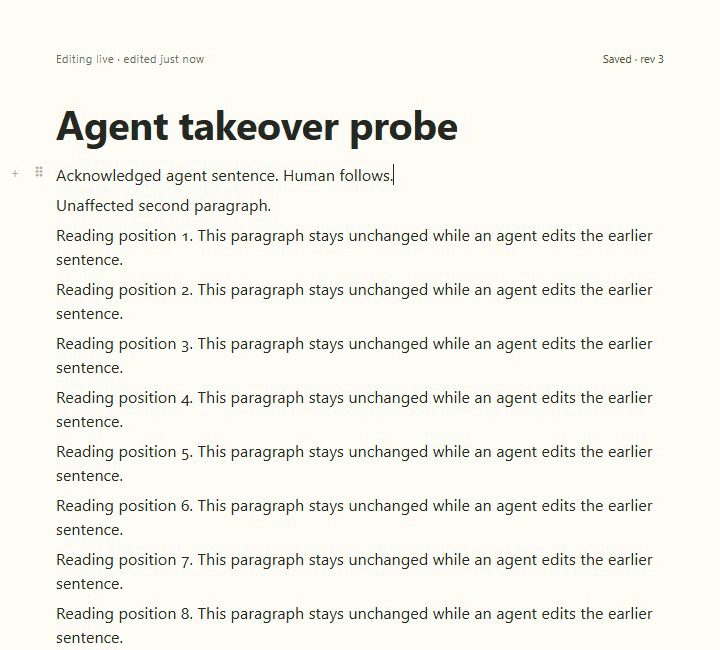

# Agent edit takeover

E002 closed with eight passing real-server cases at Barkdown `663a12a` and upstream `bb3bd299d`. Acknowledged agent text survives the person's next input, selection stays in its intended paragraph, and the first Undo receipt no longer pushes the document.

[Reviewed evidence and continuous video](runs/2026-09-21T23-35-14-407Z/README.md) · [before-fix data-loss diagnosis](before-fix/README.md) · [handoff and limits](../../cycles/E002-agent-takeover.md)

This uses real Paper, PortableDoc operations and the production revision-checked agent adapter against disposable data. Dedicated motion has no model turn. Keyboard, pointer, beforeinput and Chromium IME take over immediately; reduced motion, hidden panes and focused offscreen reading are covered. A separate current status showcase includes real Codex.

The guarded editor API requires upstream `bb3bd299d`; the older a544 bundle safely retains its prior revision and offers reload. Upstream merge readiness is not established: existing save-ack and press-watchdog tests still fail, and parent PR19579 is OPEN/BLOCKED. No merge or deployment occurred.

## Changelog

- 2026-09-22: reviewed final 8-case proof, narrow receipt, all GIF excerpt frames and sampled continuous video; preserved rejected receipt-shift run and original loss diagnosis.
