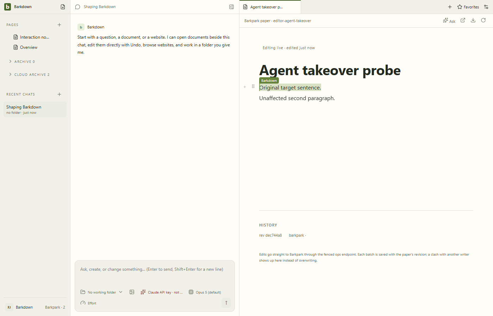
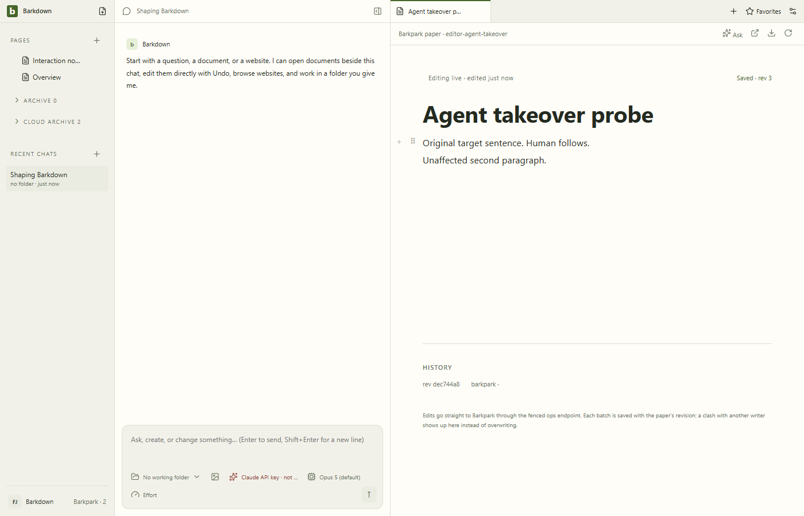

# Before-fix diagnosis: acknowledged agent text lost during takeover

Captured 2026-09-21 on Barkdown runtime `096e93e` and upstream `a5440345caa413087ac6488cac67f19fce58fa0f`, with an uncommitted diagnostic harness. This is retained failing evidence, not visual approval. Disposable runtime `b7ti00` stopped after the failed assertion.

The production agent adapter saved `Acknowledged agent sentence.` at revision 2. While the idle editor remained focused, selection presentation began but the canvas queued the external update. Human typing then saved `Original target sentence. Human follows.` at revision 3. The host had advanced its revision without the editor accepting that content. The result JSON contains the actual visible and server blocks.

Next evidence must show both the acknowledged agent sentence and human input preserved on screen and on the real server, with exact source provenance.
