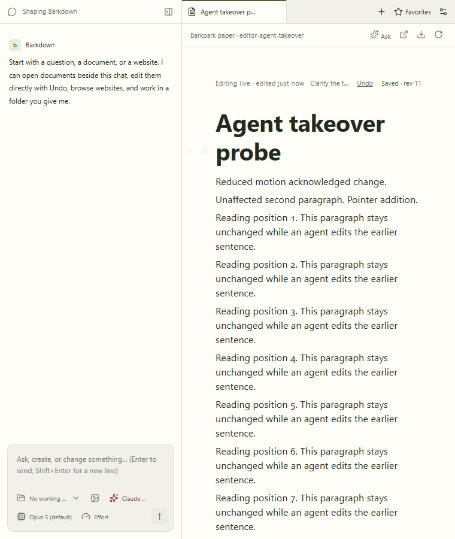

# Reviewed live Paper takeover

Clean Barkdown `663a12a` and Barkpark `bb3bd299d`. Eight real-server cases passed. [Exact provenance](manifest.json), [named review](review.json), and [continuous video](agent-takeover.webm).

The GIF is an unretimed 27–34 second excerpt of the real Electron video, cropped to the editor at 720×650, 10fps. It shows normal motion and the first receipt without shifting the document. No model turn or simulated save is used; the production agent adapter supplies acknowledged server edits. The full video also contains real keyboard, beforeinput, Chromium IME and pointer takeover, reduced motion, a hidden pane and offscreen reading.

All eight stills, all 70 excerpt frames and 107 one-second full-video samples were inspected. The prior afc9c79 run remains unapproved historical evidence because its receipt shifted the document. Existing upstream save-ack and watchdog failures are outside the passing E002 claim.
