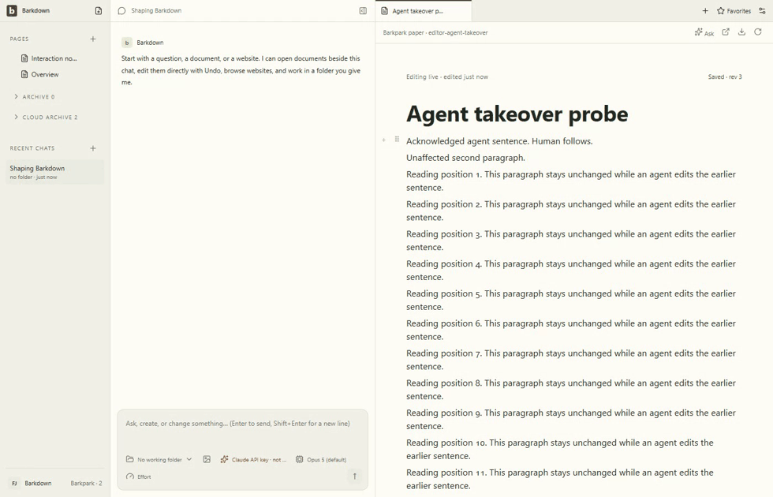

# Combined Paper takeover review

Source `ae49f97`, real Paper source `bb3bd299d`; eight live scenarios passed and the owned runtime stopped. [Manifest](manifest.json) retains exact source, served bundle and artifact hashes. [Named review](review.json) records actual inspection of eight stills, 92 full-video samples at 1 fps and 70 samples at 10 fps around first receipt insertion.

[Continuous original recording](agent-takeover.webm) includes keyboard, beforeinput, IME, pointer, reduced motion/narrow, hidden and offscreen cases. No model turn is implied. Later source changes require their own validation; rich-content selection is E003 work.
