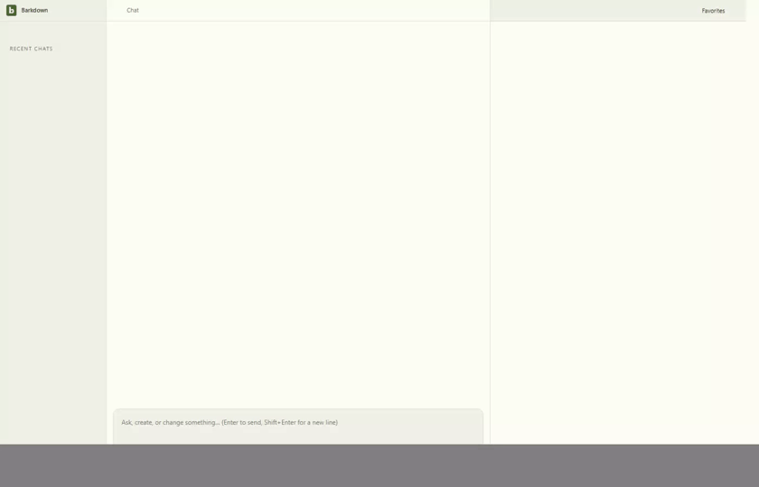

# Actual API Paper edit and Undo

Source `d8423e7`, upstream `01dfdd663`; clean inputs. Actual SDK, Electron and disposable Paper server; model output is scripted. All four journey assertions passed. Four full-resolution stills, 38 video samples and 36 decoded GIF frames reviewed. [Manifest](manifest.json), [review](review.json), [continuous video](api-paper.webm).

