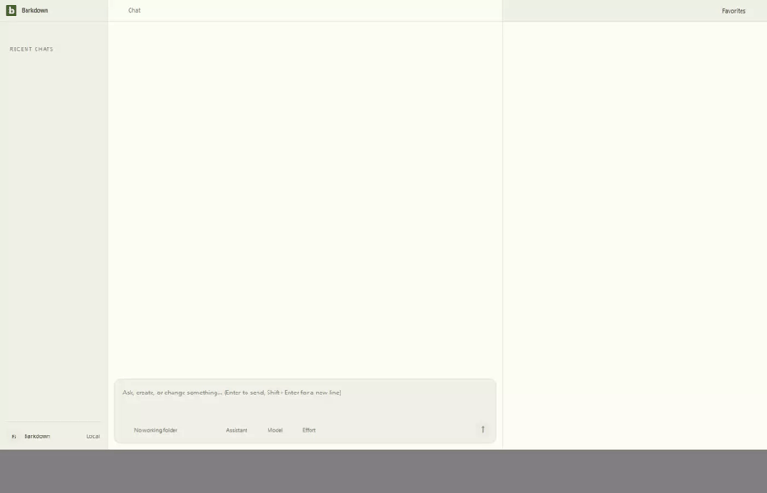

# Stable Paper block identities and native history

E012 corrects three actual editor defects: duplicated paragraph identities after Enter, missing checklist identity attributes, and recovery projection mutating live nested schema attributes. The last defect created phantom edits that intercepted native Undo.

[Cycle handoff](../../cycles/E012-block-identity.md) · [Failed-first split](baseline/mounted-54579.txt) · [Failed-first recovery ownership](baseline/recovery-attrs-ffb09de73.txt) · [Full upstream validation](validation/full-bf23f773c.txt).

The final connected source bf23f773c serves JS SHA1 `3a94a2964b37358f3ec791f009a2f52b28cffb0d`. Ten mounted regressions and the full upstream suite pass. The actual native journey preserves complete server/live identities through split, typing, checkbox changes, Undo/Redo and reload at revisions1–9.

[Full native review](runs/2026-09-22T07-07-27-792Z/review.json) covers nine stills and30 raw-video samples, including900px narrow layout. [Independent checklist proof](runs/2026-09-22T07-02-22-244Z/review.json) isolates the history correction. Original failed native attempts remain beside these runs. Long titles still clip in the existing single-line title control; this work does not claim a title-layout correction.

These are connected-source proofs. Fallback/pin consumption and final combined application visual validation remain separate; the existing E011 fallback is still54579 at this checkpoint. Nothing here establishes upstream merge readiness or deployment.
