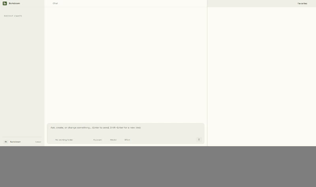

# Editor cache integrity

C025 source e95fcb6; capture b93f832. [Actual manifest](runs/b93f832/manifest.json) and [review](runs/b93f832/review.json) distinguish synthetic corruption/isolation from live Paper status.

The production resolver rejected A's modified JavaScript, loaded only B's verified cache after switching, and used explicit vendor fallback after B restarted without a cache. Four stills and 19 video samples reviewed; original WebM files retained beside them. No cross-profile substitution observed. Digests detect corruption, not adversarial authenticity; vendor is not asserted to match upstream.

[Earlier unapproved framing](runs/2026-09-22-TrBILZ-framing/README.md) remains preserved. Narrow provenance was below the fold; the corrected fixture scrolls the actual Settings panel before capture. Product source did not change.
