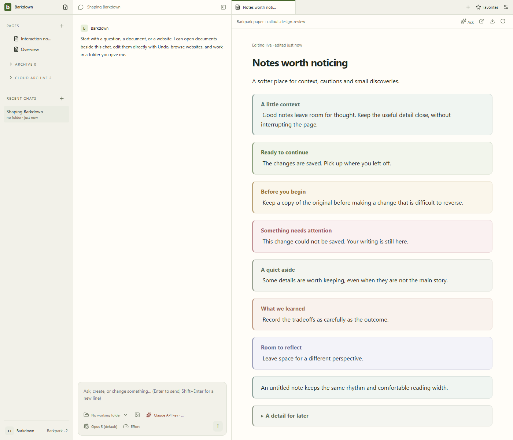
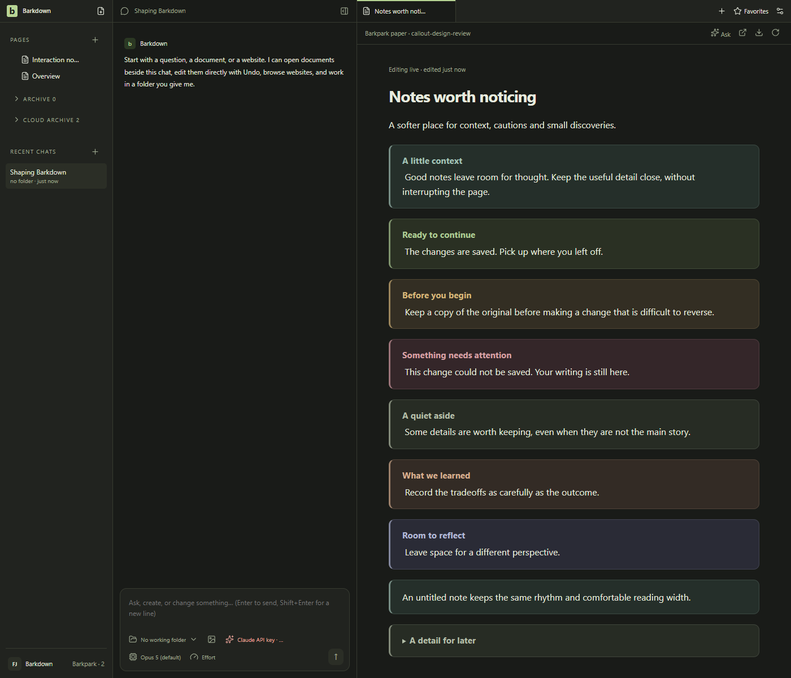
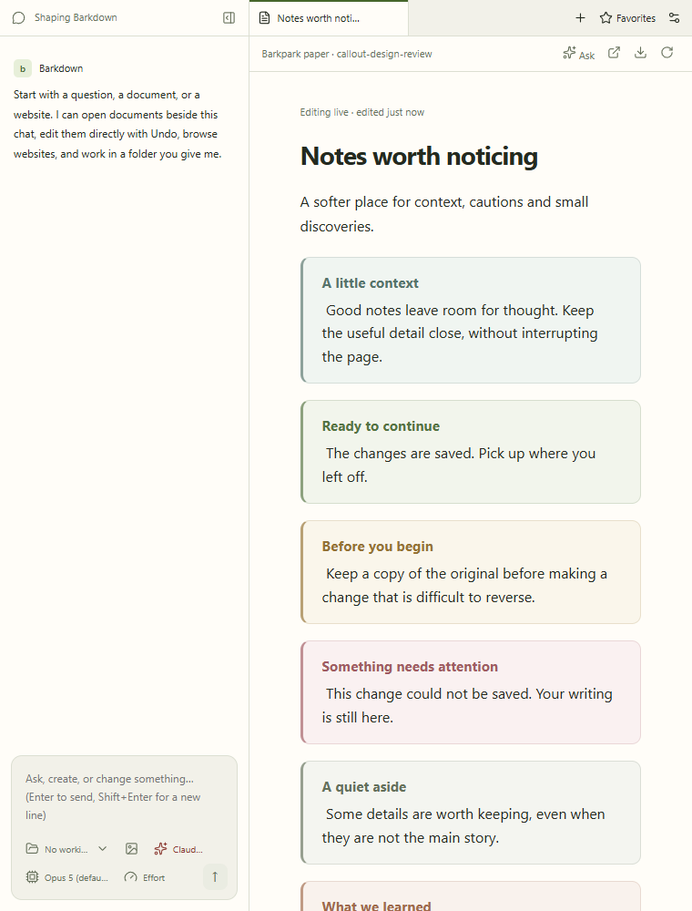
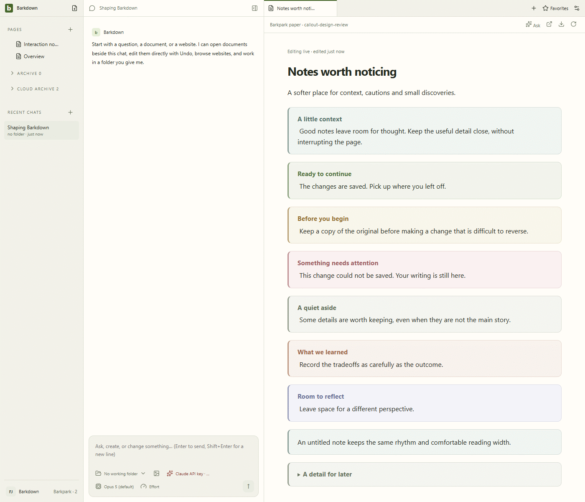

# Paper callouts

C038 at source ae8024f; real Paper served by isolated Barkpark bf23f773. Eight stills and all six GIF frames reviewed; four native editing/server checks passed. [Review](runs/2026-09-23T00-40-11-290Z/review.json) · [Manifest](runs/2026-09-23T00-40-11-290Z/manifest.json) · [Cycle](../../cycles/C038-callout-polish.md).

The GIF records action checkpoints, not continuous typing. Title and body edits plus disclosure state were acknowledged by the server and survived reload. No provider call occurs in this fixture.

## Changelog

- C038: soft tonal surfaces, restrained borders, separate editable titles, seven tones and narrow review.
- Earlier 00-38 run is retained as rejected title-layout evidence; its body/folding assertions passed but titles remained inline.
