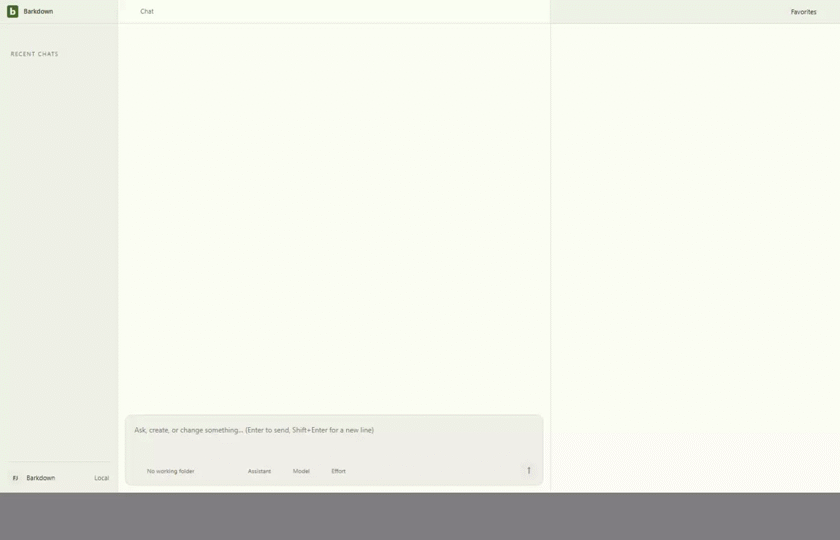
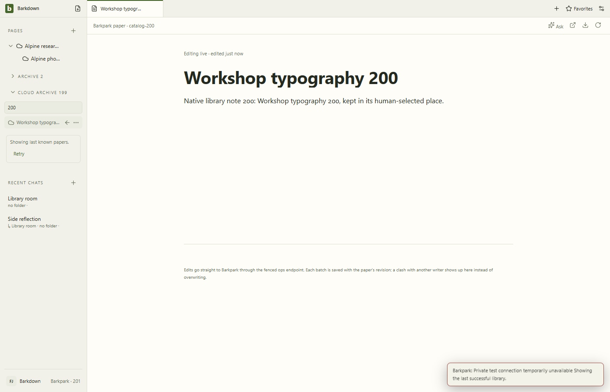

# Complete Paper library

C056 verifies complete foreground discovery over real HTTP and explicitly scoped CLI:200papers, then201, failure/retry, connection ordering and restart. Pages and main/side drafts remain intact. The private relay injects transport failures only.

[Reviewed native gallery](runs/2026-09-24T05-08-29-090Z/README.md) · [Cycle handoff](../../cycles/C056-complete-catalog.md). Capture with `npm --prefix app run test:paper-catalog:isolated` and an explicit built `BARKDOWN_TEST_BP_SOURCE`. This is observed discovery, not an atomic snapshot or migration activation. Provider lists remain limited; local Archive classification is still pending.

## Changelog

- 2026-09-24: reviewed eight native stills and37 decoded GIF frames. Corrected restart capture waits for actual Paper content; prior failed and superseded captures remain retained.
