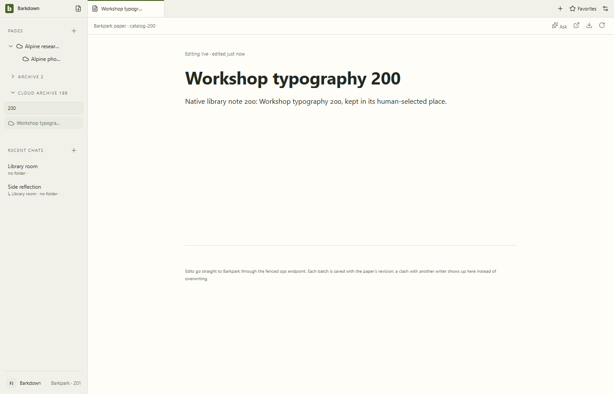

# Reviewed native catalog discovery

Actual isolated Barkpark30c007e43, Barkdown0321161. HTTP and explicitly scoped CLI return200 then201 unique papers; the desktop opens a paper beyond the first page. Controlled relay faults exercise failure/retry and late responses without replacing server content. Human Pages, main/side drafts and restart are preserved. All eight stills and37 decoded GIF frames inspected.

[Original manifest](manifest.json) · [Review](review.json) · [Derived provenance](derived/manifest.json). Earlier failures and the superseded loading-state gallery remain retained. Offset discovery is not an atomic snapshot. No authority activation or local/cloud origin reclassification.
