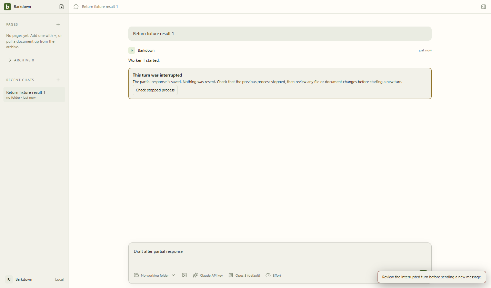
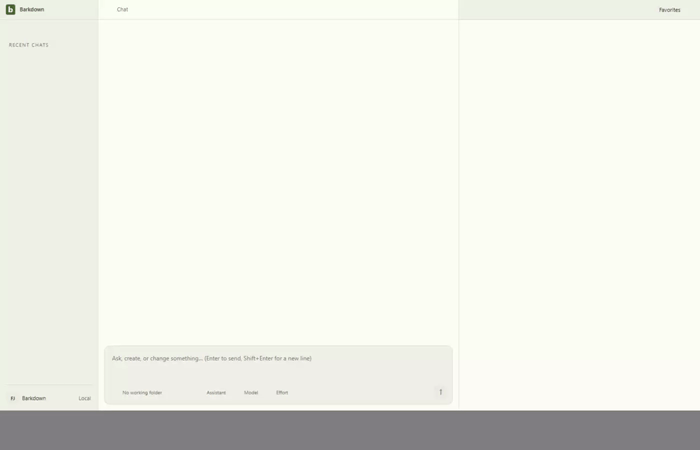

# Ordinary chat recovery

Managed Windows chats preserve partial work after an abrupt app exit. A stopped-process check precedes explicit review of possible changes; allowing a new turn never resends the interrupted prompt.

## Evidence

Source e3a6554, clean actual capture 23139, disposable tp1w78. The [manifest](e3a6554/manifest.json) records all3 owned jobs verified stopped. [Review and media hashes](e3a6554/review.json) bind the5 screenshots,3 continuous videos and derived frames. The actual API SDK talks to a local deterministic HTTP fixture; this is process/persistence evidence, not an external model demonstration.

- [Verified review](e3a6554/verified.png), [new explicit turn](e3a6554/new-turn.png), [side chat](e3a6554/side-interrupted.png), [narrow side review](e3a6554/side-verified-narrow.png).
- [Parent recovery video](e3a6554/page@04d21c4f391597e5de14354fc28b72a0.webm), [side restart video](e3a6554/page@a21fc5f8b99794a3ed39feb72ddc99c8.webm), [initial launch video](e3a6554/page@ba1af2023cc0c4caacf375d20e400c40.webm).
- [Cycle scope and validation](../../cycles/C014-chat-recovery.md); [unchanged deterministic comparison](../runs/2026-09-22T01-03-52-492Z/README.md). Separate live Paper regression passed at the same source; five stills and all 37 GIF frames reviewed. See [source manifest](../../images/status/history/C014-e3a6554.json) and [review](../../images/status/history/C014-e3a6554-review.json).

## Limits and changelog

2026-09-22: actual forced main exits for parent and side chat, no replay, partial text, draft, uploaded attachment, folder/model/parent persistence, verified shutdown, explicit review/newturn, shared narrow UI. Reviewed5 full stills,32 one-fps samples and all 88 raw frames used by the recovery GIF (83 encoded frames after duplicate coalescing). The1px fixture image proves stored attachment ownership/preservation, not rich-image fidelity. Raw videos retain natural startup and toast frames; abrupt exits can truncate tails.

Legacy nonprofile conversations and non-Windows containment remain outside this milestone. Older attempts without owned receipts stay blocked. Run npm --prefix app run test:chat-recovery; BARKDOWN_CHAT_RECOVERY_OUT selects a fresh evidence directory.

Earlier source9135723 evidence is retained in [its original manifest](9135723/manifest.json) and [review](9135723/review.json). Final e3a6554 prevents a late start acknowledgement from restoring a stale running control after early interruption.
