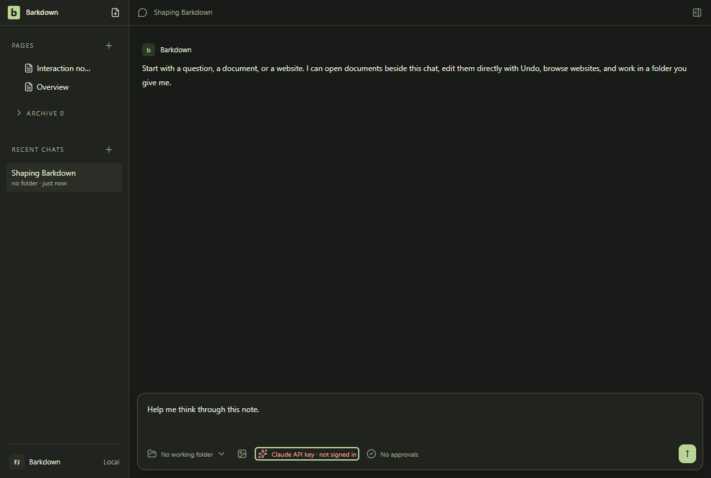
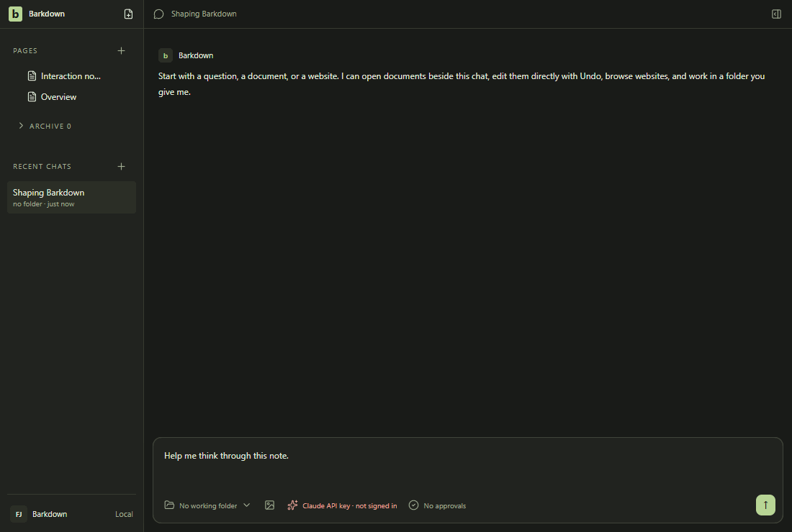

# chat

Shared main composer: draft, provider chooser and model chooser. No message is sent.

[Full comparison](../runs/2026-10-14T02-32-26-495Z/README.md) · [Capture manifest](../runs/2026-10-14T02-32-26-495Z/manifest.json)

## Changelog

- 2026-10-14T02:39:29.790Z: Inspected all44 candidate action stills via four sheets and the full-size Settings difference. Geometry/environment remain exact; the sole difference is a disposable command-path suffix. Narrow profiles/goals, adoption busy/refusal/recovery, menus and light/dark comparison frames remain readable. Actual native Windows Sup/Sub81 passes9/9 at de2 with wrong-range non-mutation and all original8 cases; four native stills and15 sampled motion frames were inspected, with the original13.08s video retained. Fresh real Paper capture82 is inspected separately: five stills and all37 encoded GIF frames, including slash/quote typing, table and quick-open transitions. Providers were unavailable and the transcript is explicitly sample; no real-provider, current-merged-source, installation or stage acceptance. Product shortcut/router, pin and application renderer are unchanged; sameec74 Linux proof remains pending. Source de2f3f7ca; [review](../reviews/approval-19772919abebe6e9ae9c5bd7c27890bd21cb8c363d51ed504658ea7b968e085d.json) - [comparison](../runs/2026-10-14T02-32-26-495Z/comparison.json).
- 2026-10-13T19:30:49.877Z: Inspected all44 action stills via four sheets plus full-size Settings difference after the HTML-history test repair. Every geometry/environment matches; only a disposable command-path suffix differs. Narrow profiles/goals, menus, adoption busy/refusal/recovery and dark contrast remain readable; light fixtures retain their explicit theme-comparison purpose. Actual Windows live gaps02 passes13/13 against disposable carried138, with native500ms group interval,571ms idle and event20→21 before strict Undo/Redo/server checks. All13 live action stills and29 one-fps motion samples inspected separately; original26.92s video retained. Failed01 remains diagnostic, not accepted. Application runtime/pin/UI and existing root demo unchanged. Source 8c8907eb9; [review](../reviews/approval-780245c049f31f47701de623c76678d6ec374bea104132f439de876dc2c64c4b.json) - [comparison](../runs/2026-10-13T19-26-25-388Z/comparison.json).
- 2026-10-13T18:53:23.815Z: After adding three strict quote model tests to the existing88-command Desktop chain, inspected all44 fixture action stills through four sheets and the full-size Settings difference. Every frame geometry and environment matches; only the disposable command-path suffix changes. Narrow profiles/goals, adoption busy/refusal/recovery, menus and dark contrast remain readable; light frames retain the explicit theme-comparison purpose. Full paired20/20, deliberate named Tab failures with aggregate red and restored11/11 with aggregate green are retained separately as Linux live proof. Existing hosted Windows88commands/five skips pass at5e0; new Desktop test-list wiring still needs fresh hosted confirmation. No application/runtime/pin behavior or root demo change. Source d749e1892; [review](../reviews/approval-38f5e625b68580ecb83f3f327c287550f60cfd4d165c7a54927868bf2562f344.json) - [comparison](../runs/2026-10-13T18-50-49-354Z/comparison.json).
- 2026-10-13T18:11:23.791Z: Inspected all44 action stills through four contact sheets, full-size Settings Assistant/difference and narrow profile Settings. Geometry unchanged on every frame; the only pixel difference is the disposable command-path suffix. Intermediate menus, narrow goals/profiles, adoption busy/refusal/recovery and dark contrast remain readable. Light document/retained frames serve the existing theme comparison. Fixture recordings are scripted reduced-motion actions, not live editor proof. Three strict quote-contract tests pass; live gap run38444480330 is still pending. Test-only change leaves the existing root demo applicable. Source c4ebd9a19; [review](../reviews/approval-61ebb553fdbcc99acde03312b6748a819950300f812d209b5c5eaef3264788b5.json) - [comparison](../runs/2026-10-13T18-09-01-492Z/comparison.json).
- 2026-10-09T04:32:19.882Z: Reviewed all44fixture stills,44difference images and44encoded GIF frames through contact sheets, plus original narrow workspace/goals/profiles/adoption and Settings. Only measured pixel change is the disposable CLI path; geometry unchanged. Seventeen new browser/agent-browser images reviewed. Dark default; required light frames review theme contrast. Full Windows Desktop1163196ms/88commands passes; actual packaged Paper/reader six native images and native lifecycle remain separate. Fixed80column reader overflow remains open; no installer, live provider, Studio, Mac or A2/A3/A5 acceptance. Source 7634348c0; [review](../reviews/approval-a350d16e9fee56bea7cf552e8f663ca774f2e1183313730586688357d4aea3d7.json) - [comparison](../runs/2026-10-09T04-30-29-731Z/comparison.json).
- 2026-10-08T12:59:14.021Z: Reviewed all44 fixture frames, all37 lossless and37 encoded live editing frames, five live stills, Settings before/after/diff, narrow profiles and Score selection; dark default, light contrast comparison. Sole fixture difference is random temporary CLI path (0.00021499), geometry/environment unchanged. Separate packaged terminal wide/narrow images and real restart/zero-active quit passed; native OS-only PATH fallback and ownership regression passed. Live source capture serves0.2.26.5027; it is distinct from the carried production package. Full Desktop and root checks remain pending. No installer, Mac transfer or A2/A3/A5 acceptance. Source 78a885f67; [review](../reviews/approval-8f45c8b8deb528a4778000ca3847a2ffe46b18e62f393008076ec64cc55c4eec.json) - [comparison](../runs/2026-10-08T12-55-29-276Z/comparison.json).
- 2026-10-08T11:52:58.137Z: C098 retention fix e0426211: all44 fixture frames inspected in contact sheets; Settings before/after/diff and narrow profiles/goals inspected full-size. Sole pixel difference is random temporary CLI path; geometry/environment unchanged. Five live stills plus all37 lossless and37 encoded editing frames inspected separately; table Score selection/edit preserved. Retention/lifecycle20 checks pass22.094s; actual capture preserves1304 earlier runtime directories and prior1917files byte-identically. Carried package lifecycle/reader evidence remains separate; optional upstream80-column TUI overflow, installer and A2/A3/A5 are not accepted. Source e04262114; [review](../reviews/approval-2de372e492a3dc28a226f5b5c6d85a65e308f289c35577d18fa79200ed7ad916.json) - [comparison](../runs/2026-10-08T11-51-09-225Z/comparison.json).
- 2026-10-08T08:34:56.717Z: Capturefa6775a0 after preserving-tool repair:43 of44 standard PNGs are byte-identical to capture02, whose entire gallery and full-size narrow goals/profiles/adoption were inspected. Opened the sole changed Settings assistant frame; only the random owned CLI path differs, changedRatio0.000242, all geometry/environment unchanged. Opened five fresh live Paper stills and inspected all37 lossless editing frames through seven contact sheets, including slash/quote typing, table selection/Tab and quick-open transitions. Dark default; light stills explicitly compare contrast. Actual Claude read/edit turn against isolated carried release, no real library. Full Windows Desktop02 passes814.562s, five existing skips; native06/Electron03 independently prove owned restart/crash recovery. No installer, clean-machine, Mac transfer or A2/A3 acceptance claimed. All earlier captures/failures remain retained; preserving inventories never approve media. Source fa6775a05; [review](../reviews/approval-2e4f478c7c8259fe4c48952f4c9c6220b87f67716bb60c7a0f1b8ce51e72acac.json) - [comparison](../runs/2026-10-08T08-32-40-709Z/comparison.json).
- 2026-10-08T08:18:24.311Z: Inspected all44 standard candidate frames across nine areas, full-size narrow goals/profiles/adoption, all37 lossless live Paper editing frames and five live stills, plus decoded GIF overview/palette frames. Candidate230e5d76 corrects capture default to dark; document/retained light frames explicitly compare theme contrast. Environment and all control geometry unchanged; large pixel changes follow theme selection, with readable menus, dialog actions and no overlap. Live isolated capture records actual Claude turn. Actual Windows driver-native-06 and Electron03 prove restart/forced host recovery separately; fixture tours do not establish live scheduler, migration, installer or A2/A3 acceptance. First capture remains retained/unapproved. Full Desktop rerun is pending after documented skip-ratchet repair. Source 230e5d769; [review](../reviews/approval-118c9e2ea5017a5fc8e6afbf58f11f535977ef00caf0cd5b1c018485ceccc3d6.json) - [comparison](../runs/2026-10-08T08-15-25-190Z/comparison.json).
- 2026-10-08T02:16:06.708Z: Capture36 at d3c1705b: inspected 44 standard stills, 44 differences and 44 motion frames, five Paper stills and 37 GIF frames. Enlarged Settings, both 390px Goals states and Paper frames29/36. Only temporary Settings command path differs (ratio0.00015970515970515972), no geometry regression. Light fixtures retain theme/contrast purpose; dark root demo remains applicable. Three final dark native import-journal frames reviewed: full unfinished-import explanation is readable before/after restart. Six malformed journals refuse actual IPC selection; valid imported/ordinary controls pass.39 adjacent tests pass; final native8.958s. Original native bypass and all harness failures retained; capture35 superseded before approval for CI artifact output. Paper uses real isolated server and labeled sample transcript, no provider turn. No actual interrupted database restore, Mac transfer or A2 acceptance. Source d3c1705b2; [review](../reviews/approval-73b2ebec60ed10c7bc42ec50c24dd6af5f5fd7425a70cfda06750f6f3f1868f2.json) - [comparison](../runs/2026-10-08T02-14-29-183Z/comparison.json).
- 2026-10-08T01:55:07.681Z: Capture34 at 8873261f: inspected 44 standard stills, 44 differences, 44 motion frames, five private Paper stills and 37 GIF frames; enlarged Settings, both 390px Goals states and Paper frames 29/36. Only temporary Settings command path differs (ratio 0.00019287469287469287), no geometry regression. Light fixtures retain theme/contrast comparison purpose; existing dark root demo remains applicable. Four dark two-installation native images and 17 hosted coordinator images reviewed. Native portability passes in 326807ms and exits 17.159ms after final result; original 90-second rejection deadline preserved. This test harness is outside hosted Desktop. Hosted31 passes at 8863e703; prior intermittent startup delay remains unexplained. Paper uses a real isolated private server with explicitly labeled sample transcript and no provider attempt. No Mac transfer or A2 acceptance. Source 8873261fa; [review](../reviews/approval-bd49b810baa5c9dcb4c7c58f45a1ed1ba38c046041c9a12a892e04dc315e5630.json) - comparison (`docs/visual/runs/2026-10-08T01-51-57-455Z/comparison.json`, kept in git history).
- 2026-10-08T01:08:32.871Z: Capture33 at b05d39bf startup diagnostics. Inspected44 standard stills,44 differences,44 motion frames, five private Paper stills and37 GIF frames; enlarged Settings, both390px Goals states and Paper frames29/36. Only temporary Settings command path differs (ratio0.00019656019656019656), no geometry regression. Existing light fixtures preserve theme/contrast comparisons. Also reviewed17 native coordinator and18 applicable terminal/original-history images; hosted failure30 nine images retained. Five diagnostics/five ownership checks, ordinary/recovery phase assertions and20 remaining Desktop commands pass locally. Hosted startup delay remains unresolved; no deadlines or receipt semantics changed. Paper uses real private server with explicitly labeled sample transcript and no provider attempt. No Mac transfer or A2 acceptance. Source b05d39bf3; [review](../reviews/approval-027f29b41e9ef8b733824c710d273318e4757e6def8920b56555dab8bec1867a.json) - comparison (`docs/visual/runs/2026-10-08T01-07-05-447Z/comparison.json`, kept in git history).
- 2026-10-08T00:21:40.386Z: Capture32 at22594902 after import-count implementation84d1a56f. Inspected44 standard stills,44 differences,44 motion frames and five private Paper stills plus37 GIF frames; enlarged Settings, both390px Goals states and Paper frames29/36. Only temporary Settings command path differs (ratio0.00021744471744471745), no geometry regression. Light fixtures preserve existing theme/contrast coverage. Four dark native refusal/valid-transfer images and roadmap also reviewed. Native420.850s and77 adjacent tests pass. Paper uses real private server with explicitly labeled sample transcript; no provider attempt here. Capture31 remains rejected for tracked documentation changes during capture. No Mac transfer or A2 acceptance. Source 22594902d; [review](../reviews/approval-a536ae99d9cb523346aa6c7bf7c43e8d08443c91ab2b968aa047a64b2461517c.json) - comparison (`docs/visual/runs/2026-10-08T00-20-16-897Z/comparison.json`, kept in git history).
- 2026-10-07T23:47:09.331Z: Corrected capture30 attestation, same0802b65b candidate: all44 stills/differences/motion frames and five Paper stills/37 GIF frames inspected; Settings,390px Goals and Paper29/36 enlarged. Only temporary command path differs; geometry unchanged. Prior attestation incorrectly carried forward sample-transcript wording. Actual manifest chat.real=true/provider=claude and inspected transcript show one completed read/edit turn; no sample fallback. Capture omitted the earlier blocker environment setting. This proves one disposable-profile Claude turn, not broader provider continuity, Codex success or Mac transfer.40 export units,109 adjacent checks and Windows two-installation journey pass; first native launch failure retained. Light fixtures retain theme/contrast coverage; native dark frames and roadmap separately inspected. Source 0802b65b8; [review](../reviews/approval-816bb797407f5549d1583d8ed57d139dbf16af2c7553b5cc92f64169f5d72940.json) - comparison (`docs/visual/runs/2026-10-07T23-42-58-824Z/comparison.json`, kept in git history).
- 2026-10-07T23:45:01.707Z: Export-count repair at 0802b65b. Inspected all 44 standard stills, 44 differences and 44 motion frames, plus five private Paper stills and all 37 GIF frames. Enlarged changed Settings, both 390px Goals states and Paper frames29/36. Only temporary command path differs (0.01855 percent); no geometry change or new clipping. Existing light fixtures retain theme/contrast coverage; dark native transfer frames and roadmap reviewed separately. Paper uses a sample transcript with a real isolated editor; no provider success or Mac transfer claimed.40 export units,109 adjacent checks and actual two-installation journey pass; separate native launch failure retained. Source 0802b65b8; [review](../reviews/approval-208d92a9f91d4d5724785afa0fc6a673f8f93afd325c7a6efc401fcff5e3bce4.json) - comparison (`docs/visual/runs/2026-10-07T23-42-58-824Z/comparison.json`, kept in git history).
- 2026-10-07T22:03:36.903Z: C097 at39c06b94: inspected all44 standard stills/differences and44 motion frames, five private Paper stills and37 GIF frames in16 sheets; enlarged Settings path,390px Goals and Paper29/36. Only temporary Settings command path differs (0.0002162162), geometry unchanged. Planning/retry, drafts, retained originals, menus and narrow layouts remain readable. Native start-action evidence:50 inspected images, ordinary/recovery and22 resumed commands pass; synthetic delayed success and no-dispatch refusal retained alongside an unexplained earlier synthetic dismissal. Private real Paper uses labeled sample transcript; light variants preserve theme/contrast and original-failure comparison. No native latency-rootcause, real-provider, Mac-transfer or A2 claim. See docs/cycles/evidence/C097/coordinator-click-review.md. Source 39c06b943; [review](../reviews/approval-bc24f3e45d3d9f813f13034437598f4556d211e85d9eae573e04b6e990c3ac02.json) - comparison (`docs/visual/runs/2026-10-07T22-02-07-072Z/comparison.json`, kept in git history).
- 2026-10-07T20:39:10.685Z: C097 source9a74a3af: inspected all44 standard stills,44 differences,44 motion frames, five Paper stills and37 GIF frames; enlarged Settings assistant,390px Goals and Paper29/36. Only temporary Settings command path differs (ratio0.00020761670761670762); no geometry change. Controlled original30s failure and delayed repaired pass retained; ordinary recovery and all21 resumed Desktop commands pass. Segmented validation, not an uninterrupted Desktop pass. Private live Paper uses a labeled sample transcript. Existing light fixtures retain theme/contrast comparison; dark Paper and Original history also reviewed. No Mac transfer or real-provider claim. Source 9a74a3af2; [review](../reviews/approval-b5a18e4e93c34e74070ccdd52087b4e5edd7d387227cda9c08804592ccd16510.json) - comparison (`docs/visual/runs/2026-10-07T20-35-47-119Z/comparison.json`, kept in git history).
- 2026-10-07T19:43:11.187Z: C097 final source d7bf87e8: inspected all44 standard stills,44 differences and44 motion frames; five Paper stills and37 GIF frames in16 sheets, with enlarged Settings assistant,390px Goals and Paper29/36. Only temporary command path differs (0.00022604422604422604); geometry unchanged.32 focused tests and native ownership/CLI/Full YOLO/in-flight checks pass. Full Desktop failed at terminal Settings navigation; addressed terminal shortcut and all17 resumed steps pass, not an uninterrupted suite pass. Original cause unconfirmed; failure retained. Native dark evidence separately reviewed; existing light fixtures cover theme/contrast. Private Paper uses labeled sample transcript; no real-provider,real-library or Mac-transfer claim. Source d7bf87e8b; [review](../reviews/approval-d749e10c538bb30207066a3c0df5044fca4ac5a13174ffa504922bc7df4a9673.json) - comparison (`docs/visual/runs/2026-10-07T19-36-08-034Z/comparison.json`, kept in git history).
- 2026-10-07T19:12:25.022Z: C097 assistant ownership at 92292586: inspected all44 stills,44 differences and44 decoded standard motion frames plus five private Paper stills and37 GIF frames in16 sheets. Enlarged Settings assistant,390px Goals and Paper frames29/36. Only temporary command path differs (0.0002199017199017199); geometry unchanged.32 focused tests and native A/B,CLI,Full YOLO,in-flight selection checks pass; dark native screenshots separately inspected. Existing light fixtures preserve theme/contrast coverage; private Paper uses labeled sample transcript without provider attempts. Full Desktop running; no real-library,real-provider or Mac-transfer claim. Source 922925865; [review](../reviews/approval-f50ae4f9aab4fe9a21b736d4f7a0054622e9c6a7fbb7132982032e230ac6a358.json) - comparison (`docs/visual/runs/2026-10-07T19-09-35-907Z/comparison.json`, kept in git history).
- 2026-10-07T18:44:43.911Z: Capture25 reviewed: all44 standard stills,44 difference images,44 decoded motion frames, five private Paper stills and37 GIF frames in16 sheets. Enlarged Settings assistant,390px Goals and Paper frames29/36. Only the temporary command path differs (0.0002063882063882064); control geometry unchanged. Existing light fixtures retain theme/contrast comparison; native catalog evidence is dark. Private Paper uses a labeled sample transcript without provider attempts. Sixty targeted cases and actual CLI refusal/retry pass; controlled focus loss plus28 resumed Desktop commands pass, with original full-suite failure retained. No uninterrupted suite, real-library, real-provider or Mac-transfer claim. Root demo remains applicable because layout/editor behavior is unchanged. Source 759c6c4f8; [review](../reviews/approval-1c4878f36d54d10ddbd08798f7efa2233f69175089b0d4a62b839671bb4b6251.json) - comparison (`docs/visual/runs/2026-10-07T18-43-27-355Z/comparison.json`, kept in git history).
- 2026-10-07T18:23:09.148Z: Catalog command repair at3213c2e5, captured6b72a193. Reviewed44 standard stills,44 differences,44 decoded motion frames and five private Paper stills plus37 GIF frames in16 contact sheets; enlarged Settings assistant and Paper frames29/36. Only the temporary Settings launcher path differs (ratio0.0002027027027027027), no geometry change. Reviewed four actual dark CLI catalog journey stills, including720px drawer/Retry: page-2 refusal exits1, cache/Pages preserved, retry returns201 fresh notes, genuine empty success distinct.60 targeted cases and unchanged3-case probe pass. Existing light fixtures retain theme/contrast comparison; Paper uses labeled sample transcript, no provider attempt. Full Desktop running; no hosted repair, real-library or A2 acceptance claim. Root editing demo remains applicable: no layout/editor behavior change. Source 6b72a1932; [review](../reviews/approval-27ee7ae4d9e2fadb10c6f97571c77aacfabc934645e2441547b8b0d2be653bfb.json) - comparison (`docs/visual/runs/2026-10-07T18-21-27-282Z/comparison.json`, kept in git history).
- 2026-10-07T17:55:46.075Z: C097 coordinator startup diagnostics67e6ddf1. Inspected44 standard stills,44 differences,44 decoded motion frames and five private Paper stills plus37 GIF frames in16 contact sheets. Enlarged Settings assistant and Paper edit/restoration frames29/36; ten native coordinator recovery images reviewed, including full-size390px completion. Only the temporary Settings command path differs (ratio0.00019901719901719902), no geometry change. Existing light fixtures preserve theme/comparison coverage; private Paper uses an explicitly labeled sample transcript. Two diagnostic tests pass162ms; actual Windows descendant query passes; native crash/review/retry passes33.002s. Hosted zero-request/zero-receipt startup failure remains unconfirmed; this is diagnostics only. Full Desktop is running, no hosted repair or provider claim. Root editing demo remains applicable because production rendering/editing is unchanged. Source 67e6ddf10; [review](../reviews/approval-356c3732e63ad5d87f9d5c0cc578cb8ccd28a7631e2bec6f89b3b5bebb0e43d7.json) - comparison (`docs/visual/runs/2026-10-07T17-53-00-261Z/comparison.json`, kept in git history).
- 2026-10-07T16:00:23.996Z: Pending-launch quit repair f4d3ae5d. Inspected44 standard stills,44 differences,44 decoded motion frames,five private Paper stills and37 GIF frames in16 contact sheets; enlarged Settings assistant,narrow Goals/profiles and Paper frames28/29/36. Only temporary Settings command path differs (ratio0.0001977886977886978); geometry unchanged. Score selection,edit and restoration preserve adjacent text. Seven final dark native admission/renderer-refusal images inspected,including720px; draft persistence and zero late dispatch are behavior assertions.21 focused tests,64 adjacent(one POSIX skip),native admission6.389s and renderer refusal24.610s pass. Existing light fixtures cover theme/contrast; private Paper uses a labeled sample transcript. No real-provider,backend recovery,Mac,real-library or installer acceptance. Hosted coordinator failure retained; local replay passes but cause unconfirmed. Root editing demo remains applicable. Source f4d3ae5da; [review](../reviews/approval-40a359506131df10bc105aedaf355b1f2305b8112361cd48a07bbb7a6293afde.json) - comparison (`docs/visual/runs/2026-10-07T15-58-16-316Z/comparison.json`, kept in git history).
- 2026-10-07T15:09:37.717Z: Backend quit receipt repair e9af9e7e: inspected44 standard stills,44 differences,44 decoded standard motion frames,five private Paper stills and37 GIF frames in16 contact sheets. Enlarged Settings assistant,narrow profiles/goals and Paper frames28/29/36; score selection/edit/restoration preserves adjacent text. Only temporary Settings command path differs (ratio0.00019533169533169533), no geometry change. Three final dark native backend refusal/retry/reopen images inspected full size, including720px. Actual Electron uses a controlled failed cleanup receipt; native dialog requests are intercepted, so no dialog-layout or process-death proof. Original two failures retained;39 adjacent cases pass with one POSIX skip,8 focused pass and actual native repeated refusal4.778s. Existing light fixtures cover theme/contrast; private Paper uses a labeled sample transcript. No backend-service reopening,real provider/child,Mac,real-library or installer acceptance. README editing demo remains applicable. Source e9af9e7e6; [review](../reviews/approval-9d2c3384e980efca079f2a760a53af3f018b3f6a30401453e5f2b3c3eb6cb805.json) - comparison (`docs/visual/runs/2026-10-07T15-05-55-021Z/comparison.json`, kept in git history).
- 2026-10-07T14:32:56.155Z: Service quit ordering at9e44b9d2: inspected all44 standard stills,44 differences,44 decoded motion frames,five Paper stills and37 Paper GIF frames across16 contact sheets. Full-size Settings assistant,narrow profiles/goals and Paper frames28/29/36 reviewed; score selection/edit/restoration preserves adjacent text. Only temporary Settings command path differs (ratio0.00016953316953316954), geometry unchanged. Four dark native refusal/retry images inspected full size, including720px toast and unobstructed natural expiration. Existing warning temporarily overlaps composer controls. Native before failure17.051s, repaired replay23.101s and normal regression22.916s prove Goals/existing and new terminal continuity;42 adjacent pass,one POSIX skip. Prepared-export quit117.057s passes at committed source. Existing light fixtures cover theme/contrast; private Paper uses labeled sample provider transcript. README demo remains applicable. No backend-drain failure recovery,active real provider/goal,Mac,real-library or installer acceptance claimed. Source 9e44b9d2e; [review](../reviews/approval-46b9f782aeab415f2f7d80c1256403b012edca399692746323832a8085eceb45.json) - comparison (`docs/visual/runs/2026-10-07T14-30-23-180Z/comparison.json`, kept in git history).
- 2026-10-07T14:09:33.231Z: Reviewed source e9563ed4: all 44 standard stills, 44 differences and 44 decoded motion frames; five Paper stills and all 37 Paper GIF frames across 16 contact sheets. Full-size Settings, narrow profiles/goals and Paper frames 28/29/36 inspected. All ten native workspace-quit images inspected. Only standard difference is temporary Settings command path, ratio 0.00019656019656019656, geometry unchanged. Native warning toast temporarily overlays composer controls; natural expiration and unobstructed narrow frame reviewed. Current native quit/refusal/retry/restart 10.537s and clean-frozen export/quit 120.141s pass. Units 6 workspace, 6 handshake, 55 Paper, 5 preparation and 55 adjacent pass. Existing light fixtures cover theme contrast; native captures dark. Private Paper uses labeled sample provider transcript. No real-provider, Mac transfer, real-library or full shutdown acceptance claimed. Source e9563ed4b; [review](../reviews/approval-216da15440bebc8b90f364d15fe9054084574701d6a35ec9a79162750291a44a.json) - comparison (`docs/visual/runs/2026-10-07T13-59-58-497Z/comparison.json`, kept in git history).
- 2026-10-07T13:08:04.734Z: Verified Paper shutdown repair; capture source 500dfb32, app inputs through 41afd5f4. Inspected all 44 standard stills, 44 differences, 44 decoded standard motion frames, five private Paper stills and all 37 Paper GIF frames across 16 contact sheets; targeted full-size Settings, profile form, narrow goals and Paper frames 28/29/36. Only changed pixels are the temporary Settings command path (ratio 0.0002063882063882064); geometry unchanged. Inspected all ten retained native images from runs 02/03/04, including dark refusal and 720px layouts. No new clipping, overlap or missing controls observed; scrollable layouts remain bounded. Behavior proof: 55 host and four handshake cases, 64 adjacent checks; native save/death/refusal/retry/restart 212.541s at eaf2cd31, clean-frozen export/quit 118.167s at 41afd5f4. Rejected dirty-source capture remains unapproved. Existing light fixtures cover theme/contrast; native refusal images and applicable README demo are dark. Private Paper server with visibly labeled sample provider transcript; no real-provider success claimed. Mac, real-library, full shutdown and installer acceptance remain open. Source 500dfb32f; [review](../reviews/approval-036fcb51765d18f763eff952832705a1ec7287fedc7576985940f3e9f72add0e.json) - comparison (`docs/visual/runs/2026-10-07T12-59-48-045Z/comparison.json`, kept in git history).
- 2026-10-07T12:05:30.449Z: Clean frozen Paper quit repair at source 954d0864, implementation f4368062. Inspected all 44 standard stills, 44 differences and 44 decoded motion frames; five private-runtime Paper stills and all 37 GIF frames in 16 contact sheets. Full-size Settings, narrow goals/profiles, and Paper frames 28/29/36 checked. Only temporary Settings command path text changed; geometry, dialogs, focus, intermediate edits and table cells remain correct. Light fixtures cover theme contrast; dark root demo remains applicable to unchanged interaction. Native export-to-quit replay at f4368062 passed 120.774s with actual saved:true, frozen lock intact and no warning; 51 host and 64 adjacent tests passed. Sample provider transcript explicitly labeled; no real-provider or Mac-transfer claim. Dirty frozen shutdown remains outside this bounded fix. Source 954d08648; [review](../reviews/approval-2c29a650565b284aeb4059385b1fd707cdf9bd6f373effcb5b18daa762e058a1.json) - comparison (`docs/visual/runs/2026-10-07T12-00-52-216Z/comparison.json`, kept in git history).
- 2026-10-07T11:41:56.413Z: Inspected44 standard stills/differences and44 decoded motion frames; five Paper stills/37 GIF frames, full-size Settings/narrow Goals/profiles and table frames28/29/36. Only temporary command path characters differ, no geometry change. Paper Tab edits Score and preserves Fixed in. Native import/Undo/recovery and two-installation identity text checks pass, two dark native images inspected. Retained quit warning remains unresolved. Light fixtures serve theme/contrast regression; dark root demo remains applicable. Sample transcript, no new provider attempt; no real-library/Mac-transfer acceptance. Source ebad31b82; [review](../reviews/approval-27fb472cb992e556d0cc66c77b444d1473137417896c5d99beed8d96cedb1afc.json) - comparison (`docs/visual/runs/2026-10-07T11-39-53-163Z/comparison.json`, kept in git history).
- 2026-10-07T10:59:00.870Z: Inspected all44 standard stills/differences and44 decoded motion frames, plus five private Paper stills and37 GIF frames. Full-size changed Settings and narrow Goals/profile views checked. Only temporary command-path characters differ; geometry unchanged. Paper frames28/29/36 now edit Score and preserve Fixed in, paired with selection/content assertions. Capture12 rejected and retained. Light fixture/theme comparison and Paper contrast coverage; dark root hero/demo remain applicable. Sample transcript, no provider retry.34 adjacent export/import checks and headless native logical export53.042s pass; no real-library or Mac transfer claim. Source 009314fd9; [review](../reviews/approval-e9cba441fad86fe7b27d524664f55c4e971d2bbd4997f87c98429e29f6d48984.json) - comparison (`docs/visual/runs/2026-10-07T10-56-47-815Z/comparison.json`, kept in git history).
- 2026-10-07T10:22:16.978Z: Inspected 44 standard stills and differences, all 44 decoded motion frames, five private Paper stills and 37 editing frames. Full-size changed Settings and narrow Goals/profile layouts inspected: only temporary command-path characters change; no geometry change. Light fixtures retain baseline/theme regression coverage; Paper light is contrast comparison. Paper transcript is sample with no provider attempt. Runtime application source b4e85d7f remains unchanged by the subsequent atomic test-clock repair; root dark demo remains applicable. Native logical export is headless, with no new UI claim. Source b4e85d7fc; [review](../reviews/approval-8a62e2ff4acb175ef3061f8851674979543b179a3c69d311f55bd1ef56fc77e4.json) - comparison (`docs/visual/runs/2026-10-07T10-13-40-517Z/comparison.json`, kept in git history).
- 2026-10-07T09:46:36.895Z: Inspected44 standard stills and differences plus44 decoded GIF frames at7d894206.43 stills unchanged; Settings Assistant has a shorter temporary command path on one line instead of two, moving the provider section upward. Full-size before/after inspection found no clipping or control loss; geometry change is disclosed. Narrow, intermediate and recovery states reviewed. Light fixture views retain baseline theme/contrast coverage; dark retained/document and Paper views reviewed. Five private Paper stills and37 decoded motion frames inspected; transcript explicitly sample, no provider attempt. Archive path behavior is proven separately by before/after refusal and adjacent tests; native portability closeout remains separate. Source 7d8942066; [review](../reviews/approval-064474ee55e15b0f2d9e7f8a2dc3de71ca2fc3cab55c2b891c053ce2262dcb69.json) - comparison (`docs/visual/runs/2026-10-07T09-43-25-077Z/comparison.json`, kept in git history).
- 2026-10-07T07:46:23.869Z: Inspected 44 standard stills, 44 differences, 44 decoded standard GIF frames, five Paper stills and 37 decoded Paper GIF frames. Full-size Settings before/after, dark Paper hero and connection Settings inspected. Also inspected 17 native coordinator stills, ten controlled focus-loss stills and two hosted pre-failure images, including interrupted/narrow views. Only temporary Settings path differs; geometry unchanged. No new clipping or overlap. Light scenes cover contrast and preserve failing native theme; sample transcript remains explicit. Source a19a1b762; [review](../reviews/approval-3416e55efdb691721d423754e477a03194260752e3ed5dea45595ebbf9e488a9.json) - comparison (`docs/visual/runs/2026-10-07T07-41-42-615Z/comparison.json`, kept in git history).
- 2026-10-07T07:04:23.575Z: Inspected 44 stills, 44 differences, 44 decoded standard GIF frames, 5 Paper stills and 37 decoded Paper GIF frames; full-size changed Settings before/after, Paper dark hero and connection settings; two native recovery screenshots. Only temporary command-path text changed; geometry unchanged. Light frames retain theme/contrast coverage. No new clipping or overlap; existing GIF shadow bands and narrow canvas padding retained. Source 3cc671171; [review](../reviews/approval-326ad3e3d8429da7c6f7312f3f106bcf9a0ecf3ed7d16f7c96f0f9c702652736.json) - comparison (`docs/visual/runs/2026-10-07T06-59-28-713Z/comparison.json`, kept in git history).
- 2026-10-07T06:20:26.495Z: Inspected all 44 stills, all 44 difference images and all 44 decoded GIF frames; enlarged Settings Assistant before/after. Only temp-path text changed, with stable geometry. Native adoption and real short-path regression pass. Existing light fixtures retain theme/contrast coverage; dark Paper hero remains current. No new visual regression found; existing GIF palette bands/narrow padding remain. Source 7f3f4d197; [review](../reviews/approval-aeadd7244feacaf8443c96705fd78fcc95a936a0a54b31517e7df8e3c9ba913e.json) - comparison (`docs/visual/runs/2026-10-07T06-18-14-648Z/comparison.json`, kept in git history).
- 2026-10-07T05:48:12.897Z: C097 at368108c5: inspected all44 stills,44 difference images and44 decoded GIF frames, including narrow layouts and theme contrast.43 stills are identical; the sole Settings change is the longer disposable command path wrapping to two lines, inspected before/after full size. No environment change; existing fixture GIF palette bands and narrow padding remain. Fresh private Paper:5 stills and37 GIF frames inspected, with an explicitly labeled sample transcript and recorded prior provider blockers; no real-provider attempt claimed. Final keyboard proof:8 native checks,4 dark stills and37 video samples reviewed. Project-file Settings refusal and terminal-focus shortcut pass; interaction78 and resumed Desktop checks pass. Failures remain retained. Source 368108c52; [review](../reviews/approval-6d5d351320821801d2aab9aacaeb384c0bcd94d803a855752ed9b8ad9c38ec6c.json) - comparison (`docs/visual/runs/2026-10-07T05-45-55-273Z/comparison.json`, kept in git history).
- 2026-10-07T05:14:08.744Z: Reviewed all44 stills,44 differences and44 decoded GIF frames at a1470fbe, with Settings before/after inspected full-size.43 stills identical. The temporary command path is shorter, wraps to one line instead of two, and moves the provider area upward; this explains the sole geometry flag. Controls remain reachable. Existing GIF palette bands and narrow padding are unchanged. Light scenes retain theme/contrast coverage. Interaction tour77 passes; Windows editor matrix20/20 and writer proof are retained separately. Matrix review exposed the existing Control+, Settings collision, still open; this gallery does not approve that editor shortcut journey. Live Paper at928f1933 remains applicable without restamping. Source a1470fbe9; [review](../reviews/approval-51d0940f8a2eca70d730cd055e56adfc5de37d5759d42e2b9bd5ebd1f0984544.json) - comparison (`docs/visual/runs/2026-10-07T05-12-13-344Z/comparison.json`, kept in git history).
- 2026-10-07T04:50:21.144Z: C097 CI repair at c75024bc: inspected all 44 stills, 44 difference images and all 44 decoded frames across nine GIFs, including intermediate states, narrow layouts and dark/light contrast coverage. Forty-three stills are pixel-identical; the only pixel change is the disposable command-line path in Settings, inspected before/after full size. Geometry and environment are unchanged. Existing fixture GIF palette bands and narrow padding remain; this test-only change adds no UI regression. Native login six checks, ten stills and eighteen 2-fps video samples reviewed; desktop queue passes in retained resumed receipts ci-desktop-01/02/03, with original failures preserved. Existing live Paper capture remains applicable because production and status-capture inputs did not change; its labeled sample transcript is not real-provider proof. Native POSIX creation-time test collection remains unverified. Source c75024bc9; [review](../reviews/approval-b6233c57ef3b1e84cbb59b942595604ca8189965800f05d7be2aea121d66564f.json) - comparison (`docs/visual/runs/2026-10-07T04-48-18-581Z/comparison.json`, kept in git history).
- 2026-10-06T22:47:24.717Z: C097 Windows return: inspected all 44 stills, 36 difference images and 44 decoded frames across nine fixture GIFs, including narrow dialogs, menus and intermediate states. Intentional changes since C080 reflect the Mac-delivered read-only originals, retained-note coverage, profile export/import, provider controls and Electron 44.5.1. Existing fixture GIF palette bands and narrow-frame padding remain. Separately inspected five live Paper stills and 37 decoded frames; its corrected fallback visibly says sample transcript (Claude quota, Codex timeout), so no real-provider success is claimed. Native browser/terminal, switch/rollback/Resume, forced-exit recovery and two-installation Windows import pass; evidence and limits in docs/cycles/evidence/C097/README.md. Light frames retain theme/contrast regression coverage. No real-library, cross-machine, installer or complete Windows editor-matrix acceptance. Source 928f19336; [review](../reviews/approval-12df93fbccb8e16bed953880e8eda9c8e23b997696587701e4230ecc3698b6b5.json) - comparison (`docs/visual/runs/2026-10-06T22-45-08-629Z/comparison.json`, kept in git history).
- 2026-09-26T00:01:15.212Z: C080: inspected 40 stills, 40 differences and all 40 decoded frames across eight fixture GIFs, including narrow dialogs. No pixel or geometry changes against the accepted baseline. Existing fixture GIF palette bands and narrow-frame padding remain; live Paper uses its separate reviewed capture. Scoped 81 and migration 85 checks, full desktop, real comparison and native owned navigation/restart pass. No activation or real-library migration. Source df621915e; [review](../reviews/approval-a95dd8bc3bbefc92ee0f7df39bbf8d6bd507c2639fe1ce99c288dbbe7fab56be.json) - comparison (`docs/visual/runs/2026-09-25T23-59-37-682Z/comparison.json`, kept in git history).
- 2026-09-25T21:17:00.791Z: C079: inspected all40 stills and40 decoded frames across eight fixture GIFs; enlarged narrow goals. No new clipping or missing controls. Zero pixel and geometry changes, same environment. Existing GIF palette bands remain. Light fixtures cover established theme regression. Real native entry13/13 and Find6/6 pass with observation-only caret acknowledgement; native13 stills/67 video samples and live Paper5 stills/37 GIF frames reviewed separately. Real Claude and table headers6/6. Harness-only change; production source unchanged and C078 desktop regression remains applicable. No cutover or A2 completion. Source fa01c1e14; [review](../reviews/approval-d6591c76f98975b9e3fd040f6ca63690a6388d22c332a2aa17e84f030d7a9095.json) - comparison (`docs/visual/runs/2026-09-25T21-15-05-183Z/comparison.json`, kept in git history).
- 2026-09-25T18:55:34.688Z: C078: inspected all 40 stills and 40 decoded frames across eight fixture GIFs in contact sheets, enlarged narrow goals. Zero changed pixels or geometry versus previous baseline. Checked menus, focus, narrow dialogs, reachable footer controls and theme comparison; no new UI regression observed. GIF palette bands remain an existing fixture encoding limitation. Light fixtures retained for established theme regression; dark live Paper and native preparation reviewed separately. Full desktop passed 658.516s; real comparison preserved 204 variants plus two staged targets. Internal read-only adapter, no migration UI or cutover. Root README demo remains applicable because no renderer behavior changed. Source 81e807ac8; [review](../reviews/approval-d6847435e9cac2a2d6427461633e8c342b21127bb9dbc673489eefd96af15aff.json) - comparison (`docs/visual/runs/2026-09-25T18-51-30-482Z/comparison.json`, kept in git history).
- 2026-09-25T16:59:12.610Z: C076: inspected all40 fixture stills and decoded frames of8 GIFs, including narrow layouts, menus, theme comparison and adoption. Comparison reports no geometry changes and all frames within tolerance; no new clipping observed. Light fixture theme retained for baseline/theme regression comparison; new native preparation gallery is dark. Full desktop passes at4c030a0c; separate reviewed native retained-draft/cancel/restart evidence lives in docs/visual/profile-preparation/README.md. Fixture approval does not prove live Paper saves, migration or portability. Source 839efbe2e; [review](../reviews/approval-1a3695ff366638e853da139b3b9170cc7cfb5a0f291eb63aeed2515de52f4c3c.json) - comparison (`docs/visual/runs/2026-09-25T16-56-52-628Z/comparison.json`, kept in git history).
- 2026-09-25T12:51:31.779Z: C075 final source e4a60ac9: inspected all40 stills,40 differences and40 decoded step-GIF frames, including narrow workspace/goals/profiles/adoption, menus, focus and error states. Same Windows environment; zero changed pixels or geometry. Existing step-GIF quantized shadow bands remain; full stills retain actual gradients. Full desktop and30 focused stream/goal checks pass. Native writer4 stills,81 raw1fps samples and51 excerpt frames plus live Paper5 stills/37 GIF frames separately inspected; live Claude edit and6/6 table checks pass. No new clipping or control loss. No migration activation, durable dirty-draft recovery or child teardown claimed. Source e4a60ac9b; [review](../reviews/approval-f4022c289339ae25e54aa5922f092a4f19249bb0bd72fea353e31043c52a38e1.json) - comparison (`docs/visual/runs/2026-09-25T12-49-16-707Z/comparison.json`, kept in git history).
- 2026-09-25T12:02:03.028Z: C075 source 4e618ef7: inspected all 40 candidate stills, 40 differences and 40 decoded fixture GIF frames, including intermediate menus, narrow layouts and themes. Comparison reports zero changed pixels and unchanged control geometry. Existing quantized fixture GIF shadows remain; stills are authoritative for gradients. Full desktop and 13 writer admission/process checks pass; private real Paper parity passes 20/20 at runtime-identical 6033ee4. Native writer refusal and live Paper reviewed separately; no migration activation or abrupt-restart draft recovery is claimed. Source 4e618ef7b; [review](../reviews/approval-1537b78f5e5e8715183a5ba0cbb75d6f683f0138c8dca0df0ddd04535e007fc3.json) - comparison (`docs/visual/runs/2026-09-25T11-56-14-104Z/comparison.json`, kept in git history).
- 2026-09-25T10:35:36.682Z: Reviewed all 40 stills, 40 diffs and all decoded frames of eight fixture GIFs. Changes are the intended Original history settings row and current vendor hash; narrow settings remains scrollable. Separate native history, fallback and live Paper evidence reviewed in C074. Light fixtures retained for contrast comparison; no migration authority or rollback claim. Source a126c7185; [review](../reviews/approval-3efcddd12f1c0e051148934339e9a4a4f05fcc6ba17d227a6c3ff8000efa619c.json) - comparison (`docs/visual/runs/2026-09-25T10-28-54-722Z/comparison.json`, kept in git history).
- 2026-09-24T21:54:31.595Z: C071: inspected all 40 fixture stills, 40 differences and 40 GIF frames; no visual or geometry changes. Inspected 8 native deletion/restart/copy stills and all 195 sampled video frames, including narrow dialog and completed repeated recovery navigation. Reviewed 5 live Paper stills and 37 editing GIF frames; real Claude/private upstream ae6065545. Fixed missing recovery dialog padding and corrected premature native navigation assertion; earlier candidate retained unapproved. Full desktop suite, 47 upstream tests and real HTTP lost-response/recreated-original/later-copy-edit checks pass. This accepts the bounded local draft recovery journey, not general crash recovery, migration activation or portability. Source aa8c6dc00; [review](../reviews/approval-91d258ec1f78ebd432f0a887370a5750b2bd01b92c9d482fbf49714d97975bf8.json) - comparison (`docs/visual/runs/2026-09-24T21-50-50-790Z/comparison.json`, kept in git history).
- 2026-09-24T20:41:03.532Z: C069 source 8a277bb: inspected all 40 stills, 40 difference images and 40 fixture GIF frames, including narrow layouts, menus, profile/recovery and side-chat states. No pixel, geometry or environment changes from accepted baseline. Existing palette banding in fixture GIF modal shadows remains; PNG geometry is intact. Full desktop and focused ownership/context checks pass; real server API/MCP and native creation/edit/profile/restart/Undo/human-revision guards pass separately. Live Paper five stills and all 37 GIF frames inspected; real Claude on a disposable runtime. Native ordinary-note model decisions are scripted, not a real-provider claim. No P2 completion, migration activation or deletion/recovery claim. Source 8a277bb7c; [review](../reviews/approval-341bbd4d754ca600ab2765eef89e764a7fd7e11b868c9847a843e787796e6f96.json) - comparison (`docs/visual/runs/2026-09-24T20-38-11-017Z/comparison.json`, kept in git history).
- 2026-09-24T18:59:18.870Z: C067: inspected all 40 fixture stills, 40 difference images and 40 decoded GIF frames, including narrow layouts, menus and profile recovery. No pixel or geometry changes against the prior fixture baseline. Full desktop and 66 focused checks passed; isolated real tables 11/11 and live Paper 5 stills/37 GIF frames reviewed separately. Ordinary draft-note native proof is recorded in the dedicated Paper notes gallery; fixture approval does not prove migration or recovery. Source 46854ef60; [review](../reviews/approval-c486ceafa9b6da94648ce4fd7d6d7ecd825d09ea3fa2e50ce7dc1277a6c7fb96.json) - comparison (`docs/visual/runs/2026-09-24T18-55-59-622Z/comparison.json`, kept in git history).
- 2026-09-24T09:46:36.638Z: C060 after code-health README checkpoint a7431bf: all40 stills,40 difference images and40 decoded GIF frames actually inspected again; unchanged pixels and geometry. Behavior source7e15949 remains identical: full desktop, tables11/11 and two-profile Archive/native restart503 Retry passed;8 native stills/333 full GIF frames/29 excerpts reviewed. Prior live5/37 reviewed with real Claude/tablehead6/6; another live capture follows to satisfy conservative directory freshness. Palette banding remains in fixture modal shadows. No ordinary blank-note or migration activation claim; fresh Linux pending. Source a7431bfc0; [review](../reviews/approval-2bb61600b319788053fc26837e4aa6478c26e2883dafd5b8ab3d3dac1fb9c899.json) - comparison (`docs/visual/runs/2026-09-24T09-45-10-153Z/comparison.json`, kept in git history).
- 2026-09-24T09:42:43.501Z: C060 source7e15949: all40 candidate stills,40 difference images and40 decoded fixture GIF frames actually inspected; pixels and geometry unchanged. Separately reviewed native Archive8 stills/333 full GIF frames/29 excerpt frames across two real managed profiles, restart, manual loopback and503 Retry. Live Paper5 stills/37 GIF frames inspected with real Claude and tablehead6/6. Full desktop and targeted tables11/11 pass. Existing fixture GIF shadow palette banding remains; fixtures do not prove provider motion. No ordinary blank-note or migration activation claim. Corrected Linux table setup awaits fresh exact-head CI. Source 7e15949f9; [review](../reviews/approval-02751c395fc227a997f001470a494feb69008efb481a432d313e281abfc9404f.json) - comparison (`docs/visual/runs/2026-09-24T09-40-57-333Z/comparison.json`, kept in git history).
- 2026-09-24T09:02:56.687Z: C059 source a11621d: inspected all40 candidate stills,40 difference images and40 decoded fixture GIF frames; comparisons and geometry unchanged. Also inspected5 live Paper stills and37 decoded live GIF frames (real Claude turn; tablehead6/6). Expanded native navigation9/45, retained-evidence11/58 and open-buffer9/48 still/GIF frames separately reviewed with actual restart and guarded Undo assertions. Full desktop and local20/20 parity pass. Existing fixture GIF modal-shadow palette banding remains; fixtures do not prove live provider motion. Unknown saved references remain preserved, never guessed. Source a11621d74; [review](../reviews/approval-56044c0fddd5920b9767311e11e8dc2cdf5f918a3063a6ad8a1aed401c3f22fe.json) - comparison (`docs/visual/runs/2026-09-24T09-00-59-893Z/comparison.json`, kept in git history).
- 2026-09-24T07:44:48.607Z: C058 source 72d8f64: actually inspected all 40 candidate stills, 40 difference images and 40 decoded fixture GIF frames; all comparisons unchanged with stable geometry. Also inspected all five live Paper stills and all 37 decoded live GIF frames. Native ownership proof separately reviewed 11 stills and 58 decoded frames. Existing fixture modal-shadow palette banding remains; fixture tours do not prove live provider motion. Title changes explicitly refuse because no guarded title endpoint is supported. Source 72d8f64c0; [review](../reviews/approval-ed73e7c3897f1fa0765da98152de6e29ed918fa2fae4e0139c9565d9d2548bcb.json) - comparison (`docs/visual/runs/2026-09-24T07-38-20-900Z/comparison.json`, kept in git history).
- 2026-09-24T05:58:28.255Z: C057: inspected all40 candidate stills and40 difference images plus40 decoded frames from8 fixture GIFs; all pixel and geometry comparisons unchanged from C056. Menus, theme contrast, narrow goals/profiles/recovery and side-chat composer retained. Fixture GIF palette banding is existing and separate from native evidence. Also inspected9 real Paper connection stills (including full-size820px recovery),47 decoded native GIF frames and5 live status stills plus37 live GIF frames at0e4b891. One recovery notice and disabled proposal controls verified after fixing superseded first native presentation. Native13 foreign-bound operations sent zero requests; Retry, guarded Undo, explicitly scoped CLI and restart passed.16 binding and37 source-host tests pass; full desktop rebuilt8da8d0f passed, final notice changes covered by focused/native tests. Native2fps derivative samples can omit brief states; stills and original WebM retained. In-session ownership only; durable receipt/bookmark identity remains separate. Source 0e4b8913c; [review](../reviews/approval-19569a6c0bc997857f06d9c56e9821a4c6c7502328161d3e347ba1759f8d7d88.json) - comparison (`docs/visual/runs/2026-09-24T05-55-41-168Z/comparison.json`, kept in git history).
- 2026-09-24T05:20:50.829Z: C056: reviewed all 40 fixture stills/diffs and 40 decoded GIF frames, five live Paper stills and 37 live GIF frames at744123f; native0321161 reviewed eight stills and37 decoded frames. Native200/201 HTTP+CLI, failure/retry, connection ordering, Pages/drafts/restart and39 focused/full desktop checks pass. Geometry unchanged and all fixture comparisons within tolerance. Offset discovery is not an atomic snapshot; no authority activation. Source 744123fb9; [review](../reviews/approval-a035fffceec0d30e99a0fbc61dde2c35bba2825a50a600475ee4ff62e1a6ecbf.json) - comparison (`docs/visual/runs/2026-09-24T05-16-53-692Z/comparison.json`, kept in git history).
- 2026-09-24T03:54:56.220Z: Inspected three changed side-chat stills; only 1/255 RGB shadow at y731, no clipping or geometry change. Other 37 fixture stills and all eight GIFs byte-identical to reviewed C053. Inspected five fresh live Paper stills, full-size light view and all 37 decoded GIF frames: menus, typing, table selection, quick-open and modal geometry remain sound. Full desktop suite passes including 131 migration checks; reader has no UI and these captures do not claim a history viewer or authority cutover. Source 37635038d; [review](../reviews/approval-42476f73fb3e6a34cbd13dc074887a20ec6dfdf858df59e2c305f28728414725.json) - comparison (`docs/visual/runs/2026-09-24T03-50-53-994Z/comparison.json`, kept in git history).
- 2026-09-24T03:33:29.346Z: C053: inspected all three byte-changed side-chat stills; only 1/255 RGB at y731 shadow, no content/geometry/environment change. Other37stills and all8GIFs byte-identical to reviewed C052. Five fresh live stills and37decodedGIFframes inspected after real Claude turn; dedicated native navigation review covers10stills/30video+GIFsamples/8restart samples at af9d982. Full desktop exit0,107migration checks and35host checks pass. No authority switch; archive-origin and ambiguous closed-target blockers remain. Source a81695870; [review](../reviews/approval-cac19803051c269dd77f1f93aae22ab7f51d906a44599883333659a02977dea1.json) - comparison (`docs/visual/runs/2026-09-24T03-31-52-310Z/comparison.json`, kept in git history).
- 2026-09-24T02:55:27.847Z: C052 at18dbf8b: full desktop exited0 before capture. Compared40 fixture stills/eight GIFs to C051; only side-chat0/1/3 shadows differ by1 RGB level at741,570-1099,735 and side-chat GIF encoding differs. Actually inspected all three changed stills and all four decoded side-chat GIF frames; other37stills/sevenGIFs byte-identical to reviewed C051. Zero thresholded pixel, geometry or environment changes. Also inspected five fresh live Paper stills and all37 decoded live GIF frames from real Claude/private30c007, plus native source migration14stills,11source/38Paper/7restart video samples and38GIF frames. Ordinary default links/lists retain native save, exact Undo and restart; no activation or real-library migration. Existing narrow tab/provider truncation and loading placeholders remain limits. Source 18dbf8bc7; [review](../reviews/approval-58b08f0a7c8996556600972d34e49f5c139839c0f9c19dab495ff9c6a82a9e43.json) - comparison (`docs/visual/runs/2026-09-24T02-53-10-440Z/comparison.json`, kept in git history).
- 2026-09-24T02:22:38.310Z: C051: full desktop command exited0 before either capture. Inspected all three changed side-chat stills; only1/255 RGB shadow noise at740,570–1100,739, with zero thresholded pixel, geometry or environment changes. Other37stills and all8GIFs are byte-identical to the reviewed C050 baseline. Inspected all5fresh live Paper stills and all37decoded GIF frames after a real Claude turn. Separately inspected restored-profile7stills,15raw and15GIF frames,7restart samples;70migration checks and native restored drafts/media/history/proposals/save/restart pass. Existing narrow legacy title/provider truncation remains. No authority switch, portability or power-loss claim. Source 50b8fa154; [review](../reviews/approval-e339ddad9d39242c42d08638dec81cade1cbf9095fca8fad0c52ec89da4962de.json) - comparison (`docs/visual/runs/2026-09-24T02-20-44-771Z/comparison.json`, kept in git history).
- 2026-09-24T01:45:52.313Z: C050: inspected all three changed side-chat stills and all four decoded side-chat GIF frames; only 1/255 RGB shadow noise, zero measured pixel/geometry/environment changes. Other37 stills and seven GIFs byte-identical to reviewed C049. Current workspace view also inspected. Separate final live Paper capture at d53a5a7 has a real Claude turn; all five stills and37 GIF frames inspected. Dedicated bc1dc82 PNG proof reviewed ten stills,35 raw/decoded GIF frames and eight restart samples; native saved alt/width/delete Undo and interruption/restart passed. Full desktop exit0,51 migration checks and local tablehead6/6. Earlier overlapping standard capture remains unapproved; final captures ran after desktop completed. Narrow native image ALT/URL fields remain cramped; no general media or authority activation claim. Source d53a5a73e; [review](../reviews/approval-a272bdd133d02da31d393abf8359302cb096e788c9a675b49430b8b5012ce9ee.json) - comparison (`docs/visual/runs/2026-09-24T01-44-01-947Z/comparison.json`, kept in git history).
- 2026-09-24T01:07:52.360Z: C049: all 40 fixture frames and eight GIFs are byte-identical to the reviewed C048 baseline; zero pixel/geometry differences and no environment change. Current narrow workspace and side-chat images inspected. Dedicated paired native references: 38 stills, 103 source-video samples, all 103 decoded GIF frames and 20 restart samples inspected; previews/navigation fit, marks and content retained. Fresh live Paper: real Claude edit, five stills and all 37 GIF frames inspected in light/dark, menu, table and settings. 36 migration checks, full desktop and isolated table 6/6 pass. No media migration, authority cutover or power-loss claim; Linux table verification remains pending. Source fff311022; [review](../reviews/approval-56030e542634e0f7cb1a86a895945251ab9662b94a909da69ab6b8e29642b51e.json) - comparison (`docs/visual/runs/2026-09-24T01-06-09-705Z/comparison.json`, kept in git history).
- 2026-09-24T00:19:50.050Z: C048: inspected changed side-chat stills 0, 1 and 3 before/after and all four decoded side-chat GIF frames; no clipping, movement or control loss. SHA256 comparison binds remaining 37 stills and seven GIFs to the previously reviewed C047 candidate, carrying its narrow/intermediate review. All 40 comparisons have zero changed pixels above tolerance and no geometry/environment changes. Inspected five fresh live stills and all 37 live GIF frames after a real Claude turn: themes, quote insertion, table selection, quick-open and Settings remain usable. Dedicated migration review covers 31 stills, 96 video/GIF samples and eight restart samples, including full list break and narrow nesting. Native 21-case typing/save/exact Undo/restart, interruption recovery, full desktop and local table 6/6 pass. Fixture GIF shadow banding remains an encoding limitation; Linux table timeout and upstream integration gates remain separate. No real-library cutover. Source 5e0e58008; [review](../reviews/approval-1e288e06025a5439cd4508e65145332a59ecf2885af161667947f92caccff528.json) - comparison (`docs/visual/runs/2026-09-24T00-18-02-364Z/comparison.json`, kept in git history).
- 2026-09-23T23:34:36.527Z: C047: inspected before/after side-chat frames 0, 1 and 3; no visible clipping, movement or control loss. SHA256 comparison confirms remaining 37 stills and all eight GIFs byte-identical to fully reviewed C046 candidate 2026-09-23T22-51-45-914Z (approval b78e5353796bf89459a280083b2efaabab4e6dfff4d750a87916516b20fefbff); carry its narrow, intermediate and 40 decoded GIF frame review. Comparator reports zero changed pixels above RGB tolerance and no geometry/environment changes across 40 frames. Also inspected five fresh live stills and all 37 decoded live GIF frames: menus, themes, table selection and quick-open remain usable. Dedicated migration review covers 23 stills, 77 video/GIF samples and eight restart samples; native 16-case typing/save/exact Undo/restart, alignment checks, staging recovery and full desktop suite pass. Fixture GIF shadow banding remains an encoding limitation; real libraries and cutover remain untested. Source b837e13a0; [review](../reviews/approval-8abbcc1bd829c0b3de2885fc7af95b6f977883716d4f0776353bcf035eef0e98.json) - comparison (`docs/visual/runs/2026-09-23T23-28-38-198Z/comparison.json`, kept in git history).
- 2026-09-23T22:58:43.087Z: Inspected all 40 source stills and all 40 decoded frames across eight fixture GIFs, including menus, focus, themes, narrow layouts, goal states and adoption recovery. Comparison shows zero changed pixels or geometry differences. Controls remain reachable; fixture GIF palette banding around blurred modal shadows remains an encoding limitation visible in prior evidence, not a layout change. Separately reviewed five live Paper stills and 37 live GIF frames, plus migration 16 stills, 55 editing GIF frames and eight restart samples. Full desktop tests, ten-case native migration with Shift+Enter and saved Undo, and Linux parity run 35929675673 pass. Fixture tours do not prove live saves; those are covered by the private runtime tests. Source 5aafb68aa; [review](../reviews/approval-b78e5353796bf89459a280083b2efaabab4e6dfff4d750a87916516b20fefbff.json) - comparison (`docs/visual/runs/2026-09-23T22-51-45-914Z/comparison.json`, kept in git history).
- 2026-09-23T21:43:28.599Z: Final capture follows the code-area health cleanup. Reviewed current workspace and decoded side-chat sequence; 44 of 48 media files are byte-identical to the immediately preceding fully inspected 40-frame/eight-GIF tour. Three side-chat PNGs and their GIF differ in bytes but comparison reports zero changed pixels at its threshold and no geometry change; visual inspection found no regression. Separately inspected all five fresh live Paper stills and 37 GIF frames at 68fbdf5 / 844ecd321 after a real Claude edit. Migration media review covers 14 stills, 51 GIF frames and eight restart samples at fe8696c. Full Windows desktop suite passed with one POSIX-only skip; nine native migration edit/Undo/restart cases and 29 preflight/staging tests passed. Hard-break migration remains explicitly refused; no authority switch or full P2 acceptance. Source 68fbdf5fa; [review](../reviews/approval-fe99197d5c0e83b91920cc79aaf675e531d5bddbc5f30cb6cdea7224c16b00e2.json) - comparison (`docs/visual/runs/2026-09-23T21-41-47-377Z/comparison.json`, kept in git history).
- 2026-09-23T21:32:51.978Z: Inspected all 40 deterministic frames through eight decoded GIF sequences; comparison shows zero pixel and geometry differences. Separately reviewed five live Paper stills and all 37 editing GIF frames after a real Claude edit at 25a61d5 / 844ecd321. Migration evidence at fe8696c includes 14 stills, 51 decoded editing GIF frames and eight restart video samples; nine native edit/save/Undo cases and reload/restart passed. Long titles wrap without hidden text. Seven preflight plus 22 staging tests and Paper-host tests passed. Hard-break input remains explicitly refused with retained failure trace; no migration UI activation or whole-P2 completion is claimed. Source 25a61d5a6; [review](../reviews/approval-fa51678920b95456edef99a835391e9ca6ac956c1b7c0dfe73a01c2e74f8bfda.json) - comparison (`docs/visual/runs/2026-09-23T21-30-48-878Z/comparison.json`, kept in git history).
- 2026-09-23T20:46:48.649Z: Inspected all 40 deterministic frames through eight decoded GIF sequences, including menus, narrow goals/profiles/recovery and both document themes. Comparison reports zero pixel and geometry changes. Separately inspected five live Paper stills and all 37 decoded editing frames at cf0612c / 844ecd321; real Claude edit acknowledged. Full desktop suite, 22 staging tests and ten-case real API interruption/readback proof pass. These captures are regression evidence; no migration UI or authority switch is claimed. Source cf0612c32; [review](../reviews/approval-2ab722e21dfe11c2b1b1883ad7a9ad18f765f1807ea8c35f878f885fa24102b5.json) - comparison (`docs/visual/runs/2026-09-23T20-45-18-730Z/comparison.json`, kept in git history).
- 2026-09-23T20:13:37.606Z: Inspected all 40 fixture frames and eight decoded GIF sequences, including narrow goals/profiles/recovery. Zero pixel or geometry changes; no clipping or missing controls introduced. Separate live Paper review inspected five stills and 37 GIF frames with a real Claude edit and saved revision. Creation proof comes from real collision/concurrency/lost-response tests, not these fixture tours. Source b1cd732e7; [review](../reviews/approval-859308019d745381a698c4a3f5f420b56bf52fa4d6db8212dc76e7e2bcf760be.json) - comparison (`docs/visual/runs/2026-09-23T20-09-10-716Z/comparison.json`, kept in git history).
- 2026-09-23T19:38:39.829Z: Inspected all 40 stills and decoded frames from eight fixture GIFs at f109601: zero pixel, geometry or environment differences; narrow layouts and controls remain intact. Six offline migration integration tests pass. Separate live Paper capture passed with a real Claude turn; five stills and all 37 motion frames reviewed. No UI migration, cutover or portability claim. Source f109601fa; [review](../reviews/approval-f48839bc4c0f82b34a76d0777813d9190d7233b063794b7f61d6e2f6485cdd8b.json) - comparison (`docs/visual/runs/2026-09-23T19-35-02-755Z/comparison.json`, kept in git history).
- 2026-09-23T09:45:36.441Z: Reviewed changed Assistant Settings still and all four decoded Settings GIF frames: checked login state replaces idle controls, lower cards remain scrollable. Other 39 stills and seven GIFs byte-identical to reviewed 2026-09-23T09-06-36-021Z baseline. Also inspected five live Paper stills/all 37 decoded frames and ten login stills/19 decoded motion frames. Native login and goal UI checks pass; frozen-source full desktop still running. Controlled login transport is not real browser account login; live Paper has actual Codex completion. No new clipping or geometry regression. Source 27ea120dd; [review](../reviews/approval-615d3ff9bae41fc03b2bbd11f952e159d525257d768cc4cd9ca423275b18b088.json) - comparison (`docs/visual/runs/2026-09-23T09-42-11-954Z/comparison.json`, kept in git history).
- 2026-09-23T09:08:42.607Z: App source 1c94f8d, capture head e2a4723 with coverage/README checkpoint. Reviewed 40 stills and 40 decoded GIF frames: 33 final stills and all GIFs byte-identical to the inspected 08-58-53 candidate; separately inspected the seven changed final stills. Same environment; only expected Assistant Settings controls differ from approved baseline (3.316% pixels). Native login gallery has nine inspected stills, goal dialog opening frame and 17 video samples; draft/image preservation and explicit retry passed. Full desktop passes, plus focused authentication and six native A/B worker credential transports. Isolated live Paper capture e2a4723 passed with a real Codex turn after Claude quota refusal; five stills/all 37 GIF frames inspected, private runtime stopped. No seeded transcript. POSIX/package smoke and initial keyring-only selection remain limitations; C039/P1 not closed. Source e2a47238b; [review](../reviews/approval-7f7918de91c0840cb477dd7c414d2297f6dccf582c54100a08b3c771e056c83b.json) - comparison (`docs/visual/runs/2026-09-23T09-06-36-021Z/comparison.json`, kept in git history).
- 2026-09-23T01:25:16.602Z: Inspected four changed stills and all four side-chat GIF frames. 36 stills and seven GIFs match previously inspected bytes. All 40 comparisons preserve geometry and remain within tolerance. Fixture-only emoji caret change; native and CI behavior results recorded separately. Source c3947f3ed; [review](../reviews/approval-1a351aa1a11b9d05bcd2f4a918f54d3ba784d832799759da6fa08352c708c49b.json) - comparison (`docs/visual/runs/2026-09-23T01-24-15-073Z/comparison.json`, kept in git history).
- 2026-09-23T01:19:48.318Z: Reviewed four changed stills and all four frames of changed side-chat GIF; 36 stills and seven GIFs byte-identical to previously reviewed baseline. All 40 comparison frames within tolerance with unchanged geometry. Separately reviewed 13 native stills and 56 video samples at 2fps; multiblock 11/11 and gaps 13/13 locally. Full Linux CI separate. Source 71d0d3755; [review](../reviews/approval-a95809c0dd2f5655cb386eb7c5fefc324a9c5d9d04eb5a83aaa7e26c5d31b8f8.json) - comparison (`docs/visual/runs/2026-09-23T01-15-19-599Z/comparison.json`, kept in git history).
- 2026-09-23T01:07:52.663Z: Source e32482f changes test caret setup and video reporting only. All 40 fixture frames retain geometry and are within tolerance; 37 stills and all eight GIFs are byte-identical to the prior reviewed baseline. Three differing side-chat stills inspected with subthreshold raster differences only. Separately reviewed five fresh live Paper/Codex stills and all 37 GIF frames, plus 13 real editor-gap stills and 53 video samples. Native repaired groups pass row14 4/4, gaps 13/13, find 6/6; full Linux CI remains a separate merge gate. Source e32482f97; [review](../reviews/approval-3ca6450df9011b45462835b04a53f7ad77c9947eb58bc87fde894b36aeec1ea6.json) - comparison (`docs/visual/runs/2026-09-23T01-06-12-129Z/comparison.json`, kept in git history).
- 2026-09-23T00:44:26.669Z: C038 source ae8024f. All 40 frames remain within tolerance with unchanged geometry. 36 stills and all eight GIFs are byte-identical to the prior reviewed baseline; four changed stills inspected and show only subthreshold raster variation. Dedicated real Paper gallery separately reviews seven tones, light/dark and 760px wrapping with four native server assertions. Five fresh live status stills and all 37 decoded editing frames inspected. No full desktop, portability or stage-completion claim. Source ae8024f74; [review](../reviews/approval-c3ed51bcefc146d492faa9407bcc27284c32d22b0c70f4024670c525653ee356.json) - comparison (`docs/visual/runs/2026-09-23T00-42-44-837Z/comparison.json`, kept in git history).
- 2026-09-23T00:24:01.186Z: Documentation-only recertification after code-area README update. All eight GIFs and36 stills are byte-identical to reviewed 00-18-21; four differing stills inspected again and retain the same geometry with subthreshold raster noise. Paper source remains0b25014; real live status and save/recovery evidence apply unchanged. Source fee803ab7; [review](../reviews/approval-a1179ec8da9432f56977574d6349b1d876d1dfe6d9d5968db53acaca37030b20.json) - comparison (`docs/visual/runs/2026-09-23T00-22-54-157Z/comparison.json`, kept in git history).
- 2026-09-23T00:20:07.416Z: Reviewed 40 fixture stills and decoded motion tours; comparison has no changed geometry or pixels above tolerance. Paper-only styling is demonstrated separately by current real Paper light/dark/status captures and 37 editing frames. Fixture GIF quantization remains as in the baseline. Paper host 31 cases pass. Source 0b2501491; [review](../reviews/approval-bb85389ac6f86e6e4126c3841cf72d42da5755ad7bf234a0d075a424dc205466.json) - comparison (`docs/visual/runs/2026-09-23T00-18-21-531Z/comparison.json`, kept in git history).
- 2026-09-22T23:20:43.075Z: All 40 stills and 40 decoded GIF frames reviewed at exact source 3e8a2aa. Independent audit found only imperceptible side-chat composer antialiasing and one-pixel motion noise; 40/40 comparisons remain within tolerance with unchanged geometry and environment. Full desktop passed at 1b01bf2, capture/history checks passed 18/18 at 3e8a2aa, and separate live Paper/Codex status evidence at this source passed two independent full-frame reviews. Source 3e8a2aadb; [review](../reviews/approval-60e6ac6b872fe94390fbf6d6993fee66b076929bb44a6b9b2a8d6b0e9a8453b8.json) - comparison (`docs/visual/runs/2026-09-22T23-18-09-907Z/comparison.json`, kept in git history).
- 2026-09-22T23:08:41.511Z: Reviewed the 40 stills, eight motion tours, comparison report and provenance after the live-status GIF encoder-only change. All 40 entries are within tolerance with unchanged geometry and environment; changes are limited to invisible antialias noise. Product behavior remains covered by the full desktop pass at 1b01bf2 and 18/18 capture/history checks at e28d759. Live Paper/status remains a separate pending gate. Source e28d759db; [review](../reviews/approval-7d03f4e67edb22d704bc6ed7294ba57b67f4be72310f783d018870110c18c173.json) - comparison (`docs/visual/runs/2026-09-22T23-06-27-174Z/comparison.json`, kept in git history).
- 2026-09-22T23:00:11.374Z: Reviewed all 40 stills and all eight motion tours after the status-motion timing-only change. Every still and GIF is byte-identical to the approved 77d5726 baseline; compare reports zero changed pixels and unchanged geometry, including narrow views. Behavior coverage remains the full desktop pass at 1b01bf2 plus 18/18 capture/history checks at 34fb5a1. Live Paper/status evidence is separate and remains pending. Source 34fb5a165; [review](../reviews/approval-e9748085a84fe261b3c586ae56b015cb80f08b9be694f86744027c5358cff24e.json) - comparison (`docs/visual/runs/2026-09-22T22-57-41-217Z/comparison.json`, kept in git history).
- 2026-09-22T22:51:34.373Z: Reviewed all 40 stills and 40 motion frames at source 77d5726. Eight GIFs and 36 stills are byte-identical to baseline; remaining still differences are one invisible pixel and subthreshold composer-border antialiasing. Geometry, content, controls and narrow layouts are unchanged. Source 77d57266a; [review](../reviews/approval-c4d2af8c2ee1e6bbc754bd9fee0859b5880f720b2a2794bde7ea69d347b81603.json) - comparison (`docs/visual/runs/2026-09-22T22-49-01-330Z/comparison.json`, kept in git history).
- 2026-09-22T22:42:07.627Z: Reviewed all 40 stills and 40 coalesced motion frames at source 08e9722. Eight GIFs are byte-identical to the prior approved run. Four stills contain only imperceptible composer-border antialias noise; all geometry, text, controls and narrow layouts are unchanged. Source 08e972219; [review](../reviews/approval-2e4e193f995215ffe9468c895f06806afd1cac0f7d99ce87fa6f24b284281f73.json) - comparison (`docs/visual/runs/2026-09-22T22-38-28-864Z/comparison.json`, kept in git history).
- 2026-09-22T22:27:57.332Z: Reviewed all 40 stills and 40 coalesced motion frames at commit 13cba576. Only expected change is Settings Barkpark fallback SHA 62b80526 to 3a94a296; geometry unchanged. Side-chat subpixel encoding noise is not visible. Narrow workspace, goals, profiles and adoption remain usable. Source 13cba576c; [review](../reviews/approval-75491c1265b75f353602a1a916396ef374c3700b81243d99ec0b5cae1d33dbdb.json) - comparison (`docs/visual/runs/2026-09-22T22-22-12-493Z/comparison.json`, kept in git history).
- 2026-09-22 import checkpoint: C026 final `1e138aa` [actual main/side send-preservation galleries](../send-preservation/README.md) cover rejected draft/images, newer typing, structured acknowledgement and keyboard attachment recovery. This area's existing fixture approval remains historical; combined candidate2b2ec11 needs fresh capture/review.

- 2026-09-22T02:18:55.981Z: Reviewed all 40 stills and all decoded GIF frames. Final recapture matched 43 of 48 reviewed artifacts byte-for-byte; the four changed stills and changed side-chat GIF were inspected again. Named-step comparison shows three new goal planning views and expected tasks-to-workers labels; no unintended geometry or clipping regression found. Combined desktop suite 64608 passed. Fixture capture alone does not prove live provider or persistence behavior. Source e38038577; review (`docs/visual/runs/2026-09-22T02-13-13-738Z/comparison.json`, kept in git history).
- 2026-09-22T00:25:49.206Z: Inspected all37 actual candidate stills in eight area sheets, including menus, both themes, full side chats, narrow profile/goal/adoption recovery views. All comparisons have zero above-tolerance pixel/geometry changes versus preceding combined baseline. No new clipping or displacement observed. These are reduced-motion fixture steps, not live Paper or credential durability evidence; dedicated actual crash tests and live captures remain separate. Full combined desktop44785 is still running; prior466dfd9 full suite and rebuilt7248ef8 delayed-startup draft regression passed. Source 82cc6229a; review (`docs/visual/runs/2026-09-22T00-23-29-485Z/comparison.json`, kept in git history).
- 2026-09-22T00:11:34.408Z: Inspected all37 actual candidate frames:31 shell/goals/profiles and6 recovery-window states. Intended default width60 changes side-chat proportions and background geometry; saved-width behavior passed. Model controls wrap within side-chat composer, no overlapping menus; narrow goal scroll/footer and420px recovery buttons remain legible. Recovery images are explicit fixture states with no migration, not actual runtime adoption proof. Combined full desktop56cc102 passes incl crash/reopen/reconcile/retry and16 adoption process exits; corrected adoption fixture passes atf0d513a. Live Paper freshness for this new source remains pending. Source f0d513a73; review (`docs/visual/runs/2026-09-22T00-09-52-577Z/comparison.json`, kept in git history).
- 2026-09-21T23:58:19.941Z: Inspected all31 actual frames across seven area sheets. All31 comparisons have zero above-tolerance pixel changes and unchanged geometry. No new clipping, missing controls or overlap; narrow goal scroll/footer and profile forms remain readable. Known inherited40percent default correction is queued separately. Combined full desktop on5a3a502 passed including actual owned SDK worker Electron fixture; deterministic images themselves do not prove live execution. Separate live Paper5stills and37GIF frames reviewed, real Codex turn and owned runtime stopped. E002 eight-still,92sample video and70frame first-receipt review retained separately. Source 5a3a5024f; review (`docs/visual/runs/2026-09-21T23-55-40-140Z/comparison.json`, kept in git history).
- 2026-09-21T23:41:01.692Z: Inspected all31 actual frames in seven area contact sheets, including profile Settings and goal planned/running/paused/narrow/worker navigation. Existing21 reference frames have zero above-tolerance pixel or geometry differences; new10 frames readable with menus and footer/scroll regions intact. No new clipping or overlap observed. Deterministic providers remain blocked; this does not prove native worker execution or live Paper behavior. Inherited40percent default mismatch is tracked separately. Full pre-native desktop passed;46 native goal tests and23 Paper host tests pass, current native Electron fixture adaptation pending. Source ae49f97b9; review (`docs/visual/runs/2026-09-21T23-39-00-392Z/comparison.json`, kept in git history).
- 2026-09-21T22:33:31.825Z: C004: inspected all 21 action frames across five areas, including intermediate chooser states, narrow workspace and light/dark documents. Comparison reports no changed pixels above tolerance or geometry changes in the same environment. Bound-run ownership is covered by 11 behavior-test groups, not inferred from screenshots. No profile switching UI is claimed. Source 0086867d2; review (`docs/visual/runs/2026-09-21T22-32-06-713Z/comparison.json`, kept in git history).
- 2026-09-21T21:50:11.399Z: C002: reviewed all 21 action frames across five areas after folder-context and offline-fallback changes. No pixel differences above tolerance or control-geometry changes; environment unchanged. Request/dispatcher tests cover resumed and cleared folders, image-only turns and original-text offline navigation. Visual evidence does not measure live folder-answer latency. Source 3e2ed6fa0; review (`docs/visual/runs/2026-09-21T21-48-36-561Z/comparison.json`, kept in git history).
- 2026-09-21T21:34:25.844Z: Reviewed the CI startup-toast difference and corrected capture timing without hiding UI. New local capture matches all 21 prior frames and geometry; workspace dismissal image inspected again. Environment-change flag reflects newly recorded OS/architecture/font fields on the same local machine. Prior full visual and desktop regression evidence retained. Source 335b460f3; review (`docs/visual/runs/2026-09-21T21-33-30-215Z/comparison.json`, kept in git history).
- 2026-09-21T21:27:32.744Z: Repeatability review: all 21 action frames and control geometries match the inspected baseline within tolerance; environment unchanged. Initial full image review retained in prior approval. This records fixture UI only; live saves, provider behavior and recovery require their separate tests. Source e15d08c29; review (`docs/visual/runs/2026-09-21T21-26-13-874Z/comparison.json`, kept in git history).
- 2026-09-21T21:25:36.090Z: Initial baseline: inspected all 21 action frames across five areas, full-size settings and side-chat details, and GIF frame counts/dimensions. Navigation, menus, draft controls, themes and narrow layout remain visible. Fixture provider calls are blocked; no live save or recovery claim. Source e15d08c29; review (`docs/visual/runs/2026-09-21T21-24-32-164Z/comparison.json`, kept in git history).
