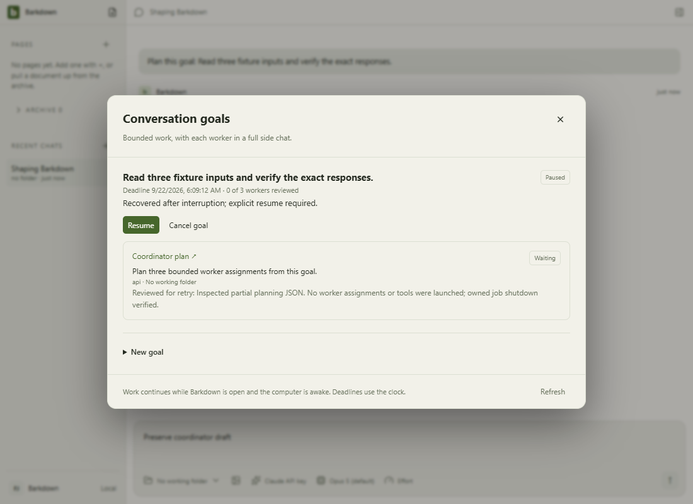
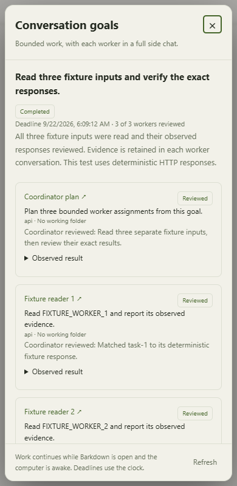

# Coordinator interruption and recovery

C020 original evidence at test source `17c2cc8`, recorded in `1367b37`. These are actual Electron views using a deterministic local provider transport. [C015](../../cycles/C015-goal-coordinator.md) holds separate authenticated-provider evidence; these images do not establish model quality or approval of the current combined source.

## Recover without replaying work

The coordinator retains the interrupted plan, verifies owned-process shutdown and requires explicit review before retry. Worker conversations remain full saved side chats.

## Readable at narrow widths

The goal body scrolls while the footer stays reachable. All17 original normal/recovery stills were reviewed in the lane; the coordinator additionally inspected this narrow completion and the retry state during import.

## Evidence and changes

- C020: explicit native host death after acknowledged partial review/summary; no worker replay, explicit retry, retained human draft. [Proof and scope](../../goals/evidence/17c2cc8/README.md).
- Full desktop57965 and root4562 passed on the original lane. Current integration gates remain pending; original image hashes/source manifests are preserved.
- Fixture motion and comparison (`docs/visual/runs/2026-09-22T03-10-25-041Z/comparison.json`, kept in git history) covers34 inspected action frames. Dedicated recovery images are stills; no dedicated recovery-video claim.
- Observed Windows rename contention is retained as C023 work, not hidden by the passing retry fixture.
