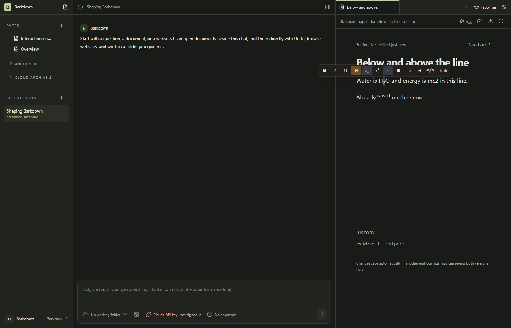

# Paper and Settings keyboard ownership

Control+, applies Paper subscript while keeping editor focus and Settings closed. Composer and focused website shortcuts still open Settings; the native menu also works from Paper. A subsequent native Close-tab shortcut closes the website. Proof uses a disposable Windows profile and real private Paper server, with programmatic text selection as setup and Electron input for the action.

[Behavior receipt](../../cycles/evidence/C097/shortcut-final-01/result.json) · [Raw recording](../../cycles/evidence/C097/shortcut-final-01/40-subsup.webm) · [Sampling record](../../cycles/evidence/C097/shortcut-final-01/motion-review.json)

Codex inspected all four stills and 37 samples at 2 fps. Source 368108c5, runtime944a57a1e, Electron 44.5.1, 1400×900 native window. Eight checks pass, including saved sub/sup wrappers and a real renderer reload. Settings controls remain readable/reachable; Paper's selection toolbar floats above the selected text. The raw video begins with light startup and switches to dark through Settings; the website reader uses its own light styling. No Mac/Linux keyboard execution is claimed.

The [original failing receipt](../../cycles/evidence/C097/shortcut-repro-01/result.json) preserves the unintended sheet and lost focus. The [first rerun](../../cycles/evidence/C097/shortcut-fix-01/result.json) stopped on a hidden setup button. The [second](../../cycles/evidence/C097/shortcut-fix-02/result.json) passed behavior, but image review caught invalid test navigation; final proof uses an actual reload and returns to Paper.

The adjacent [Desktop receipt](../../cycles/evidence/C097/desktop-resume-01/result.json) also proves Settings from terminal focus and dirty project-file refusal. An initial overbroad CodeMirror exception was caught and narrowed to Paper; its original failure remains linked in the cycle evidence.
