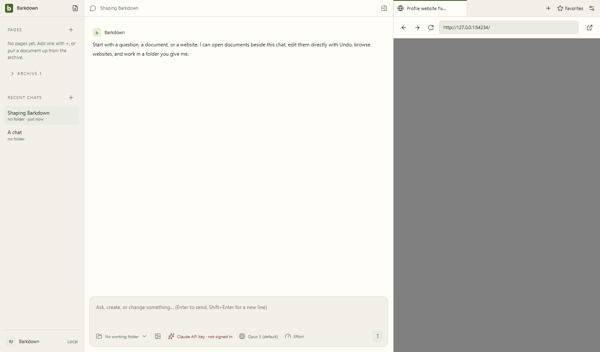

# Electron43 contingency — blocked

Same profile fixture at09a3258/Electron43.7.3 fails on returning A with guest crashed/0xC0000005, reproducing the44 failure. The earlier38 control passed the same app/fixture. No wider43 suite or Paper runtime was launched.

[Diagnostics](09a3258-failed-profile/failure.json) · [Review](09a3258-failed-profile/review.json) · [Handoff](../../cycles/C031-electron43-contingency.md). This is retained failure evidence, not an approved baseline.

GPU-disabled diagnostic at0005812 also failed identically; [retained still](0005812-gpu-diagnostic/failure.png) and [review](0005812-gpu-diagnostic/review.json). The minimal Electron-only shell passed both versions; cause remains unisolated.
