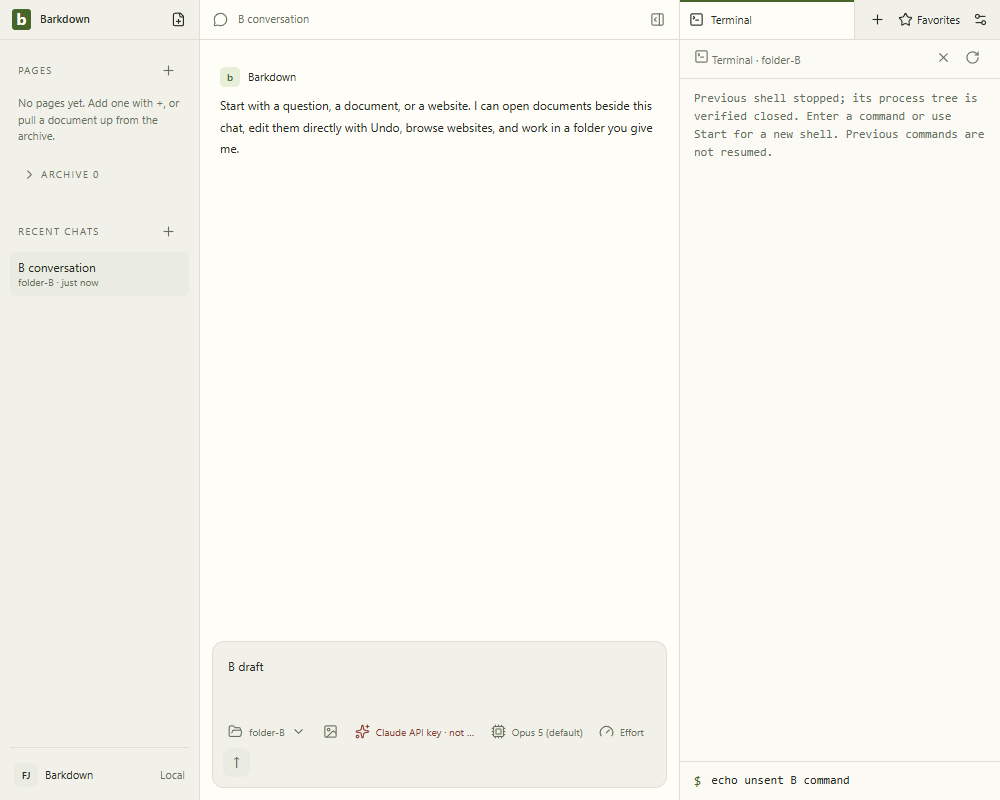
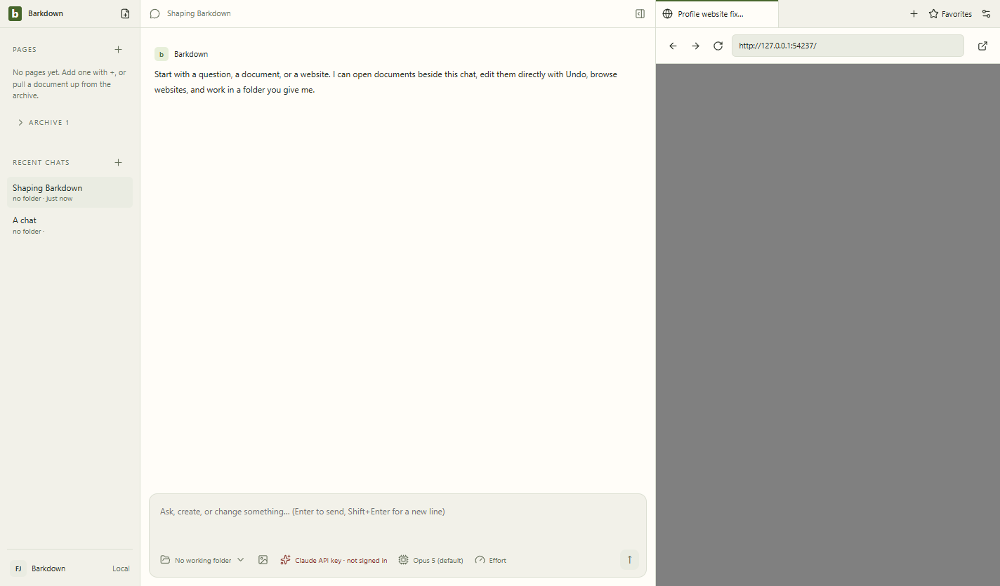

# Electron44 trial — blocked

Packaged native terminal journey passes at819abdb with44.4.3;7stills and29 video samples reviewed, all4native receipts verified stopped. [Manifest](819abdb-packaged-terminal/manifest.json) and [packaged provenance](819abdb-packaged-terminal/packaged-provenance.json).

The full suite then reproduced a native guest crash after profile B→A. Diagnostic6b60be4 captures crashed/0xC0000005. Same fixture/source with38.8.6 passes. [Comparison](../../cycles/evidence/C031-electron44/webview-regression-comparison.json). This is failed upgrade evidence, not a global approval.

[Hash-bound review](review.json). No Paper runtime was launched; remaining full/clipboard/Paper/visual/live/root gates are incomplete.
