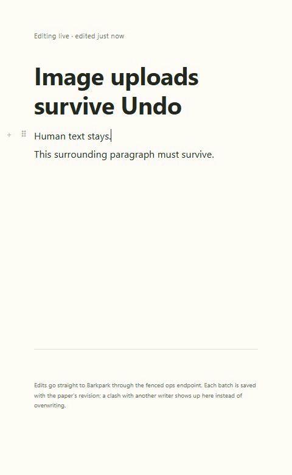
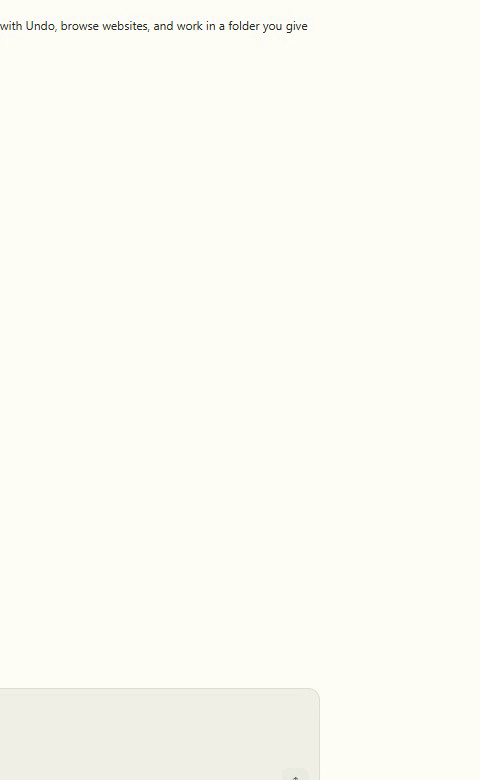

# Paper fallback compatibility

E011 candidate consumes exact54579 editor JS/CSS and ships49 dependency notices, preserving the host popup/flags/Mermaid/license. Both actual native compatibility runs passed: the proxy refused only editor asset fetches while actual Paper/media/ops used disposable servers. Old a544 and intended54579 runs reported vendored and loaded the pinned bytes before upload/history/reload assertions.

[Cycle handoff](../../cycles/E011-fallback-consumption.md). Server→verified profile-owned cache→vendor precedence is unchanged. An older reachable server or valid old cache still wins. This establishes bounded native compatibility, with no upstream merge or unfinished-upload restart-recovery claim.

## Actual compatibility runs

Both native runs use cleancefe312 consumed source, exactvendored545 hashes and actual document/media traffic.

| Private server source | Proof | Motion |
|---|---|---|
| a5440345c | [Manifest and server state](runs/2026-09-22T05-23-20-987Z/manifest.json), [review](runs/2026-09-22T05-23-20-987Z/review.json) |  |
| 54579debe | [Manifest and server state](runs/2026-09-22T05-24-51-920Z/manifest.json), [review](runs/2026-09-22T05-24-51-920Z/review.json) |  |

Each run preserves one actual uploaded image across repeated native Undo/Redo and later human revision9/reload. All12stills,78video samples at2fps and32decodedGIFframes were inspected. This establishes bounded image/paragraph compatibility, not all PortableDoc operations or recovery after restarting an unfinished upload. Earlier pending text is the retained preparation checkpoint. Final visual/full gates are recorded in the handoff.
