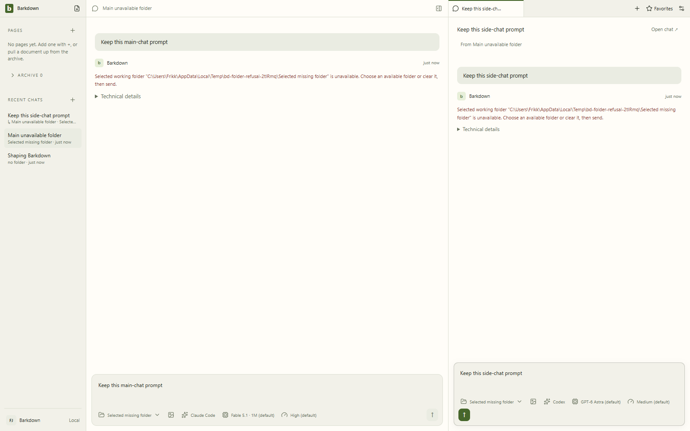
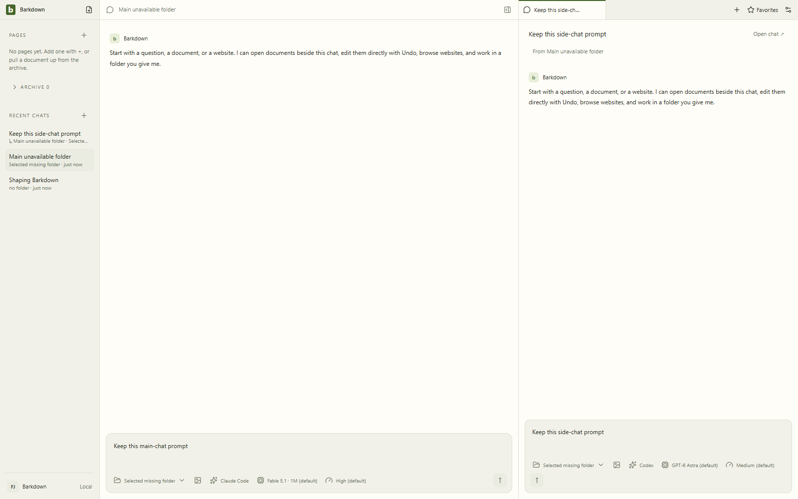
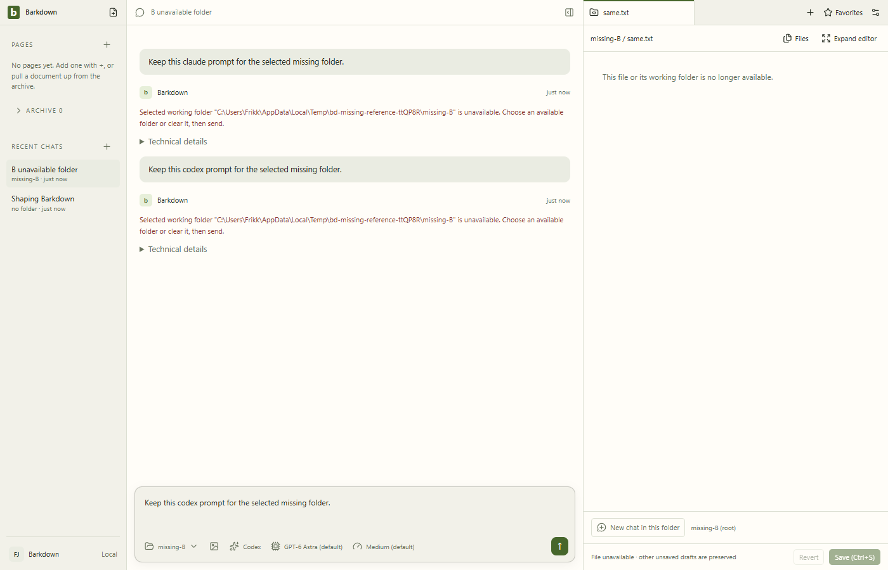

# C032 native folder refusal — source 8b51fbc

Both bounded native journeys passed at clean `8b51fbce9dedfe0a619f211ef65467d2295e1ef9` on Electron 38. Original screenshots, full-motion WebM recordings and JSON records are copied without transformation. Scoped Git attributes preserve their bytes. Each original manifest binds source files and all captured artifacts.

- [Main/side manifest](main-side/manifest.json): Claude main and Codex side prompt refusal, zero reservations/messages, both prompts/providers/folders through process restart. [Before](main-side/before-restart.json) and [after](main-side/after-restart.json) retain actual main-owned state.
- [Selected-B manifest](selected-b/manifest.json): selected B survives restart; unavailable same-path reference never substitutes A content; both Claude/Codex prompts refuse before reservation; A draft and original file remain intact.
- [Explicit visual review](review.json): all 6 stills and all 234 video frames inspected, with [numbered decoding map](motion-review/decode-manifest.json). Initial shell, viewport settling and profile-reload transitions remain visible in the original recordings. No GIF was generated.

Recordings: [main/side actions](main-side/01-refusal-session.webm), [main/side restart](main-side/02-restart-session.webm), [profile selection](selected-b/01-selected-B-session.webm), [selected-B restart/refusals](selected-b/02-restart-refusal-session.webm).

All four owned Electron sessions exited 0; no Barkpark runtime or provider was started. The exclusive UI slot was explicitly released. There were no failed native attempts in this run. Original C029 SDK-error and C032 failure-first evidence remains in its original location.

Root `npm run verify` exits 1 at the inherited global status-screenshot freshness gate ([exact output](root-verify.txt)); later root tests did not execute. The coordinator explicitly owns fresh combined global capture/compare/approval, so no baseline was refreshed here. These are source-specific refusal journeys, not combined-source approval, authenticated CLI execution, post-stat removal coverage or P1 completion.
