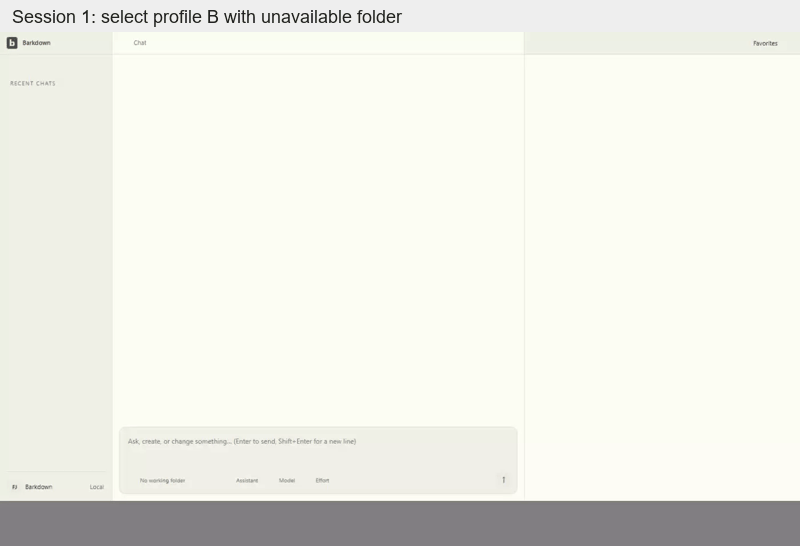

# Ordinary-folder preflight evidence

[C032 native main/side and selected-profile journeys](8b51fbc/README.md) preserve source-specific screenshots, complete recordings, before/restart state, manifests and explicit review. Original C029 missing-folder SDK failures remain historical evidence under [missing-folder](../missing-folder/69acbce/README.md). Global combined gates remain coordinator-owned.

## Recorded motion

These compact GIFs derive from all original video frames at source `8b51fbc`. Each joins two separately recorded Electron sessions, labelled above the image. Playback is half speed; dimensions and palette are reduced. Full-resolution videos and state proof remain in the original gallery. All 229 encoded GIF frames were inspected; [derivation](8b51fbc/derived/derivation.json), [review](8b51fbc/derived/review.json) and [addendum hash index](8b51fbc/derived/hash-index.json) preserve attribution without changing the original 44-file index.

Main/side refusal, followed by process restart with both prompts retained:

Profile B selection, followed by restart, unavailable reference and Claude/Codex refusal:

