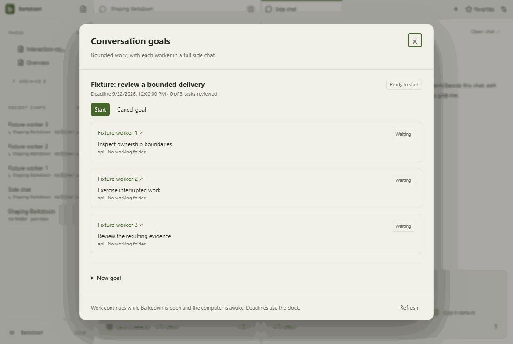

# goals

Goal component with explicitly injected fixture snapshots and providers blocked. Saved worker chats use the ordinary composer; this is not live scheduler/provider proof.

[Full comparison](../runs/2026-09-21T23-39-00-392Z/README.md) · [Capture manifest](../runs/2026-09-21T23-39-00-392Z/manifest.json)

## Changelog

- 2026-09-21T23:41:01.692Z: Inspected all31 actual frames in seven area contact sheets, including profile Settings and goal planned/running/paused/narrow/worker navigation. Existing21 reference frames have zero above-tolerance pixel or geometry differences; new10 frames readable with menus and footer/scroll regions intact. No new clipping or overlap observed. Deterministic providers remain blocked; this does not prove native worker execution or live Paper behavior. Inherited40percent default mismatch is tracked separately. Full pre-native desktop passed;46 native goal tests and23 Paper host tests pass, current native Electron fixture adaptation pending. Source ae49f97b9; [review](../runs/2026-09-21T23-39-00-392Z/comparison.json).
