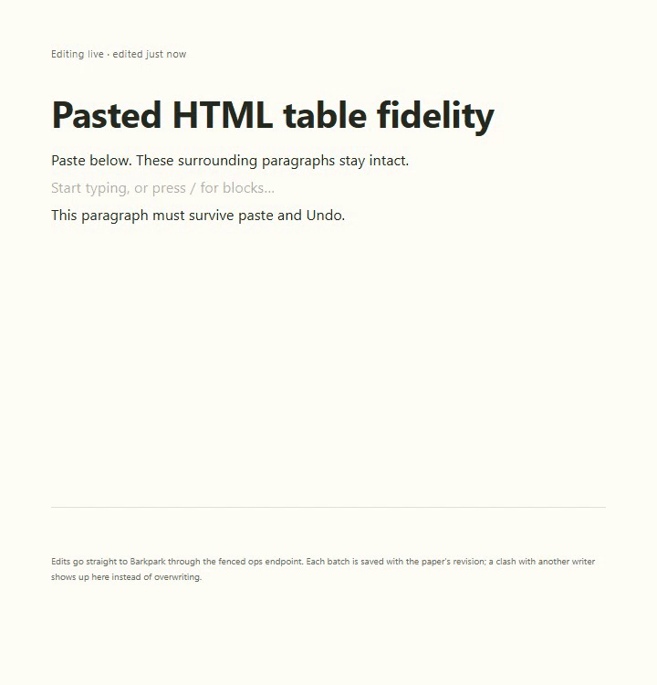
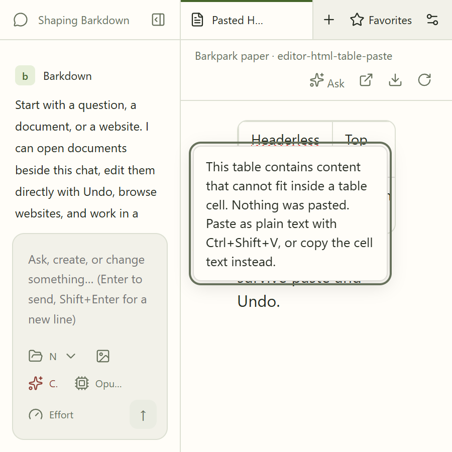

# Real HTML table paste evidence

Barkdown `fdf6b9e`, upstream `d8fda9690`; disposable runtime SdqQvh stopped normally and PostgreSQL pid file was absent. Source and generated/served bundles are recorded in [manifest](manifest.json).

Actual production ClipboardEvent paste preserves two tables, paragraph/newline boundaries, alignment, marks, links and body spans. Native Undo/redo, subsequent human typing and reload agree with the server at revisions 1 through 5. Rejected nested content preserves the draft; keyboard Escape and plain-text paste produce revision 6 with unchanged tables. The host clean state is awaited before reload, including its own-echo read.

[Review and hashes](review.json) bind all 11 stills, the original continuous video, server data and the GIF. Motion was inspected at 2fps across the full35.56seconds and every62 GIF frame. The GIF is a cropped6–21second excerpt at4fps. It is real editor interaction, not a model turn. Unsupported nested structures/merged headers/open-ended spans retain the clipboard with visible plain-text guidance; arbitrary HTML fidelity is not claimed.

Earlier02-19-44 captures preserve the rejected clipped message. The02-47-39 attempt preserves the harness reload race; neither is approved as final evidence.
